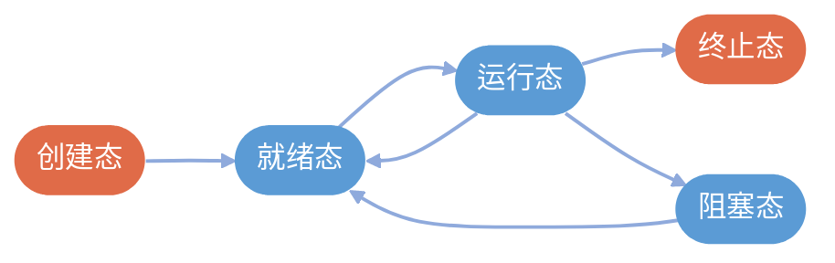
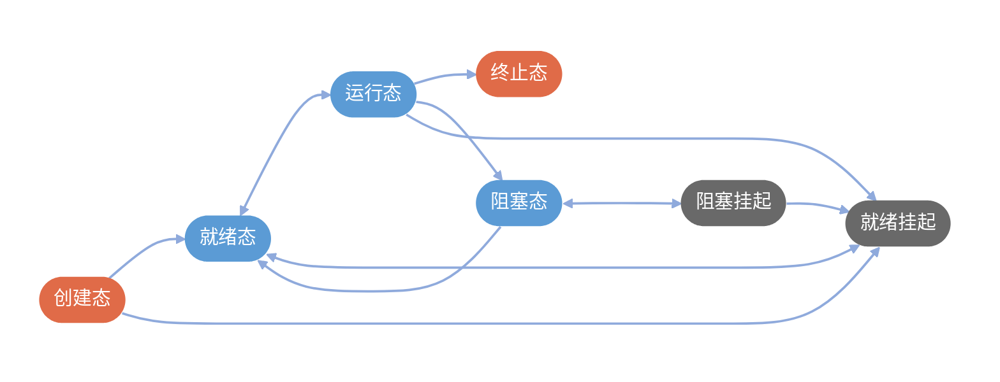

# 1 第一章 概述
## 1.1 操作系统的概念和功能
### 1.1.1 操作系统的概念

1.  **定义**：
    操作系统（OS）是指控制和管理整个计算机系统的**硬件和软件资源**，并合理地组织调度计算机的工作和资源的分配，以提供给用户和其他软件方便的接口和环境，是计算机系统中最基本的**系统软件**。

2.  **计算机系统的层次结构**：
    * **用户**
    * **应用程序**
    * **操作系统**
    * **裸机/纯硬件**

---
### 1.1.2 接口

* **GUI（图形用户界面）**：
    * **特点**：形象直观，用户无需记忆复杂命令。

* **命令接口**：
    * **联机命令接口（交互式命令接口）**：
        * **特点**：用户说一句，系统做一句。交互性强。
        * **例子**：Windows的cmd命令行。
    * **脱机命令接口（批处理命令接口）**：
        * **特点**：用户说一堆，系统做一堆。用户只需提交清单，中间无需干预。
        * **例子**：Windows的 `*.bat` 批处理文件。

* **程序接口**（允许软件/程序员使用）：
    * **特点**：普通用户**不能直接使用**，只能通过程序代码**间接使用**。
    * **核心概念**：**系统调用**。
    * **调用过程**：程序员写代码（如C语言 `printf`） -> 调用库函数 -> 库函数发起**系统调用** -> 请求操作系统服务。

---
## 1.2 操作系统的特征
### 1.2.1 操作系统的四个特征

操作系统具有 **并发、共享、虚拟、异步** 四个基本特征。
* **并发** 和 **共享** 是两个**最基本**的特征，二者互为存在条件。
* **虚拟** 和 **异步** 是以并发为基础衍生出的特征（没有并发和共享，就谈不上虚拟和异步）。

---
### 1.2.2 并发

| 概念     | 定义                    | 关键点        |
| :----- | :-------------------- | :--------- |
| **并发** | 两个或多个事件在**同一时间间隔**内发生 | 宏观同时，微观交替  |
| **并行** | 两个或多个事件在**同一时刻**同时发生  | 宏观同时，微观也同时 |

* **单核 CPU**：同一时刻只能执行一个程序，各个程序只能**并发**执行。
* **多核 CPU**：同一时刻可以同时执行多个程序，多个程序可以**并行**执行。
    * 即使是多核 CPU，只要运行的程序数量超过核心数，**并发性**依然是必不可少的。
* **结论**：操作系统就是伴随着“多道程序技术”而出现的，**并发性**是操作系统最重要的特征。

---
### 1.2.3 共享

即资源共享，指系统中的资源可供内存中多个并发执行的进程共同使用。

| 共享方式     | 说明                 |
| :------- | :----------------- |
| **互斥共享** | 一个时间段内只允许一个进程访问该资源 |
| **同时共享** | 一个时间段内允许多个进程“同时”访问 |
“同时”共享往往是**宏观上同时，微观上交替**（如硬盘读取）。

**并发与共享的关系**
* **并发是共享的前提**：如果失去了并发性，系统中只有一个程序在运行，资源独享，就不需要“共享”了。
* **共享是并发的基础**：如果失去了共享性，那么两个程序就无法同时开展工作，也就无法实现并发。

---
### 1.2.4 虚拟

把一个物理上的实体变为若干个逻辑上的对应物。物理实体是实际存在的，而逻辑对应物是用户感受到的。

* **空分复用技术（如虚拟存储器）**
    * **现象**：物理内存只有 4GB，但可以同时运行多个程序，用户感觉内存大于 4GB。
    * **原理**：利用磁盘空间扩充内存，将物理实体逻辑化。
* **时分复用技术（如虚拟处理器）**
    * **现象**：单核 CPU 的电脑，用户可以同时打开多个软件，感觉有多个 CPU 在为自己服务。
    * **原理**：微观上处理机在各个微小的时间段内交替为各个进程服务。

如果没有**并发**，说明只需要运行一道程序，那么时分复用和空分复用技术就失去了存在的意义。因此，**没有并发性，就谈不上虚拟性**。

---
### 1.2.5 异步

在多道程序环境下，允许多个程序并发执行，但由于资源有限，进程的执行不是一贯到底的，而是**走走停停**，以**不可预知**的速度向前推进。

**产生原因**：
* **资源竞争**：系统资源被占用了，其他程序就得等待（阻塞）。
* **并发执行**：只有系统拥有并发性，才会有资源抢占，才有可能导致异步性。

如果失去了**并发性**，系统串行执行，程序将“一贯到底”，不会出现异步。

---
## 1.3 操作系统的发展与分类
### 1.3.1 手工操作阶段

* **工作流程**：程序员将程序打孔在纸带上 $\rightarrow$ 装入纸带机 $\rightarrow$ 计算机读取 $\rightarrow$ 计算 $\rightarrow$ 结果输出到纸带 $\rightarrow$ 程序员取走。
* **主要缺点**：
    1.  **用户独占全机**：同一时间只能有一个用户使用计算机。
    2.  **人机速度矛盾**：人工装卸纸带和机器读取速度极慢，而CPU计算速度极快。导致**资源利用率极低**，CPU大部分时间处于空闲等待状态。

---

### 1.3.2 批处理阶段

#### 1.3.2.1 单道批处理系统
* **关键技术**：引入**脱机输入/输出技术**，并由**监督程序**控制作业的输入输出。
* **特点**：内存中始终**只保持一道程序**。
* **优点**：缓解了一定程度的人机速度矛盾。
* **缺点**：
    * **资源利用率依然很低**：程序在进行I/O操作时，CPU必须停止等待，不能运行其他程序。
    * 各程序是**串行**执行的。

#### 1.3.2.2 多道批处理系统
* **关键技术**：**多道程序设计技术**。
* **特点**：
    * **多道**：内存中同时存放多道程序。
    * **宏观上并行**：多道程序都处于运行状态。
    * **微观上串行**：各程序轮流使用CPU。
* **工作原理**：当一道程序因I/O请求而暂停时，CPU不空闲，转而去执行另一道程序。
* **优点**：
    * **资源利用率大幅提升**：CPU“忙碌”时间增加。
    * **系统吞吐量大**：单位时间内完成的作业更多。
* **主要缺点**：**无人机交互功能**。用户提交作业后只能等待结果，无法在运行过程中调试程序或输入参数。

### 1.3.3 分时操作系统

* **工作原理**：计算机以**时间片**为单位，轮流为各个用户/作业服务。
* **主要优点**：
    1.  **人机交互性**：用户可以通过终端直接控制计算机，边运行边调试。
    2.  **独立性**：多个用户同时使用，但感觉像独占主机一样，互不干扰。
* **主要缺点**：**不能优先处理紧急任务**。系统对所有用户/作业完全公平，不区分任务紧急程度。

### 1.3.4 实时操作系统

* **主要特点**：
    1.  **及时性**：必须在严格的规定时间内完成处理。
    2.  **可靠性**：长时间运行中保持稳定。
    3.  **可抢占**：能够优先响应紧急任务，无需排队等待时间片。
* **分类**：
    * **硬实时系统**：必须在绝对严格的规定时间内完成。
    * **软实时系统**：能接受偶尔违反时间规定。

---
### 1.3.5 其他操作系统

* **网络操作系统**：伴随网络发展诞生，重点在于实现网络中各种**资源的共享**和各台计算机之间的**通信**。
* **分布式操作系统**：
    * 主要特点是**分布性**和**并行性**。
    * 系统中各台计算机地位相同，任何工作都可以分布在这些计算机上，由它们**并行、协同**完成。
* **微机操作系统**：为微型计算机设计的操作系统。

---
## 1.4 操作系统的运行机制
### 1.4.1 程序的运行原理与分类

| 程序类型     | 编写者     | 描述                        | 权限                  | 运行状态    |
| :------- | :------ | :------------------------ | :------------------ | :------ |
| **内核程序** | 操作系统开发者 | 系统的管理者，是操作系统最核心、最接近硬件的部分。 | 可以执行**特权指令**和非特权指令。 | **核心态** |
| **应用程序** | 普通程序员   | 也就是我们日常使用的软件。             | 只能执行**非特权指令**。      | **用户态** |

---
### 1.4.2 计算机的指令与处理器状态

**1. 两类指令**
* **特权指令**：
    * **定义**：不允许用户直接使用的指令，使用不当会导致系统崩溃。
    * **例子**：内存清零、修改PSW标志位、输入输出指令等。
    * **限制**：只能在**核心态**下执行。
* **非特权指令**：
    * **定义**：普通的运算指令，任何程序都可以使用。
    * **例子**：加减乘除运算指令。
    * **范围**：在核心态和用户态下都能执行。

**2. 两种处理器状态**：CPU通过**程序状态字寄存器(PSW)** 中的标志位来识别当前处于什么状态。

| 状态名称 | 别名 | 描述 | 能执行的指令 |
| :--- | :--- | :--- | :--- |
| **核心态** | 管态、内核态 | 说明CPU正在运行内核程序。 | **特权指令** + 非特权指令 |
| **用户态** | 目态 | 说明CPU正在运行应用程序。 | **仅非特权指令** |

---
### 1.4.3 操作系统运行机制

**用户态与核心态的切换**:
1.  **核心态 $\rightarrow$ 用户态**：
    * **触发方式**：执行一条**特权指令**（修改PSW的标志位）。
    * **过程**：操作系统内核主动让出CPU使用权，将控制权交给应用程序。
    * **性质**：主动切换。

2.  **用户态 $\rightarrow$ 核心态**：
    * **触发方式**：**中断或异常** ,这是唯一的途径。
    * **过程**：硬件自动完成变态过程，停止当前应用程序，转而执行处理中断的内核程序。
    * **场景举例**：
        * 应用程序非法执行特权指令。
        * 应用程序发生异常。
        * 需要操作系统服务。
    * **性质**：被动切换。

---
### 1.4.4 操作系统的内核与体系结构

**1. 内核的功能模块**
* **与硬件关联紧密的模块**：
    * **时钟管理**：实现计时功能。
    * **中断处理**：负责实现中断机制。
    * **原语**：
        * 处于最底层，是最接近硬件的部分。
        * 具有**原子性**（运行期间一气呵成，不可中断）。
        * 通常用于设备驱动、CPU切换等。
* **资源管理功能**：
    * 进程管理、存储器管理、设备管理。

**2. 体系结构对比：大内核 vs 微内核**

| 体系结构          | 描述                          | 优点                     | 缺点                         |
| :------------ | :-------------------------- | :--------------------- | :------------------------- |
| **大内核 (宏内核)** | 将操作系统的主要功能模块都作为系统内核，运行在核心态。 | **高性能**（各模块间交互无需切换状态）。 | 代码庞大，结构混乱，**难以维护**。        |
| **微内核**       | 只把最基本的功能（时钟、中断、原语）保留在内核。    | 功能少，结构清晰，**方便维护**。     | **性能低**（需要频繁在核心态和用户态之间切换）。 |

---
## 1.5 中断和异常
### 1.5.1 中断的作用

中断机制是操作系统内核夺回CPU使用权的唯一途径。

1.  **核心功能**：
    * 让CPU由**用户态**变为**内核态**。
    * 使操作系统内核能强行夺回CPU的控制权。
    * 如果没有中断机制，一旦应用程序上CPU运行，它将一直占用CPU，操作系统无法实行管理。
2.  **并发的基础**：
    * 没有中断机制，就无法实现**多道程序并发**。
    * 通过时钟中断，操作系统可以在不同进程间切换，实现并发。

---
### 1.5.2 中断的分类

**“中断”** 特指外中断，**“异常”** 特指内中断。

| 对比维度      | 内中断（也称：异常、例外）           | 外中断（也称：中断、狭义中断）             |
| :-------- | :---------------------- | :-------------------------- |
| **信号来源**  | 来源于CPU**内部**            | 来源于CPU**外部**                |
| **与指令关系** | 与当前执行的指令**有关**          | 与当前执行的指令**无关**              |
| **检测时机**  | CPU在**执行指令时**会检查是否有异常发生 | CPU在**每个指令周期末尾**检查是否有外部中断信号 |
| **典型例子**  | 试图执行特权指令、除数为0、陷入指令      | 时钟中断、I/O设备发出的中断信号           |

**内中断的细分**：
* **陷入**：
    * **定义**：由陷入指令引发，是应用程序**故意**引发的。
    * **目的**：应用程序想要请求操作系统内核的服务（即**系统调用**）。
    * **特点**：并不是错误，而是程序主动交出CPU控制权。
* **故障**：
    * **定义**：由错误条件引起，可能被内核程序修复。
    * **处理**：内核修复故障后，会把CPU使用权还给应用程序，让它**继续执行下去**。
    * **例子**：缺页故障。
* **终止**：
    * **定义**：由致命错误引起，内核程序无法修复。
    * **处理**：内核不再把CPU还给该程序，而是直接**终止**该应用程序。
    * **例子**：整数除以0、非法使用特权指令。

**外中断的典型例子**：
* **时钟中断**：由时钟部件每隔一个时间片发送信号，用于实现进程的时间片轮转和并发。
* **I/O中断**：由输入/输出设备发出，例如打印机打印完成、数据输入完成，通知CPU任务已完成。

---

### 1.5.3 中断机制的基本实现原理

不同的中断信号，需要用不同的**中断处理程序**来处理。

1.  **中断向量表**：
    * 系统中存储了一张表，记录了各种中断信号类型及其对应的**中断处理程序**在内存中的存放位置。 
2.  **处理流程**：
    * **检测**：CPU检测到中断信号。
    * **查询**：根据中断信号的类型，查询**中断向量表**。
    * **执行**：找到对应的中断处理程序，CPU转为内核态，执行该内核程序进行处理。

## 1.6 系统调用

**基本概念**
* **定义**：操作系统提供给应用程序使用的接口，可以理解为一种可供应用程序调用的特殊函数。
* **作用**：应用程序可以通过系统调用来请求获得操作系统内核的服务。

---
### 1.6.1 系统调用与库函数的区别

| 类别       | 描述                       | 运行状态 | 举例              |
| :------- | :----------------------- | :--- | :-------------- |
| **系统调用** | 是操作系统向上层提供的接口，是进入内核态的入口。 | 核心态  | 创建新文件、读写文件、创建进程 |
| **库函数**  | 是高级语言提供的编程接口，目的是让编程更方便。  | 用户态  | `abs`、`printf`  |

* **关系**：
    * 普通应用程序既可以直接进行系统调用，也可以使用库函数。
    * 有的库函数是对系统调用的进一步封装。
    * 有的库函数仅涉及简单的逻辑运算，不需要操作系统服务，因此不使用系统调用。

**需要通过系统调用实现的功能**：
1.  **设备管理**：完成设备的请求、释放、启动等功能。
2.  **文件管理**：完成文件的读、写、创建、删除等功能。
3.  **进程控制**：完成进程的创建、撤销、阻塞、唤醒等功能。
4.  **进程通信**：完成进程间的消息传递、信号传递等功能。
5.  **内存管理**：完成内存的分配、回收等功能。

### 1.6.2 系统调用的执行过程

整个过程由**用户态**发起，在**核心态**处理，最后返回**用户态**。

1.  **传参（用户态）**：
    * 执行指令，将系统调用需要的参数传递给CPU的寄存器。
2.  **执行陷入指令（用户态）**：
    * 应用程序执行**陷入指令**（又称**Trap指令**、**访管指令**）。
    * **注意**：陷入指令是在用户态执行的，它**不是特权指令**，但执行后会引发一个**内中断**，从而使CPU进入核心态。
3.  **处理系统调用（核心态）**：
    * CPU响应中断，暂停当前应用程序，转入相应的**中断处理程序**（即系统调用的入口程序）。
    * 内核根据寄存器中的参数（系统调用号），判断用户需要哪种服务。
    * 调用具体的内核程序处理系统调用。
4.  **返回（核心态 -> 用户态）**：
    * 系统调用处理结束后，CPU执行返回指令，恢复应用程序的上下文，返回用户态继续执行后续指令。

## 1.7 操作系统体系结构

### 1.7.1 内核

1.  **内核的定义**
    * **地位**：操作系统最基本、最核心的部分。
    * **运行机制**：内核程序运行在**核心态**（内核态），拥有最高权限。
    * **核心功能（必须在内核中）**：
        * **与硬件关联最紧密的模块**：时钟管理、中断处理、原语（设备驱动、CPU切换等）。
        * **原语**：具有**原子性**的特殊程序，运行必须一气呵成，不可被中断。
    * **非核心功能**：进程管理、存储器管理、设备管理等（在微内核结构中这些会被移出内核）。

2.  **状态转换**
    * **用户态**：运行应用程序。
    * **核心态**：运行内核程序。
    * **切换代价**：CPU在用户态和核心态之间切换是有成本的，耗费时间。

---

### 1.7.2 五种主要体系结构

#### 1.7.2.1 分层结构
* **设计思想**：将内核分多层，每层只能**单向调用相邻**的**低层**接口。
* **优点**：
    * **便于调试和验证**：自底向上逐层调试。
    * **易于扩充**：层间接口固定，修改某层不影响其他层。
* **缺点**：
    * **效率低**：不可跨层调用，高层请求底层服务需层层传递（系统开销大）。
    * **边界难定义**：各功能间往往相互依赖，难以严格分层。

#### 1.7.2.2 模块化结构
* **设计思想**：内核划分为独立模块（主模块+可加载模块），模块间通过接口协作。
* **优点**：
    * **逻辑清晰**：功能划分明确，可并行开发。
    * **动态加载**：支持动态加载新模块（如新设备驱动），无需重新编译内核。
    * **效率较高**：模块间可**直接调用**函数，无需消息传递。
* **缺点**：
    * **接口定义难**：模块间依赖关系复杂。
    * **调试困难**：模块间相互依赖成网状。

#### 1.7.2.3 宏内核（大内核/单内核）
* **特征**：进程、存储、设备管理等主要功能都在内核中。
* **优点**：
    * **高性能**：各模块在内核态通过**函数调用**直接通信，效率极高。
    * **切换少**：典型服务请求只需 2 次状态转换（进内核+出内核）。
* **缺点**：
    * **内核庞大**：结构混乱，难以维护。
    * **可靠性低**：任何一个模块（如驱动）崩溃可能导致整个系统死机。

#### 1.7.2.4 微内核
* **特征**：**只保留最核心功能**（时钟/中断/原语）在内核，其他功能作为**服务进程**运行在用户态。
* **通信方式**：模块间通过**消息传递**机制通信。
* **优点**：
    * **可靠性高**：某个服务崩溃不影响系统运行。
    * **结构清晰**：内核精简，易于维护和移植。
* **缺点**：
    * **性能低**：模块间通信需要频繁在用户态/核心态之间切换。一次复杂服务可能涉及多次状态转换。

#### 1.7.2.5 外核
* **特征**：内核负责保护资源，**外核负责分配“未经抽象”的硬件资源**。
* **核心区别**：传统OS分配虚拟资源；外核分配物理资源。
* **优点**：
    * **高性能**：用户进程可根据需求优化资源使用。
* **缺点**：
    * **复杂**：降低了系统的一致性，管理复杂。

---
## 1.8 操作系统引导

操作系统引导（Boot）是指在计算机开机时，让操作系统在计算机上运行起来的过程。

### 1.8.1 磁盘结构与关键数据

在安装了操作系统的磁盘中，数据存储结构分为特定的区域，引导过程依赖于这些特定位置的数据。

| 存储位置     | 名称    | 缩写  | 包含的关键内容               | 功能/作用                                                    |
| :------- | :---- | :-- | :-------------------- | :------------------------------------------------------- |
| **磁盘开头** | 主引导记录 | MBR | 1. 磁盘引导程序<br>2. 分区表   | **磁盘引导程序**：负责后续的引导流程。<br>**分区表**：说明每个分区（C盘、D盘等）的大小及地址范围。 |
| **活动分区** | 引导记录  | PBR | 1. 引导记录程序<br>2. 根目录数据 | **PBR**：负责找到启动管理器。<br>**根目录**：包含启动管理器（操作系统初始化程序）及其他文件。   |

---
**主存的组成**:
* **RAM**：平时所说的“内存”，断电后数据丢失。
* **ROM**：集成在主板上的芯片，存储 **BIOS**（基本输入输出系统）。
    * **特性**：断电数据不丢失。
    * **包含程序**：ROM引导程序（自举程序）。
---
### 1.8.2 操作系统引导的具体流程

1. **CPU激活与BIOS初始化**：CPU从ROM中读取并执行BIOS程序，BIOS初始化基本硬件，建立中断向量表。
2. **硬件自举与启动设备选择**：BIOS执行通电自检，之后选择首个有效的启动设备，如C盘。
3. **加载主引导记录(MBR)**：BIOS将主引导记录加载到内存中。MBR包含引导代码和硬盘分区表。
4. **加载分区引导记录**：根据分区表找到活动分区后，将该分区的第一个扇区，即 引导记录 (PBR) 读入内存。
5. **加载操作系统初始化程序**：从根目录中找到 启动管理器。

---
## 1.9 虚拟机

* **传统计算机局限性**：一台物理机器通常只能运行一个操作系统。这在商业环境中会导致硬件资源利用率不充分以及安全隐患。
* **虚拟机的定义**：利用虚拟化技术，将一台物理机器虚拟化为多台虚拟机器（VM）。每个虚拟机都可以独立运行一个操作系统。
* **虚拟机管理程序**：也称为VMM或Hypervisor。它是实现虚拟化的关键软件，负责管理硬件资源并将其分配给各个虚拟机。
---
### 1.9.1 两类虚拟机管理程序 (VMM)

#### 1.9.1.1 第一类 VMM

- **运行方式**：直接运行在硬件上
* **结构**：硬件 -> VMM -> 客户操作系统 -> 用户应用。
* **特点**：
    * VMM直接运行在物理硬件之上。
    * VMM负责将硬件资源直接划分给上层的各个虚拟机。
    * **特权级管理**：
        * 只有VMM运行在最高特权级（Ring 0），可以使用所有特权指令。
        * 上层的客户操作系统运行在次高特权级（如Ring 1），它以为自己运行在内核态（被称为虚拟内核空间），但实际上无法直接执行敏感的特权指令。
        * 当客户操作系统尝试执行特权指令时，会被VMM截获，并由VMM模拟出指令执行的效果。

#### 1.9.1.2 第二类 VMM

- **运行方式**：运行在宿主操作系统上
* **结构**：硬件 -> 宿主操作系统 -> VMM软件 -> 客户操作系统。
* **特点**：
    * VMM作为宿主操作系统上的一个应用程序运行。
    * **资源获取**：VMM不能直接控制硬件，必须向宿主操作系统申请资源。
    * **再分配**：VMM获得宿主OS分配的虚拟资源后，再将其“虚拟化”分配给客户操作系统。

### 1.9.2 两类 VMM 的详细对比

| 对比项目 | 第一类 VMM | 第二类 VMM |
| :--- | :--- | :--- |
| **对物理资源的控制权** | **直接控制**：直接运行在硬件上，拥有硬件的分配权。 | **无直接控制权**：依赖宿主操作系统分配资源，需通过宿主OS调用硬件。 |
| **资源分配方式** | **直接划分**：如将磁盘的0-1024块直接分给VM1（类似外核）。 | **虚拟分配**：宿主OS分配虚拟资源（如大文件作为虚拟磁盘），VMM再分配给VM。 |
| **性能** | **更好**：无需经过宿主OS的中介，指令执行效率高。 | **更差**：存在多层虚拟化（VMM层+宿主OS层），需要多次地址映射和系统调用转换。 |
| **支持的虚拟机数量** | **更多**：无需运行庞大的宿主OS，相同硬件下额外开销小。 | **更少**：宿主OS本身消耗资源，导致可分配给VM的资源减少。 |
| **虚拟机的可迁移性** | **较差**：通常与特定硬件或环境绑定，迁移复杂。 | **更好**：只需迁移镜像文件（ISO/虚拟磁盘文件），跨平台通用性强。 |
| **运行模式** | VMM在最高特权级(Ring 0)；<br>客户OS在次高级(Ring 1)；<br>应用在最低级(Ring 3)。 | VMM部分在用户态，部分在内核态（驱动）；<br>客户OS发出的系统调用会被截获并转化为对宿主OS的请求。 |

### 1.9.3 支持虚拟化的 CPU 指令等级示意图

为了支持第一类VMM的高效运行，现代CPU通常将指令特权级划分得更细，例如：

```text
Ring 0 (最高特权)  ——>  运行 VMM (虚拟机管理程序)
      |
Ring 1 (次高特权)  ——>  运行 Guest OS (客户操作系统内核)
      |
Ring 2 (最低特权)  ——>  运行 Applications (用户应用程序)
```
**优势**：通过分级，VMM只需要拦截和检查Ring 1发出的敏感指令（特权指令），而不需要检查所有指令，提高了效率。

---
# 2 第二章 进程

## 2.1 进程的概念
### 2.1.1 进程的定义

**进程是进程实体的运行过程，是系统进行资源分配和调度的独立单位**。进程实体由**PCB**、**程序段**、**数据段**三部分组成。

---
### 2.1.2 进程的组成

**1. 进程控制块 (PCB)**
* **地位**：是进程存在的**唯一标志**。进程创建时创建PCB，结束时回收PCB。
* **使用者**：给**操作系统**使用的（OS通过PCB来管理进程）。
* **包含信息**：
    * **进程描述信息**：进程标识符 (PID)、父进程标识符 (PPID) 、用户标识符 (UID)。
    * **进程控制和管理信息**：进程当前状态（就绪/运行/阻塞）、CPU使用时间、磁盘/网络使用情况。
    * **资源分配清单**：正在使用哪些文件、内存区域、I/O设备。
    * **处理机相关信息**：各种寄存器的值 (PSW, PC等)，用于实现进程切换。

**2. 程序段**
* **内容**：程序的代码（指令序列）。
* **特点**：若同一个程序同时运行多个进程，它们的程序段内容是**相同**的。
* **使用者**：给**进程自己**用的。

**3. 数据段**
* **内容**：运行过程中产生的各种数据（如程序中定义的变量）。
* **特点**：不同的进程（即使是同一个程序），其数据段是**不同**的。
* **使用者**：给**进程自己**用的。

### 2.1.3 进程的内存映像

当程序被加载运行时，操作系统会为其建立一个虚拟地址空间，该空间的逻辑布局被称为**进程的内存映像**。

进程的内存映像由**代码段**、**数据段**、**PCB**、**堆**、**栈**和**共享库的存储映射区**组成。
共享库用于提供进程所依赖的公共函数代码，它们在运行时被动态映射到进程的地址空间，代码是只读的，且可被多个进程共享，从而节省内存资源。

**代码段和数据段的大小在程序加载时就已确定**，而**堆栈则可在运行过程中动态扩展和收缩**。

---
### 2.1.4 进程的特征
* **动态性**
    * 进程是程序的一次执行过程，是动态地产生、变化和消亡的。
* **并发性**
    * 内存中同时存在多个进程实体，各进程可并发执行。
* **独立性**
    * 进程是能独立运行、**独立获得资源**、**独立接受调度**的基本单位。
    * *注意：在引入线程后，进程仍是资源分配的基本单位，但不再是调度的基本单位。*
* **异步性**
    * 各进程按各自独立的、不可预知的速度向前推进。
    * 异步性会导致运行结果的不确定性，需操作系统提供“进程同步机制”来解决。

---
## 2.2 进程的状态与转换
### 2.2.1 进程的三种基本状态

* **运行态**
    * **定义**：进程正在处理机（CPU）上运行。
    * **特征**：
        * **单核CPU**：同一时刻只有一个进程处于运行态。
        * **多核CPU**：可以有多个进程同时处于运行态。
        * **资源情况**：既拥有CPU资源，也拥有其他所需资源。

* **就绪态**
    * **定义**：进程已经具备运行条件，但由于没有空闲CPU，暂时不能运行。
    * **特征**：
        * 万事俱备，只欠处理机。
        * **资源情况**：拥有除CPU外的所有所需资源。
        * **位置**：通常存在于“就绪队列”中。

* **阻塞态**（又称等待态）
    * **定义**：进程因等待某一事件发生（如等待系统分配打印机、等待磁盘读写完成、等待其他进程响应）而暂时不能运行。
    * **特征**：
        * **资源情况**：既没有CPU，也缺少其他所需资源（或正在等待特定事件）。
        * 即使给它CPU，它也无法运行。

* **创建态**（又称新建态）
    * **定义**：进程正在被创建的阶段。
    * **工作内容**：操作系统为进程分配资源（如内存）、初始化PCB（进程控制块）。
    * **转换**：创建完成后，转入就绪态。

* **终止态**（又称结束态）
    * **定义**：进程正在从系统中撤销的阶段。
    * **触发原因**：进程正常结束（exit系统调用）或发生不可修复的错误（如整数除以0）。
    * **工作内容**：操作系统回收进程拥有的资源、撤销PCB。进程彻底消失。

### 2.2.2 进程状态间的转换

* **就绪态 → 运行态**
    * **条件**：进程被调度程序选中。
    * **说明**：获得CPU资源，开始执行指令。

* **运行态 → 就绪态**
    * **条件**：
        * 时间片用完（时钟中断）。
        * 被更高优先级的进程抢占。
    * **性质**：**被动行为**（依然具备运行条件，只是被剥夺了CPU）。

* **运行态 → 阻塞态**
    * **条件**：进程请求系统资源或等待某事件发生。
    * **性质**：**主动行为**（进程通过系统调用主动请求）。
    * **注意**：**不可能**从就绪态直接变为阻塞态，因为发出请求需要CPU执行指令。

* **阻塞态 → 就绪态**
    * **条件**：等待的事件发。
    * **性质**：**被动行为**（不是进程自己控制的，而是由外部事件或操作系统处理）。
    * **注意**：**不可能**从阻塞态直接变为运行态，必须先进入就绪队列排队。

* **运行态 → 终止态**
    * **条件**：进程运行结束或发生异常。




---
## 2.3 进程控制

* **定义**：进程控制的主要功能是对系统中的所有进程实施有效的管理。
* **核心任务**：实现进程状态的转换。
* **实现方式**：使用**原语**来实现。

---
### 2.3.1 原语与原子性

* **原语的概念**：一种特殊的内核程序，其执行具有**原子性**。
* **原子性**：运行必须一气呵成，不可中断。
* **为什么需要原子性**：
    * 进程状态转换涉及修改PCB中的关键变量和将PCB在不同队列间移动。
    * 如果操作不能一气呵成，可能导致数据结构信息不一致，从而引发系统严重错误。
* **实现机制（关/开中断）**：
    * 通过**关中断指令**和**开中断指令**这两个特权指令实现。
    * **关中断**：CPU执行后，不再检查外部中断信号，确保后续指令序列不被打断。
    * **开中断**：恢复对中断信号的检查。

### 2.3.2 五大原语

| 原语名称     | 主要功能与执行过程                                                                                | 引起该原语操作的典型事件                                   | 状态转换                                                |
| :------- | :--------------------------------------------------------------------------------------- | :--------------------------------------------- | :-------------------------------------------------- |
| **创建原语** | 1. 申请空白PCB<br>2. 为新进程分配所需资源<br>3. 初始化PCB<br>4. 将PCB插入就绪队列                                | 1. 用户登录<br>2. 作业调度<br>3. 提供服务<br>4. 应用请求       | 无 $\rightarrow$ 创建态 $\rightarrow$ 就绪态               |
| **撤销原语** | 1. 找到对应PCB<br>2. 若正在运行，立即剥夺CPU<br>3. 终止其所有子进程（**树形结构**）<br>4. 将资源归还给父进程或操作系统<br>5. 删除PCB | 1. 正常结束<br>2. 异常结束<br>3. 外界干预                  | 运行/就绪/阻塞 $\rightarrow$ 终止态 $\rightarrow$ 无          |
| **阻塞原语** | 1. 找到PCB<br>2. **保护进程运行现场**<br>3. 状态设为阻塞态<br>4. 将PCB插入**相应事件**的等待队列                      | 1. 等待系统分配某种资源<br>2. 等待合作进程完成工作                 | 运行态 $\rightarrow$ 阻塞态                               |
| **唤醒原语** | 1. 在等待队列中找到PCB<br>2. 移除PCB，状态设为就绪态<br>3. 将PCB插入就绪队列                                      | 等待的事件发生                                        | 阻塞态 $\rightarrow$ 就绪态                               |
| **切换原语** | 1. **保存**当前进程运行环境到PCB<br>2. PCB移入相应队列（就绪/阻塞等）<br>3. 选择新进程，更新其PCB<br>4. **恢复**新进程的运行环境    | 1. 时间片耗尽<br>2. 更高优先级进程到达<br>3. 主动阻塞<br>4. 进程终止 | 运行态 $\rightarrow$ 就绪/阻塞/终止<br>就绪态 $\rightarrow$ 运行态 |

### 2.3.3 运行环境与上下文切换

#### 2.3.3.1 CPU中的关键寄存器
CPU使用寄存器存储程序运行时的中间数据：
* **PSW (程序状态字)**：存放CPU状态、条件码等。
* **PC (程序计数器)**：存放**下一条**指令的地址。
* **IR (指令寄存器)**：存放**当前**正在执行的指令。
* **通用寄存器**：存放变量值、运算中间结果。

#### 2.3.3.2 上下文切换机制
* **问题**：如果在执行指令的中间发生了进程切换，新的进程上台也会使用这些寄存器，导致原进程的数据被覆盖丢失。
* **解决办法**：
    * **保存环境**：在进程切换（下CPU）前，将当前寄存器中的所有关键信息（PC、PSW、通用寄存器内容）**保存到该进程的PCB中**。
    * **恢复环境**：当进程重新获得CPU时，从**PCB**中读出之前保存的信息写入寄存器，从而让CPU“无缝衔接”地继续执行。

---
## 2.4 进程通信
* **必要性**：进程是分配系统资源的单位，各进程拥有的内存地址空间相互独立。出于安全考虑，一个进程不能直接访问另一个进程的地址空间。
* **实现方式**：进程间的数据交换必须通过操作系统内核的支持来完成。
* **三大类型**：共享存储、消息传递、管道通信。

---
### 2.4.1 共享存储
* **基本原理**：
    * 操作系统在内存中划出一块共享存储区。
    * 将这片共享内存映射到各个进程的虚拟地址空间中。
    * 进程可以直接读写该内存区域进行通信。
* **互斥要求**：为避免出错（如写冲突），各进程对共享空间的访问必须是**互斥**的（由**通信进程自行实现**，**操作系统不提供同步保护**）。
* **分类**：
    1.  **基于数据结构的共享（低级方式）**：
        * 比如共享空间里只能放一个长度为10的数组。
        * 特点：速度慢、限制多、灵活性差。
    2.  **基于存储区的共享（高级方式）**：
        * 操作系统只负责划分区域，数据怎么存、放在哪由进程决定。
        * 特点：速度很快、灵活性高。

### 2.4.2 消息传递

进程间的数据交换以格式化的**消息**为单位。

* **消息结构**：
    * **消息头**：包含发送进程ID、接受进程ID、消息长度等格式化信息。
    * **消息体**：具体的传输数据。
* **实现手段**：必须使用操作系统提供的**发送原语**和**接收原语**。
#### 2.4.2.1 直接通信方式
* **定义**：发送进程直接把消息发送给接收进程，挂在接收进程的消息缓冲队列上。
* **特点**：指名道姓（需明确指定接收者/发送者）。
    * `send(Q, msg)`：发送给Q。
    * `receive(P, &msg)`：接收来自P的消息。
#### 2.4.2.2 间接通信方式
* **定义**：通过“信箱”作为中间实体进行通信。
* **特点**：
    * 发送方将消息发到指定信箱。
    * 接收方从指定信箱取走消息。
    * `send(A, msg)`：发到信箱A。
    * `receive(A, &msg)`：从信箱A取。
* **应用**：允许多个进程往同一个信箱发/收消息。

### 2.4.3 管道通信

* **定义**：“管道”是一个特殊的共享文件（pipe文件），本质是在内存中开辟的一个**大小固定的内存缓冲区**。
* **数据结构**：本质上是一个**循环队列**。
* **通信特点**：
    1.  **半双工通信**：某一时间段内只能实现单向传输。若要实现双向同时通信（全双工），需要设置两个管道。
    2.  **互斥访问**：各进程要互斥地访问管道（由操作系统实现）。
    3.  **数据消失**：管道中的数据一旦被读出，就彻底消失。
    4.  **读写限制**：
        * **写满时**：写进程将阻塞，直到数据被读走。
        * **读空时**：读进程将阻塞，直到有数据写入。
    5.  **多进程竞争**：
	    1. 官方答案：通常规定一个管道允许**多个写进程**，但只允许**一个读进程**，防止数据错乱。
	    2. Linux：允许**多个写进程**和**多个读进程**，但系统会让各个读进程轮流从管道中读数据。

---
### 2.4.4 信号

信号机制是进程间通信（IPC）的一种方式，用于通知进程某个特定事件已经发生。它是对操作系统异常处理机制的一种补充。

* **本质**：一种模拟中断机制，用于通知进程发生了某种系统事件。
* **作用**：
    1.  **通知事件**：告知进程发生了特定事件。
    2.  **异常配套**：作为异常处理的配套机制，让用户进程能够配合内核对无法完全由内核处理的异常进行后续处理。

#### 2.4.4.1 信号的发送与保存

信号的发送与保存依赖于进程控制块（PCB）中的特定数据结构。

* **发送来源**：
    * **用户进程**：一个进程可以通过系统调用（如 `kill` 函数）给另一个进程发送信号，进程也可以给自己发送信号。
    * **内核进程**：操作系统内核在检测到事件时向用户进程发送信号。
* **信号的保存（PCB结构）**：
    在进程的PCB中，使用两个位向量来维护信号状态：
    1.  **待处理信号 (pending)**：记录当前已收到但尚未处理的信号。
        * 若第N位为1，表示收到了第N种信号。
        * 如果进程在处理前连续收到多个**同类**信号，多余的信号将被简单丢弃。
    2.  **被阻塞信号 (blocked)**：也称为**信号掩码**。
        * 若第N位为1，表示屏蔽（阻塞）第N种信号。
        * **注意**：被阻塞的信号依然可以被“接收”并记录在pending中，但在解除阻塞前不会被“处理”。

#### 2.4.4.2 信号的处理时机
* **处理时机**：当进程从**内核态**转为**用户态**时。
    * 例如：系统调用返回时、中断处理结束返回时。

#### 2.4.4.3 信号的处理方式
* **处理优先级**：当同时收到多个不同类型的信号时，通常先处理序号更小的信号。
* **处理流程**：
    1.  **执行默认处理程序**：
        * 操作系统内核对每种信号都有默认的处理逻辑。
        * 常见操作：终止进程、终止并转储内存、忽略信号。
    2.  **执行用户自定义处理程序**：
        * 进程可以通过系统调用，自定义某些信号的处理函数。
        * **覆盖机制**：自定义程序将覆盖系统的默认处理。
        * **应用场景**：如窗口大小变化时，自定义重绘UI；除零异常时，自定义打印错误提示而非直接闪退。
	 3. **特殊信号**：部分特殊信号既不能被用户进程自定义处理（捕获），也不能被阻塞（屏蔽）。这是为了确保管理员有权在任何时候控制或终止进程 
* **处理后的恢复**：
    * 信号处理程序运行结束后，通常会返回进程的下一条指令继续执行，除非信号导致了进程终止或阻塞。
    * 处理完某个信号后，会将该信号在 `pending` 向量中的对应位重置为0。

#### 2.4.4.4 信号与异常的关系
* **内核处理**：有些异常（如缺页异常）完全由内核处理，不需要信号机制，对用户进程透明。
* **用户进程配合**：有些异常（如整数除以0）无法由内核完全处理，内核会发送信号给用户进程。
    * 若用户未自定义处理：执行默认操作（通常是崩溃/终止）。
    * 若用户自定义处理：可以实现更友好的错误提示或恢复机制。

---
## 2.5 线程

**1. 引入背景**
* **传统进程的局限性**：在引入线程之前，**进程**是程序执行流的最小单位。一个进程内的代码只能串行执行。
* **实际需求**：现代软件需要同时进行多种操作。如果仅用一个进程，这些功能无法同时进行。
* **解决方案**：引入**线程**来增加系统的并发度。

**2. 线程的定义**
* **轻量级进程**：线程可以被理解为一种“轻量级进程”。
* **调度单位**：线程是**处理机调度的基本单位**，也是程序执行流的最小单位。
* **资源归属**：引入线程后，**进程**不再是CPU调度的单位，但依然是**系统资源分配的基本单位**。

**3. 核心区别**
* **代码执行**：
    * 引入前：一个进程对应一份代码，只能顺序执行。
    * 引入后：一个进程可以包含多个线程，多个线程可以并发执行不同的代码，进一步提升了系统的并发度。

---
### 2.5.1 线程的重要属性
* **调度地位**：线程是处理机调度的单位。
* **标识与管理**：每个线程都有唯一的**线程ID**和**线程控制块（TCB）**。
* **基本状态**：与进程类似，线程也有**就绪**、**阻塞**、**运行**三种基本状态。
* **资源拥有**：线程**不拥有**独立的系统资源，只持有运行所必须的少量资源（如寄存器、栈）。
* **资源共享**：同一进程的不同线程，**共享**该进程拥有的全部系统资源。
* **支持多处理器系统**： 对于多线程进程，可以将多个线程同时调度到多个CPU上并行执行，从而真正发挥出多核处理器的性能优势。
* **通信方式**：由于共享内存地址空间，同一进程中的线程间通信**甚至无需系统干预**，效率极高。
* **切换影响**：
    * **同进程内的线程切换**：不会引起进程切换，系统开销很小。
    * **不同进程的线程切换**：会引起进程切换，需要切换运行环境，系统开销较大。

---
### 2.5.2 线程的实现方式

**用户级线程**：
* **基本概念**：
    * **历史背景**：早期的操作系统只支持进程，不支持线程。当时的“线程”是由程序员通过**线程库**实现的。
    * **实现原理**：
        * 在应用程序看来，有多个线程；但在操作系统内核看来，并未意识到线程的存在，操作系统只看到进程。
        * **线程库**：应用程序通过线程库完成线程的创建、销毁、调度等管理工作。
* **优缺点分析**：
    * **优点**：
        * **开销小、效率高**：线程切换在**用户态**下即可完成，无需操作系统干预，不涉及CPU从用户态到内核态的切换。
        * **管理灵活**：由应用程序负责，管理工作不需要请求操作系统服务。
    * **缺点**：
        * **并发度不高（阻塞问题）**：如果一个线程被阻塞，由于操作系统只看到一个进程，会导致整个进程都被阻塞。
        * **无法利用多核优势**：CPU调度依然是以进程为单位，该进程只能被分配到一个核心，线程无法并行运行。

**内核级线程**：
* **基本概念**：
    * **定义**：由操作系统支持的线程，又称“内核支持的线程”。现代操作系统大多支持。
    * **实现原理**：
        * **操作系统管理**：线程的管理工作由操作系统内核完成。操作系统会为每个内核级线程建立相应的线程控制块（TCB）进行管理。
        * **调度单位**：内核级线程是**处理机分配的单位**。
* **优缺点分析**：
    * **优点**：
        * **并发能力强**：在多核CPU环境下，不同的线程可以分配到不同的核心并行执行。
        * **非阻塞特性**：如果一个线程被阻塞，其他线程依然可以继续执行，不会导致整个进程阻塞。
    * **缺点**：
        * **开销大**：线程调度、切换等工作由内核负责，因此线程切换必然需要在**核心态**下才能完成，涉及用户态与内核态的转换，管理成本高。

| 特性          | 用户级线程      | 内核级线程       |
| :---------- | :--------- | :---------- |
| **管理者**     | 应用程序（线程库）  | 操作系统内核      |
| **切换方式**    | 用户态下完成，开销小 | 需切换到核心态，开销大 |
| **CPU调度单位** | 进程         | 线程          |
| **并发性**     | 差          | 强           |
| **多核并行**    | 无法并行       | 可以并行        |

---
### 2.5.3 多线程模型

**一对一模型**：
* **映射关系**：一个用户级线程映射到一个内核级线程。
* **特点**：
    * **优点**：并发度高，各线程可分配到多核处理机并行执行；一个线程阻塞不影响其他线程。
    * **缺点**：线程管理都需要操作系统支持，开销大；每创建一个用户级线程就需要创建一个内核级线程，占用内核资源多。

**多对一模型**：
* **映射关系**：多个用户级线程映射到一个内核级线程。
* **特点**：
    * 实质上退化为**用户级线程**的实现方式。
    * **优点**：线程管理开销小，效率高。
    * **缺点**：并发度低，一个线程阻塞会导致整个进程阻塞；无法在多核处理器上并行运行。

**多对多模型**：
* **映射关系**：$n$ 个用户级线程映射到 $m$ 个内核级线程（$n \ge m$）。
* **特点**：
    * **集二者之所长**：
        * 克服了多对一模型并发度低的缺点。
        * 克服了一对一模型开销大的缺点。
    * **理解视角**：
        * **用户级线程**：是“代码逻辑”的载体。
        * **内核级线程**：是“运行机会”的载体（只有获得了内核级线程这个“运行机会”，代码逻辑才能被CPU执行）。

---
## 2.6 进程的调度

### 2.6.1 调度的三个层次

**高级调度（作业调度）**
* **概念**：按一定原则从**外存**的作业后备队列中挑选一个作业**调入内存**，并为其**创建进程**，实现了内存与外村之间的调度。
* **背景**：内存空间有限，无法将用户提交的作业全部放入内存。
* **特点**：**每个作业只调入一次，调出一次**。作业调入时建立PCB，调出时才撤销PCB。

**中级调度（内存调度）**
* **概念**：将暂时不能运行的进程数据**调至外存**（挂起），等内存空闲或进程需要运行时再重新调入内存。
* **目的**：提高内存利用率和系统吞吐量。
* **特点**：在进程运行生命周期内，可能会多次调出、调入，频率高于高级调度。

**低级调度（进程调度/处理机调度）**
* **概念**：按照某种策略从就绪队列中挑选一个进程，将**处理机资源**分配给它。
* **地位**：操作系统中最基本、频率最高的调度。
* **作用**：实现多道程序并发执行，让各进程快速轮流上CPU执行，宏观上产生“同时执行”的效果。

### 2.6.2 进程的挂起态与七状态模型

**挂起态**
* **产生原因**：内存不足时，将某些进程的数据从内存调出到外存，以减轻系统负载。
* **状态区别**：
    * **挂起态**：进程映像（数据）在外存中。
    * **阻塞态**：进程映像（数据）还在内存中。
* **分类**：
    * **就绪挂起**：就绪态进程被调到外存。
    * **阻塞挂起**：阻塞态进程被调到外存。

**七状态模型流转**
* **五状态模型基础**：创建态、就绪态、运行态、阻塞态、终止态。
* **新增流转**：
    * **就绪态 $\leftrightarrow$ 就绪挂起**：内存不足调出，内存空闲或需要执行时激活调入。
    * **阻塞态 $\leftrightarrow$ 阻塞挂起**：内存不足调出，激活时调入。
    * **阻塞挂起 $\to$ 就绪挂起**：当阻塞挂起的进程等待的事件发生时，直接转换为就绪挂起。
    * **运行态 $\to$ 就绪挂起**：进程下处理机时可能直接被放到外存。
    * **创建态 $\to$ 就绪挂起**：创建完毕后若内存不足，可能先进入就绪挂起。



### 2.6.3 总结

| 维度           | 高级调度（作业调度）                         | 中级调度（内存调度）                          | 低级调度（进程调度）                 |
| :----------- | :--------------------------------- | :---------------------------------- | :------------------------- |
| **要做什么**     | 按照某种规则，从后备队列中选择合适的作业将其调入内存，并为其创建进程 | 按照某种规则，从挂起队列中选择合适的进程将其数据调回内存        | 按照某种规则，从就绪队列中选择一个进程为其分配处理机 |
| **调度发生位置**   | 外存 $\to$ 内存（面向作业）                  | 外存 $\to$ 内存（面向进程）                   | 内存 $\to$ CPU               |
| **发生频率**     | 最低                                 | 中等                                  | 最高                         |
| **对进程状态的影响** | 无 $\to$ 创建态 $\to$ 就绪态              | 挂起态 $\to$ 就绪态<br>（或 阻塞挂起 $\to$ 阻塞态） | 就绪态 $\to$ 运行态              |

---
### 2.6.4 进程调度的时机

**1. 需要进行进程调度与切换的情况**

* **主动放弃：**
    * **进程正常终止：** 任务完成，退出系统。
    * **发生异常而终止：** 运行过程中发生不可修复的错误。
    * **主动请求阻塞：** 如进程发出I/O请求，等待I/O完成。

* **被动放弃：**
    * **时间片用完：** 分给进程的时间片耗尽。
    * **有更紧急的事需要处理：** 如I/O中断发生。
    * **有更高优先级的进程进入就绪队列：** 抢占式调度中常见。

**2. 不能进行进程调度与切换的情况**

* **在处理中断的过程中：** 中断处理过程复杂且与硬件密切相关，必须一气呵成，很难在中间进行切换。
* **进程在“操作系统内核程序临界区”中：** 会导致其他进程无法访问该结构，严重影响操作系统内核管理工作。
* **在原子操作过程中（原语）：** 原子操作不可中断，必须一气呵成。

### 2.6.5 临界区与调度的关系

| 概念          | 解释                           | 是否可以调度 | 原因                                                            |
| :---------- | :--------------------------- | :----- | :------------------------------------------------------------ |
| **内核程序临界区** | 访问某种**内核数据结构**（如就绪队列）的代码段。   | **不能** | 如果在访问内核数据结构（如就绪队列）时加锁且未解锁就进行调度，会导致其他进程无法访问该结构，严重影响操作系统内核管理工作。 |
| **普通临界区**   | 访问**普通临界资源**（如打印机、共享变量）的代码段。 | **能**  | 普通临界资源（如打印机）是慢速设备，若在等待期间一直不允许调度，会导致CPU长期空闲，降低系统并发度和CPU利用率。    |

### 2.6.6 进程调度的方式

| 调度方式        | 别名   | 定义                                               | 优点                     | 缺点/适用场景                   |
| :---------- | :--- | :----------------------------------------------- | :--------------------- | :------------------------ |
| **非剥夺调度方式** | 非抢占式 | 只允许进程**主动放弃**处理机。即使有更紧急的任务到达，当前进程也会继续运行，直到终止或阻塞。 | 实现简单，系统开销小。            | 无法及时处理紧急任务。适合早期的批处理系统。    |
| **剥夺调度方式**  | 抢占式  | 当有更重要或更紧急的进程需要使用处理机时，**立即暂停**正在执行的进程，将处理机分配给新进程。 | 可以优先处理更紧急的进程；可实现时间片轮转。 | 系统开销相对较大。适合分时操作系统、实时操作系统。 |

### 2.6.7 进程的切换

**1. “狭义调度”与“切换”的区别**
* **狭义的进程调度：** 指从就绪队列中**选中**一个要运行的进程。
* **进程切换：** 指一个进程让出处理机，由另一个进程占用处理机的过程。
* **广义的进程调度：** 包含了“选择一个进程”和“进程切换”两个步骤。

**2. 进程切换的过程**
1.  **保存原数据：** 对原来运行进程的各种数据进行保存，一般保存到**PCB**中。
2.  **恢复新数据：** 对新的进程各种数据进行恢复。

**3. 代价**
* **进程切换是有代价的：** 涉及到上下文的保存与恢复。
* **效率问题：** 过于频繁的进行进程调度和切换，会使系统将大部分时间花在切换开销上，而非执行进程，从而导致系统效率降低。

---
## 2.7 调度器

**组成**：
- **排队器**：维护队列。
- **分派器**：分配CPU。
- **上下文切换器**：保存上下文并并载入新上下文。

---
### 2.7.1 调度时机

* **创建新进程**：新进程进入就绪队列，可能抢占当前进程。
* **进程退出**：当前进程终结，处理机空闲，需选择新进程。
* **进程阻塞**：运行进程主动放弃处理机（如等待I/O）。
* **I/O中断发生**：I/O完成使得某些阻塞进程回到就绪态，就绪队列改变，需检查是否抢占。
### 2.7.2 调度策略对比

| 调度策略     | 触发机制                                     | 时钟中断的作用                                       |
| :------- | :--------------------------------------- | :-------------------------------------------- |
| **非抢占式** | 只有当前运行进程**阻塞**或**退出**（主动放弃处理机）时，才触发调度程序。 | 不会由时钟中断唤醒调度程序。                                |
| **抢占式**  | 只要就绪队列改变，就必须检查是否抢占。                      | 每时钟周期或每K个周期**时钟中断**会例行唤醒调度程序，检查是否有新进程到达或需要抢占。 |

### 2.7.3 调度的基本单位

* **不支持内核级线程的系统**：调度对象是**进程**。
* **支持内核级线程的系统**：
    * **内核级线程**：作为调度的基本单位。
    * **进程**：作为资源分配的基本单位。

### 2.7.4 闲逛进程

当就绪队列中没有其他就绪进程时，调度程序会选中闲逛进程上处理机运行，保证CPU永不空闲。

* **优先级**：在所有就绪进程中**最低**，只有无其他进程时才运行。
* **指令特点**：
    * 反复执行**零地址指令**。
    * 不需要访问内存，甚至不需要访问CPU内部的寄存器。
    * **低能耗**，使CPU在空闲时更省电。
* **唤醒机制**：在执行完每一条指令的末尾会例行检查中断。利用中断周期性唤醒调度程序，检查此时是否有其他进程已经就绪，如果有则让闲逛进程下机。
* **从不阻塞**：CPU必须时刻处于运行状态，否则可能导致系统崩溃。

---
## 2.8 调度算法的指标

### 2.8.1 CPU利用率
* **定义**：指CPU“忙碌”的时间占总时间的比例。
* **计算公式**：
    $$CPU利用率 = \frac{CPU忙碌的时间}{总时间}$$

---
### 2.8.2 系统吞吐量
* **定义**：单位时间内完成作业的数量。
* **计算公式**：
    $$系统吞吐量 = \frac{总共完成的作业数}{总共花费的时间}$$
---
### 2.8.3 周转时间
#### 2.8.3.1 周转时间
* **定义**：从**作业被提交**给系统开始，到**作业完成**为止的这段时间间隔。
* **组成部分**：
    1.  作业在外存后备队列上等待**作业调度**（高级调度）的时间。
    2.  进程在就绪队列上等待**进程调度**（低级调度）的时间。
    3.  进程在CPU上**执行**的时间。
    4.  进程等待**I/O操作完成**的时间。
* **计算公式**：
    $$周转时间 = 作业完成时间 - 作业提交时间$$
* **平均周转时间**：反映系统的整体表现。
    $$平均周转时间 = \frac{各作业周转时间之和}{作业数}$$

#### 2.8.3.2 带权周转时间
* **定义**：作业周转时间与作业实际运行时间的比值。
* **作业实际运行时间**：作业单纯在CPU上运行的时间。
* **性质**：值必然 $\ge 1$。**带权周转时间越小，用户满意度越高**。
* **计算公式**：
    $$带权周转时间 = \frac{作业周转时间}{作业实际运行的时间}$$
---
### 2.8.4 等待时间
* **定义**：进程或作业处于**就绪队列**的时间之和。
* **不包括I/O时间**：进程等待I/O完成的期间，是被I/O设备服务的，**不计入**等待时间。
 * **作业与进程的区别**：
    * **进程等待时间** = 建立进程后在就绪队列等待CPU的时间之和。
    * **作业等待时间** = 进程等待时间 + 作业在外存后备队列等待的时间。
* **调度影响**：调度算法只会影响作业/进程的**等待时间**（因为作业被CPU服务和被I/O服务的时间通常是固定的）。

### 2.8.5 响应时间
* **定义**：从用户**提交请求**到系统**首次运行**所用的时间。
* **适用场景**：交互式系统（如分时操作系统），用户希望尽早得到反馈。

---
## 2.9 调度算法

### 2.9.1 先来先服务 (FCFS)

* **算法思想**：主要从**公平**的角度考虑，类似于生活中的排队。
* **调度规则**：按照作业/进程**到达的先后顺序**进行服务。
* **抢占性**：**非抢占式**。只有当前作业/进程主动放弃处理机（完成或阻塞）时，才进行下一次调度。
* **优缺点**：
    * **优点**：公平、算法实现简单。
    * **缺点**：排在长作业后面的短作业需要等待很长时间，带权周转时间很大，对短作业用户体验极差。即**对长作业有利，对短作业不利**（护航效应）。
* **饥饿现象**：**不会**导致饥饿。

---
### 2.9.2 短作业/进程优先 (SJF/SPF)

* **算法思想**：追求**最少**的平均等待时间、平均周转时间、平均带权周转时间。
* **调度规则**：每次调度时，选择**当前已到达**且**要求服务时间（运行时间）最短**的作业/进程。
* **两种模式**：
    1.  **非抢占式 (SJF/SPF)**：默认模式。选定后一直运行直到完成或阻塞。
    2.  **抢占式 (SRTN - 最短剩余时间优先)**：
        * **触发时机**：当新进程加入就绪队列时，若新进程的**剩余时间**比当前运行进程的剩余时间更短，则抢占处理机。
        * **特点**：相比非抢占式，SRTN 能获得**更少**的平均等待时间和平均周转时间。
* **优缺点**：
    * **优点**：在所有进程同时可运行（或几乎同时到达）时，采用 SJF 调度算法的平均等待时间、平均周转时间**最少**。
    * **缺点**：**不公平**。对短作业有利，**对长作业不利**；作业运行时间由用户提供，不一定真实。
* **饥饿现象**：**会**导致饥饿。如果源源不断有短作业到来，长作业可能永远得不到服务（饿死）。

> "短作业优先"通常默认指**非抢占式**。严格来说，**SRTN**（抢占式）才是平均等待/周转时间最短的算法。

---
### 2.9.3 高响应比优先 (HRRN)

* **算法思想**：综合考虑作业/进程的**等待时间**和**要求服务时间**，是 FCFS 和 SJF 的折中与权衡。
* **调度规则**：在每次调度时先计算各个作业/进程的**响应比**，选择**响应比最高**的作业/进程为其服务。
* **响应比公式**：
    $$响应比 = \frac{等待时间 + 要求服务时间}{要求服务时间} = 1 + \frac{等待时间}{要求服务时间}$$
    * 响应比一定 $\ge 1$。
* **抢占性**：**非抢占式**。只有当前进程主动放弃 CPU 时才需要计算响应比并进行调度。
* **饥饿现象**：**不会**导致饥饿。随着等待时间增加，响应比会逐渐提高，从而获得服务机会。
* **适用场景**：主要用于**作业**调度。

---

这三种算法不考虑响应时间，一般用于早期的**批处理系统**，交互性较差，不适合现代交互式系统。

---
### 2.9.4 时间片轮转调度算法 (RR)

**1. 算法思想**
* **目标**：公平地轮流为各个进程服务，让每个进程在一定时间间隔内都可以得到响应。
* **适用场景**：主要用于**分时操作系统**，更注重“响应时间”。

**2. 算法规则**
* 按照各进程到达就绪队列的顺序，轮流让各个进程执行一个**时间片**。
* 若进程未在一个时间片内执行完，则**剥夺**处理机，将进程重新放到就绪队列**队尾**重新排队。
* 进程下处理机时刻，恰好有新进程到达，默认**新队列**先进入就绪队列。

**3. 关键特性**
* **抢占式**：由**时钟装置**发出**时钟中断**来通知 CPU 时间片已到，强制切换。
* **饥饿现象**：**不会**导致饥饿。

**4. 时间片大小的影响**
* **时间片过大**：
    * 每个进程都能在一个时间片内完成，算法退化为**先来先服务（FCFS）**。
    * 会增大进程响应时间。
* **时间片过小**：
    * 进程切换过于频繁，系统会花大量时间处理进程切换（保存/恢复环境），导致实际用于进程执行的时间比例减少。

---
### 2.9.5 优先级调度算法

**1. 算法思想**
* **目标**：根据任务的紧急程度、重要程度来决定处理顺序。
* **适用场景**：**实时操作系统**。

**2. 调度方式**
* **非抢占式**：只在当前进程**主动放弃**处理机时发生调度。
* **抢占式**：当就绪队列中出现优先级更高的进程时，**立即**抢占处理机。

**3. 优先级类型**
* **静态优先级**：创建进程时确定，之后一直不变。可能出现饥饿现象。
* **动态优先级**：创建时有初始值，之后根据情况动态调整。

**4. 优先级设置原则**
* **系统进程** > **用户进程**（管理者 > 被管理者）。
* **前台进程** > **后台进程**（用户体验 > 批处理）。
* **I/O型进程** > **计算型进程**（I/O 繁忙型 > CPU 繁忙型）。
    * *原因*：让 I/O 设备尽早投入工作，与 CPU 并行，提升**系统吞吐量**和**资源利用率**。

**5. 动态优先级调整策略**
* 若进程在就绪队列等待时间过长 $\rightarrow$ **提升**优先级。
* 若进程占用 CPU 时间过长 $\rightarrow$ **降低**优先级。
* 若进程频繁进行 I/O 操作 $\rightarrow$ **提升**优先级。

---
### 2.9.6 多级队列调度算法

**多级队列调度算法**是指系统根据进程的属性和类型设置多个就绪队列，并为不同的队列赋予不同的优先级。

#### 2.9.6.1 队列结构与优先级设置

当一个进程被创建后，系统会根据其类型将其分配到特定的就绪队列中。通常根据**响应要求**来设定优先级，例如优先级从高到低依次为：

1.  **系统进程**（最高优先级）：涉及系统核心功能，必须最优先处理。
2.  **交互式进程**（中等优先级）：如用户打字、游戏操作等，需要及时的反馈和响应。
3.  **批处理进程**（最低优先级）：如AI模型训练、视频渲染等后台作业，用户对其实时响应速度不敏感，更关注任务完成即可。

#### 2.9.6.2 调度策略体系

**1 队间调度策略（队列之间的选择）**

| 调度方式      | 机制描述                                          | 特点与问题                                                                    |
| :-------- | :-------------------------------------------- | :----------------------------------------------------------------------- |
| **固定优先级** | 严格按照队列优先级调度。只要高优先级队列（如系统进程）不为空，绝不调度低优先级队列。    | **缺点**：若高优先级任务源源不断，低优先级进程可能永远得不到执行，产生**饥饿**现象（如用户打字时，系统进程一直占用CPU导致无法响应）。 |
| **时间片划分** | 将CPU时间按比例分配给不同队列。例如：系统进程占50%，交互式占40%，批处理占10%。 | **优点**：能够保证在固定时间周期内，所有类型的进程都能获得一定的执行机会，避免饥饿。                             |

**2 队内调度策略（队列内部的选择）**

选中特定队列后，该队列内部可根据进程特点采用独立的调度算法：

| 队列类型 | 典型调度算法 | 设计依据 |
| :--- | :--- | :--- |
| **系统进程队列** | **优先级调度** | 根据任务紧急程度，谁更重要谁先运行。 |
| **交互式队列** | **时间片轮转 (RR)** | 确保每个交互进程在短周期内都能被响应至少一次，提升用户体验。 |
| **批处理队列** | **先来先服务 (FCFS)** | 后台任务无需频繁切换，按顺序处理即可。 |

---
### 2.9.7 多级反馈队列调度算法

**1. 核心规则**
* **设置多级队列**：
    * 优先级：第 1 级 > 第 2 级 > ... > 第 $K$ 级（逐级降低）。
    * 时间片：第 1 级 < 第 2 级 < ... < 第 $K$ 级（逐级增大）。
* **新进程流程**：
    * 新进程进入**第 1 级**队列队尾。
    * 按 **FCFS** 原则排队等待被分配时间片。
    * 若在时间片内未执行完，则**降级**进入**下一级**队列队尾。
    * 若已在最下级队列，则重新放回该级队尾（按 RR 调度）。
* **调度时机**：只有第 $k$ 级队列为空时，才会为第 $k+1$ 级队头的进程分配时间片。
* **抢占机制**：若进程在执行时，有新进程进入**较高级**队列，则新进程抢占处理机，原运行进程放回**当前级**队尾。

**2. 优缺点分析**
* **优点**：
    * 相对公平。
    * 短进程在第 1 级迅速完成。
    * 不必事先估计运行时间。
    * 可灵活调整对各类进程的偏好（如将 I/O 阻塞唤醒的进程保持在原队列，不降级）。
* **缺点**：可能会导致**饥饿**。若源源不断有高优先级短进程到达，低优先级长进程无法获得 CPU。

---
### 2.9.8 公平原则的调度算法

1. **保证调度算法**：为每个进程提供可量化的CPU时间分配保证，调度器通过动态跟踪个进程的实际CPU使用情况，并据此调整调度顺序，来达成公平的目标。
2. **公平分享调度算法**：通过按用户权重分配调度机会，从而在用户层面实现公平性。

---
## 2.10 多处理机调度

多处理机系统主要分为以下两类：
1. **非对称多处理机**：通常采用主从架构，一个主CPU负责全部调度决策和系统管理，其余从CPU仅执行任务而不参与调度。
2. **对称多处理机**：所有CPU地位相等，均可参与调度。

---
### 2.10.1 调度目标

1.  **负载均衡**
    * **定义**：尽可能使各个CPU的忙碌程度保持一致，避免出现部分CPU过载，部分CPU空闲的情况。
    * **意义**：最大化系统吞吐量和资源利用率。

2.  **处理机亲和性**
    * **定义**：尽可能让同一个进程在同一个CPU上运行。
    * **原理**：利用CPU内部的**Cache（高速缓存）**。若进程频繁切换CPU，新CPU的Cache中没有该进程的数据副本，需频繁访问主存，导致性能下降。

---

### 2.10.2 公共就绪队列

**基本原理**：
系统设置一个统一的全局就绪队列（位于内核区），所有就绪进程的PCB挂载于此。所有CPU共享该队列，空闲时运行调度程序从中抓取进程。

**关键机制**：
* **互斥访问**：由于多个CPU可能同时访问该队列，调度程序在操作队列时必须进行**加锁**，以确保互斥，防止数据竞争。

**优缺点分析**：
* **优点**：
    * **天然负载均衡**：CPU一旦空闲就会主动领取任务，不会出现忙闲不均。
* **缺点**：
    * **性能瓶颈**：随着CPU核心数增加，对公共队列的**锁竞争**加剧，导致调度开销增大。
    * **亲和性差**：进程每次被调度可能分配到不同CPU，Cache命中率低。
	    * **解决方法**：
		    *  **软亲和**：由调度程序尝试保证，但在负载极不均衡等特定情况下，进程仍可能被迁移至其他CPU（"尽力而为"）。
	        * **硬亲和**：用户进程通过**系统调用**主动请求，强制要求操作系统将其绑定在固定的CPU上运行，绝不迁移。

---

### 2.10.3 私有就绪队列

**基本原理**：
操作系统为每个CPU维护一个独立的私有就绪队列。CPU仅从自己的队列中选取进程运行。

**优缺点分析**：
* **优点**：
    * **天然亲和性**：进程长期在同一CPU的队列中流转，Cache利用率高。
    * **无锁竞争**：各CPU访问自有队列，无需竞争全局锁，扩展性好。
* **缺点**：
    * **负载不均衡**：容易出现某CPU队列积压，而另一CPU队列为空的情况。

**负载均衡策略**：
在私有队列方案中，需通过额外的机制解决负载不均衡问题：

| 策略名称     | 触发主体          | 工作机制                                      |
| :------- | :------------ | :---------------------------------------- |
| **推迁移 ** | 特定的**系统监控程序** | 周期性检查各CPU负载。若发现不平衡，将进程从“忙”队列**推**到“闲”队列。  |
| **拉迁移**  | **空闲的CPU**    | 调度程序运行通过。若发现自己空闲而由于CPU忙碌，主动从其队列中**拉**取进程。 |

---
### 2.10.4 总结

| 比较维度       | 公共就绪队列               | 私有就绪队列         |
| :--------- | :------------------- | :------------- |
| **队列结构**   | 所有CPU共享一个全局队列        | 每个CPU拥有独立队列    |
| **同步机制**   | 访问队列需**加锁**（互斥）      | 访问私有队列无需竞争全局锁  |
| **负载均衡**   | **天然均衡**             | 需配合**推/拉迁移**策略 |
| **处理机亲和性** | **较差**（需依赖软/硬亲和技术弥补） | **天然较好**       |
| **适用场景**   | 核心数较少的系统             | 多核/众核系统        |

---
## 2.11 同步与互斥
### 2.11.1 同步

* **定义**：亦称**直接制约关系**。进程具有**异步性**，而某些进程因为需要在某些位置上**协调它们的工作次序**而产生的制约关系。
* **核心逻辑**：保证“操作 A”必须在“操作 B”之前执行。
* **本质**：源于进程间的**相互合作**。

### 2.11.2 互斥

* **背景**：进程的“并发”需要“共享”的支持，但系统中的某些资源在一个时间段内只允许一个进程访问。
* **定义**：亦称**间接制约关系**。当一个进程访问某临界资源时，另一个想要访问该临界资源的进程必须等待，直到当前进程访问结束并释放资源。
* **临界资源**：一个时间段内只允许**一个进程**使用的资源。
* **本质**：源于进程间对**临界资源**的竞争。

### 2.11.3 临界区

1.  **进入区**
    * **功能**：检查是否可进入临界区。若可进入，则设置**正在访问临界资源的标志**（即“上锁”），以阻止其他进程同时进入。
2.  **临界区**
    * 亦称为“临界段”。
    * **功能**：进程中**访问临界资源**的那段代码。
3.  **退出区**
    * **功能**：负责解除**正在访问临界资源的标志**（即“解锁”）。
4.  **剩余区**
    * **功能**：代码中的其余部分，做其他处理。

进入区和退出区是负责**实现互斥**的代码段，而临界区是**实际访问资源**的代码段。

---
### 2.11.4 进程互斥需遵循的原则

1.  **空闲让进**
    * 临界区空闲时，应允许一个请求进入临界区的进程立即进入。
2.  **忙则等待**
    * 当已有进程进入临界区时，其他试图进入的进程必须等待。
3.  **有限等待**
    * 对请求访问的进程，应保证能在**有限时间**内进入临界区（防止**进程饥饿**）。
4.  **让权等待**
    * 当进程不能进入临界区时，应立即释放处理机（防止**忙等待**）。

---
## 2.12 临界区互斥的实现方法
### 2.12.1 进程互斥的软件实现方法

#### 2.12.1.1 单标志法

* **基本思想**：设置一个公用整型变量 `turn`，用于指示被允许进入临界区的进程编号。若 `turn = 0`，则允许 P0 进程进入。
* **代码逻辑**：
    * **进入区**：循环检查 `turn` 是否等于自己的进程号。如果不等于，则**忙等**（while循环）。
    * **退出区**：将 `turn` 修改为另一个进程的编号（相当于把使用权“谦让”给对方）。
* **主要缺陷**：
    * 强制**轮流交替**进入。
    * 若 P0 持有访问权但暂不使用，P1 即使需要使用且临界区空闲也无法进入。
    * **违背原则**：**空闲让进**。

#### 2.12.1.2 双标志先检查法

* **基本思想**：设置一个布尔型数组 `flag[]`，`flag[i] = true` 表示进程 Pi **想要进入**临界区的意愿。
* **代码逻辑**：
    * **进入区**：先**检查**对方是否想进（`while(flag[j])`），若对方不想进，则**设置**自己想进（`flag[i] = true`）。
    * **退出区**：将自己的意愿设为不想进（`flag[i] = false`，即“解锁”）。
* **主要缺陷**：
    * **并发问题**：检查和设置两个动作**不是原子操作**。若两进程同时检测到对方为 `false`，则会同时将自己设为 `true` 并进入临界区。
    * **违背原则**：**忙则等待**（即不能保证互斥）。

#### 2.12.1.3 双标志后检查法

* **基本思想**：针对“先检查”法的缺陷，改为**先上锁后检查**。
* **代码逻辑**：
    * **进入区**：先**设置**自己想进（`flag[i] = true`），再**检查**对方是否想进（`while(flag[j])`）。
* **主要缺陷**：
    * **死锁风险**：若两进程几乎同时都将自己的 `flag` 设为 `true`，随后都会发现对方也想进，从而都卡在 `while` 循环中互相等待。
    * **违背原则**：**空闲让进**、**有限等待**（导致“饥饿”）。

#### 2.12.1.4 Peterson 算法

* **基本思想**：结合单标志法（谦让）和双标志法（意愿）的优点。
* **代码逻辑**：
    * **进入区**：
        1.  **主动争取**：设置自己想进（`flag[i] = true`）。
        2.  **主动谦让**：设置 `turn = j`（优先让对方进）。
        3.  **检查等待**：`while(flag[j] && turn == j)`。
        4. **含义**：若对方想进**且**我**最后**表达了谦让，我就等待。
    * **退出区**：设置 `flag[i] = false`。
* **满足原则**：空闲让进、忙则等待、有限等待。
* **主要缺陷**：
    * 未遵循**让权等待**原则。当进程无法进入临界区时，会一直占用 CPU 进行忙等。

---
### 2.12.2 进程互斥的硬件实现方法

#### 2.12.2.1 中断屏蔽方法

* **基本原理**：
    * 在进程开始访问临界区前执行**关中断**指令。
    * 在访问结束时执行**开中断**指令。
    * **关中断**后，CPU 不会响应中断信号，因此不会发生**进程切换**，从而保证当前进程能独占处理机访问临界区。
* **优点**：
    * 实现简单、高效。
    * 逻辑清晰。
* **缺点**：
    * **不适用于多处理机**：关中断指令仅对执行该指令的当前处理机有效，无法防止其他处理机上的进程访问临界区。
    * **安全性差**：开/关中断指令属于**特权指令**，只能由操作系统内核（内核态）使用，不能开放给用户进程，否则极其危险。

---
#### 2.12.2.2 TestAndSet (TS/TSL) 指令

又称 **TS** 指令 (TestSetLock)。该指令为原子操作。

* **基本原理**：
    * 利用一个布尔型共享变量 `lock`（true 表示已加锁，false 表示未加锁）。
    * TSL 指令内部逻辑：先记录 `lock` 的旧值，然后将 `lock` 设置为 **true**，最后返回旧值。
    * 当lock为true，若old为false，则表示锁是自己加上的；否则表示锁是别人加上的，应该继续等待。
    * **算法逻辑**：
```c++
        bool TestAndSet(bool& lock) {
	        bool old = lock;
	        lock = true;
	        return old;
        }
        while (TestAndSet(lock)) {};
        临界区();
        lock = false;          // 解锁
        剩余区();
```
* **优点**：
    * 实现简单，无需像软件实现那样检查复杂的逻辑漏洞。
    * **适用于多处理机环境**。
* **缺点**：
    * **不满足“让权等待”原则**：当临界区被锁定时，暂时无法进入的进程会占用 CPU 不断执行 TSL 指令进行循环检查，导致**忙等**。

---
#### 2.12.2.3 Swap 指令

* **基本原理**：
    * 主要功能是**交换**两个变量的值。
    * **算法逻辑**：逻辑上与 TSL 指令完全相同。
```c++
        bool old = true;
        while (old) {
            Swap(&lock, &old); // 交换 lock 和 old 的值
        }
        临界区();
        lock = false;          // 解锁
        剩余区();
```
* **优点**：
    * 实现简单。
    * **适用于多处理机环境**。
* **缺点**：
    * **不满足“让权等待”原则**：同样会导致暂时无法进入临界区的进程陷入**忙等**状态。

---
## 2.13 互斥锁

* **定义**：用于实现进程互斥的一种机制。
* **实质**：一个**布尔型变量**，表示当前是否上锁。

---
### 2.13.1 自旋与忙等

* **自旋锁**：
    * 互斥锁通常采用**自旋锁**的实现方式。
    * **忙等**：当进程无法进入临界区时，会通过 `while` 循环不断检查锁的状态，处于“原地打转”的状态。
* **优缺点分析**：
    * **缺点**：违反了进程互斥的“**让权等待**”原则，浪费 CPU 资源。
    * **优点**：在等待期间不需要进行**进程上下文切换**，避免了切换带来的高昂代价。
- **适用场景**：多处理机系统。当临界区较短时，一个核心上的进程自旋等待，另一个核心上的进程可以快速执行完临界区代码并解锁。自旋避免了进程切换，总体代价更低。

---
## 2.14 信号量

* **定义**：信号量本质上是一个变量，用于表示系统中某种**资源的数量**。
* **操作方式**：用户进程通过操作系统提供的**一对原语**对信号量进行操作，从而实现进程互斥与同步。
    * **PV操作**：
        * **wait(S)**：简称 **P操作**，意为申请资源（进入区）。
        * **signal(S)**：简称 **V操作**，意为释放资源（退出区）。

### 2.14.1 整型信号量

* **定义**：用一个整数型的变量作为信号量，仅表示资源数目。
* **P操作**：
```C++
void wait(int S) {
    while (S <= 0); // 资源不够，循环等待
    S = S - 1;      // 资源够用，占用一个
}
```
* **V操作**：
```c
void signal(int S) {
    S = S + 1;      // 使用完释放资源
}
```
* **核心缺陷**：
    * 当资源不足时，进程会不断循环测试 `S<=0`，一直占用处理机。
    * **违背“让权等待”原则**，产生**忙等**现象。

---
### 2.14.2 记录型信号量

* **定义**：为解决整型信号量的“忙等”问题，采用记录型数据结构，包含**剩余资源数**和**等待队列**。
* **数据结构**：
```c++
    class Semaphore {
        int value;         // 剩余资源数
        queue<Process> L;  // 等待队列（阻塞队列）
    };
```
* **P操作（申请资源）**：
    * **逻辑**：
        1.  执行 `S.value--`（表示请求一个资源）。
        2.  判断：若 `S.value < 0`，说明无资源可用。
        3.  执行 **block** 原语：当前进程从**运行态**转换为**阻塞态**，放弃处理机，挂入等待队列 `L`。
* **V操作（释放资源）**：
    * **逻辑**：
        1.  执行 `S.value++`（表示释放一个资源）。
        2.  判断：若 `S.value <= 0`，说明等待队列中仍有进程在等待。
        3.  执行 **wakeup** 原语：从等待队列 `L` 中唤醒一个进程，将其从**阻塞态**转换为**就绪态**。

* **S.value 的物理含义**：
    * **S.value > 0**：表示系统中**剩余可用资源**的数量。
    * **S.value = 0**：表示资源刚好分配完毕，无剩余且无等待。
    * **S.value < 0**：表示资源已分配完毕，`-S.value`表示**等待队列中阻塞进程的数量**。

**注意**:
* **操作顺序**：
    * P 操作一定是**先减后判**（`S.value--` 然后判断 `<0`）。
    * V 操作一定是**先加后判**（`S.value++` 然后判断 `<=0`）。

---
### 2.14.3 实现进程互斥

互斥是为了保证对**临界资源**的独占式访问。

1.  **基本步骤**：
    * 划定**临界区**（访问临界资源的代码段）。
    * 设置互斥信号量 `mutex`，**初值为 1**（表示进入临界区的名额只有一个）。
    * 在进入临界区之前执行 **P(mutex)**（加锁）。
    * 在退出临界区之后执行 **V(mutex)**（解锁）。
2.  **代码模型**：
```c++
    Semaphore mutex = 1; // 初始化
    P1() {
        ...
        P(mutex);     // 申请资源（加锁）
        临界区代码段...
        V(mutex);     // 释放资源（解锁）
        ...
    }
```

---
### 2.14.4 实现进程同步

1.  **基本思想**：
    * 分析并发进程，确定哪句代码必须**在先执行**，哪句代码必须**在后执行**。
    * 设置同步信号量 `S`，**初值为 0**（表示“前操作”尚未完成，资源未产生）。
2.  **口诀技巧：前V后P**
    * 在“前操作”**之后**执行 **V(S)**（释放资源，表示前操作已完成）。
    * 在“后操作”**之前**执行 **P(S)**（申请资源，检查前操作是否完成）。
3.  **代码模型**：
    * 若要求：代码 1 先执行，代码 2 后执行。
    ```c++
    Semaphore S = 0; // 初始化
    P1() {
        代码1;
        V(S);  // 释放资源   
    }
    P2() {
	    P(S);//检查资源(阻塞等待P1)
	    代码2;
    }
    ```

---

### 2.14.5 实现进程的前驱关系

前驱关系本质上是**多级进程同步**问题。

* 为前驱图中的**每一条有向边**设置一个同步信号量，**初值均为 0**。
* **节点结束时**：对从该节点出发的所有边对应的信号量执行 **V操作**。
* **节点开始前**：对指向该节点的所有边对应的信号量执行 **P操作**。

---
### 2.14.6 读者-写者问题
- **问题描述**：有多个写者和多个读者，共享一个文件。允许多个读者同时读文件，但同一时刻只允许一个写者对文件进行写操作。在写者完成写操作之前不允许读者进行读操作。
- **解法**：
```C++
int count = 0;       // 读者计数器
Semaphore rw = 1;    // 用于实现对共享文件的互斥访问
Semaphore mutex = 1; // 用于对count的互斥访问
Semaphore w = 1;     // 用于实现"写优先"/"读写公平"，避免写者饥饿

void Writer () {
	while (true) {
		P(w);
		P(rw);
		写();
		V(rw);
		V(w);
	}
}

void Reader () {
	while (true) {
		P(w);
		P(mutex);
		if (count == 0) {
			++count;
			P(rw);
		}
		V(mutex);
		V(w);
		读();
		P(mutex);
		if (count == 1) {
			--count;
			V(rw);
		}
		V(mutex);
	}
}
```

---
### 2.14.7 哲学家进餐问题
- **问题描述**：一张圆桌上坐着5名哲学家准备进餐，每个哲学家左右边分别有一根筷子。哲学家如果要进餐必须拿起左右边的两根筷子，否则等待。进餐完成后放下筷子进入思考。
- **解法**：
```C++
const int THINKING = 0;
const int HUNGRY = 1;
const int EATING = 2;

Semaphore mutex = 1; // 互斥访问state
vector<int> state(5, 0); // 哲学家的状态
vector<Semaphore> s(5, 0); // 哲学家进餐资格

void check(int id) {
	// 检查哲学家自己是否想进餐，并且身边两个哲学家都没有进餐
	if (state[id] == HUNGRY and state[(id + 1) % 5] != EATING and state[(id + 4) % 5] != EATING) {
		state[id] = EATING;
		V(s[id]);
	}
}

void Philosopher (int id) {
	while (true) {
		P(mutex);
		state[id] = HUNGRY;
		check(id);
		V(mutex);
		
		P(s[id]);
		进餐();
		P(mutex);
		state[id] = THINKING;
		check((id + 1) % 5);
		check((id + 4) % 5);
		V(mutex);
	}
}
```

---

**重点**：
- 实现**同步的P操作**一定要在实现**互斥的P操作**之前，否则可能会发生死锁之后。V操作不会导致死锁，因此顺序可以更换。
- 记录型信号量**资源数量为1**时，**有可能**不需要设置互斥信号量就可以实现互斥访问。

---
## 2.15 管程

### 2.15.1 定义

管程是一种**高级同步机制**，其本质类似于面向对象编程中的**类**。它由四部分组成：

1.  **管程名称**。
2.  **共享数据结构**：局部于管程，用于描述共享资源。
3.  **操作过程**：一组对上述数据结构进行操作的函数。
4.  **初始化语句**：设置共享数据初始值的语句。

### 2.15.2 管程的基本特征

管程通过**封装**隐藏了复杂的同步细节，具有以下关键特征：

1. **数据私有性**：管程内的共享数据结构只能被**管程内部的过程**所访问，外部进程无法直接操作。
2.  **统一入口**：外部进程若想访问共享数据，只能通过调用管程提供的**特定内部过程**（函数）来间接访问。
3.  **互斥性**：在任何时刻，**最多仅允许一个进程**在管程内执行某个内部过程。

### 2.15.3 条件变量

当进程进入管程后，若因条件不满足需要等待，它必须释放对管程的占用，否则其他进程无法进入该管程。为此，管程引入了**条件变量**，每个条件变量均支持`wait`和`signal`。
**注意**：其中，wait和signal操作与PV操作并不相同，wait仅负责将线程加入等待队列，signal仅负责唤醒等待队列中的一个线程。

---
## 2.16 死锁
### 2.16.1 死锁的定义

在并发环境下，各进程因竞争资源而造成的一种**互相等待对方手里的资源**，导致各进程都**阻塞**，都无法向前推进的现象。

---
### 2.16.2 死锁产生的四个必要条件

* **互斥条件**:只有对必须**互斥使用**的资源的争抢才会导致死锁。
* **不剥夺条件**:进程所获得的资源在未使用完之前，**不能由其他进程强行夺走**，只能由该进程自己主动释放。
* **请求和保持条件**:进程**已经保持了至少一个资源**，但又提出了新的资源请求，而该资源又被其他进程占有。此时请求进程被阻塞，但对自己的资源**保持不放**。
* **循环等待条件**:存在一种进程资源的**循环等待链**，链中的每一个进程已获得的资源同时被下一个进程所请求。

**循环等待与死锁的关系**：
 * **发生死锁 $\rightarrow$ 一定有循环等待**。
 * **发生循环等待 $\nrightarrow$ 一定死锁** (循环等待是死锁的**必要不充分**条件)。
     * 原因：如果同类资源数大于1，即使有循环等待，只要有其他进程释放资源，死锁可能被打破。只有当循环中每类资源都**只有一个**，那么循环等待就是死锁的充分必要条件。

---
### 2.16.3 死锁预防

预防死锁是一种**静态**策略。通过在系统设计阶段制定约束条件，破坏产生死锁的四个必要条件（互斥、不剥夺、请求和保持、循环等待）中的至少一个，以确保系统永远不会进入死锁状态。

---
#### 2.16.3.1 破坏互斥条件

* **实现原理**：
    * 将必须**互斥**使用的资源改造成允许**共享**使用。
* **缺点与局限性**：
    * **可行性不高**：并非所有设备都可改造为共享设备。
    * **安全性限制**：为了系统安全，许多地方必须保持资源的互斥性。

---
#### 2.16.3.2 破坏不剥夺条件

* **实现原理**：
    * **主动释放**：当某个进程请求新资源得不到满足时，必须**立即释放**其持有的所有资源，待以后需要时再重新申请。
    * **被动剥夺**：当进程需要的资源被其他进程占用时，由操作系统根据**优先级**协助剥夺。
* **缺点与局限性**：
    * **实现复杂**：难以管理。
    * **工作失效**：强行剥夺可能导致前一阶段工作失效。
    * **系统开销大**：反复申请和释放资源降低系统吞吐量。
    * **饥饿现象**：若进程一直被迫释放资源，可能导致无法推进。

---
#### 2.16.3.3 破坏请求和保持条件

* **实现原理**：
    * **静态分配方法**：
	    * 进程在运行前必须**一次性申请**完所需要的所有资源。
	    * 若资源未满足，则不投入运行；
	* **动态分配方法**：
		* 进程获取初期所需资源后即可开始执行，但在运行过程中，必须要先释放所有资源才能申请新资源。
* **缺点与局限性**：
    * **资源利用率低**：有些资源可能仅在运行初期或末期使用很短时间，却被全程占用。
    * **易引发饥饿现象**。

---
#### 2.16.3.4 破坏循环等待条件

* **实现原理**：
    * 采用**顺序资源分配法**。
    * 给系统中每类资源进行**编号**。
    * 规定进程必须按照编号**递增**的顺序请求资源；同类资源一次申请完。
    * **逻辑分析**：持有大编号资源的进程不可能逆向申请小编号资源，从而无法形成环路。
* **缺点与局限性**：
    * **扩展性差**：新增设备需要重新编号，工作量大。
    * **资源浪费**：若进程实际使用顺序与编号顺序不一致（如先用大编号后用小编号），必须提前申请暂不使用的资源。
    * **编程麻烦**：用户编程必须遵循特定顺序，增加了开发难度。

---
### 2.16.4 死锁避免

死锁避免属于**动态策略**。在资源分配过程中，系统通过算法预测此次分配是否会导致系统进入**不安全状态**，从而决定是否允许分配。 

#### 2.16.4.1 安全序列

**1. 安全序列**
* **定义**：指如果系统按照这种序列分配资源，则每个进程都能顺利完成。
* **逻辑**：找出一个进程序列 $\{P_1, P_2, \dots, P_n\}$，对于其中每一个进程 $P_i$，它以后所需的资源量不超过系统当前剩余资源量与所有排在它前面的进程 $(P_1 \dots P_{i-1})$ 当前占有的资源量之和。
* **实质**：只要能找到一个安全序列，系统就是安全的。安全序列**不唯一**。

**2. 状态
* **安全状态**：系统能找到**至少一个**安全序列。此时一定不会发生死锁。
* **不安全状态**：系统**找不到任何一个**安全序列。此时系统**可能**发生死锁。如果一些资源被提前归还，有**可能**进入安全状态。

| 系统状态 | 是否存在安全序列 | 死锁可能性 | 备注 |
| :--- | :--- | :--- | :--- |
| **安全状态** | 是 | **一定不会**死锁 | 安全状态是死锁的“防火墙” |
| **不安全状态** | 否 | **可能**发生死锁 | 进入不安全状态 $\neq$ 必然死锁；但发生死锁 $\rightarrow$ 必然处于不安全状态 |

#### 2.16.4.2 银行家算法

核心思想是在资源分配前**预判**分配是否会导致系统进入不安全状态。

**实现方法**：
```C++
const int n;// 进程个数  
const int m;// 资源种类数  
int cnt;    // 未完成的进程个数  
  
// 进程类  
class Process {  
public:  
    vector<int> max_require(m); // 每种资源的最大需求数  
    vector<int> allocated(m);   // 每种资源已分配的数量  
    vector<int> need(m);        // 每种资源还需要的数量  
    bool isFinish = false;      // 该进程是否已完成  
}  
  
vector<Process> safety;       // 安全序列  
vector<Process> process;      // 所有的进程  
  
// 检查当前资源是否可以完成所有进程的分配，cur为当前剩余  
bool check(vector<int>& cur) {  
    while (cnt) {  
       bool can = false; // 是否存在可分配的进程  
       for (auto& p : process) {  
          if (p.isFinish) continue;  
          bool flag = true;  
          for (int i = 0;i < m; ++i) {  
             p.need[i] = p.max_require[i] - p.allocated[i];  
             flag = flag and cur[i] >= p.need[i];  
          }  
          // 如果该进程可以被分配  
          if (flag) {  
             can = true;  
             p.isFinish = true;  
             --cnt;   
             safety.push_back(p);  
             //回收已分配的资源  
             for (int i = 0; i < m; ++i) {  
                cur[i] += p.allocated[i];  
             }  
          }  
       }  
       if (not can) return false;  
    }  
    return true;  
}
```

---
### 2.16.5 死锁检测和解除

在死锁的处理策略中，**检测和解除**属于**允许死锁发生**的策略。
* **核心思想**：系统不采取限制措施，允许死锁发生，但在运行过程中通过系统设置的**检测机构**及时检测死锁，一旦发现，配合**解除机构**将死锁清除。
* **检测**：主要通过**资源分配图**及相应的**死锁检测算法**来实现。

---
#### 2.16.5.1 资源分配图
* **两种节点**：
    * **进程节点**（通常用圆形表示）：对应一个进程。
    * **资源节点**（通常用矩形表示）：对应一类资源。矩形内的小圆圈数量代表该类资源的**数量**。
* **两种边**：
    * **请求边**（进程 $\to$ 资源）：表示进程申请该类资源。
    * **分配边**（资源 $\to$ 进程）：表示该类资源已分配给某进程。

#### 2.16.5.2 死锁检测
* **步骤**：
    1.  在资源分配图中，寻找一个**既不阻塞又不是孤点**的进程节点 $P_i$。
        * **不阻塞**：指该进程申请的资源数量 $\le$ 系统中现有的空闲资源数量。
        * **不是孤点**：指该节点至少与一条边相连。
    2.  消去 $P_i$ 所有的请求边和分配边，使其成为孤立节点。
    3.  重复上述步骤，
	    1. 若最终能消去图中所有的边，则称该图是**可完全简化**的。
	    2. 若最终不能消去图中所有的边，则称该图是**不可完全简化**的。仍有边相连的进程处于死锁状态。

#### 2.16.5.3 解除死锁的方法

| 方法        | 核心操作                      | 优缺点                                              |
| :-------- | :------------------------ | :----------------------------------------------- |
| **资源剥夺法** | 挂起某些死锁进程，抢占其资源并分配给其他死锁进程。 | **缺点**：需防止被挂起的进程长时间得不到资源而导致**饥饿**。               |
| **撤销进程法** | 强制撤销部分死锁进程，剥夺其资源。         | **优点**：实现简单。<br>**缺点**：代价大。若进程已运行很长时间，撤销会导致功亏一篑。 |
| **进程回退法** | 让一个或多个死锁进程回退到足以避免死锁的地步。   | **缺点**：系统需要记录进程的历史信息并设置还原点，实现难度较高。               |

**解除死锁的选择策略**：
* **进程优先级**：优先牺牲优先级**低**的进程。
* **已执行时间**：优先牺牲执行时间**短**的进程。
* **剩余完成时间**：优先保留马上就要结束的进程。
* **进程类型**：优先牺牲**批处理**进程，保护**交互式**进程。

---
# 3 第三章 内存
## 3.1 内存的基础概念

### 3.1.1 逻辑地址与物理地址

| 概念 | 别名 | 定义 | 特点 |
| :--- | :--- | :--- | :--- |
| **逻辑地址** | 相对地址 | 相对于进程起始地址而言的地址。 | 编译链接后的指令中使用的地址。通常从 0 开始编号。 |
| **物理地址** | 绝对地址 | 数据在内存中实际存放的地址。 | 内存管理必须解决如何将逻辑地址转换为物理地址的问题。 |

---
### 3.1.2 程序的链接与装入
将用户的源程序转换为可在内存执行的程序，通常需要经过以下三个步骤：
1. **编译**：由编译程序将用户源代码翻译成若干**目标模块**。
2. **链接**：由链接程序将这些目标模块及其所需要的**库函数**合并，形成一个完整的**装入模块**。
3. **装入**：由装入程序将该装入模块载入内存并启动执行。

#### 3.1.2.1 程序的链接方式

在程序运行前，需要将编译后的目标模块（.o）和所需的库函数链接在一起，形成完整的装入模块（.exe）。

| 链接方式        | 链接时机    | 操作                                       |
| :---------- | :------ | :--------------------------------------- |
| **静态链接**    | **运行前** | 在程序运行之前，先将各目标模块及库函数链接成一个完整的可执行文件。以后不再拆开。 |
| **装入时动态链接** | **装入时** | 边装入边链接。在装入内存时，采用动态链接方式将目标模块装入。           |
| **运行时动态链接** | **运行时** | 需要用到某模块时，才将其装入并链接。                       |

**静态链接需要完成的操作**：
- **地址调整**：各目标模块编译后均以0为起始地址，链接时需要根据其在装入模块中的实际位置，将内部地址统一加上相应的偏移量。
- **外部符号解析**：将模块间引用的外部符号替换为确定的地址。

**运行时动态链接的优势**：
* 便于代码共享。
* 节省内存空间。
* 加快程序装入速度。

#### 3.1.2.2 程序的装入方式

| 装入方式                   | 地址转换时机  | 实现原理                                       | 特点与局限性                                                           |
| :--------------------- | :------ | :----------------------------------------- | :--------------------------------------------------------------- |
| **绝对装入**               | **编译时** | 编译程序若知道程序将驻留的内存地址，直接生成绝对地址的代码。             | 1. 灵活性差，只适用于 **单道程序环境**。<br>2. 逻辑地址与实际物理地址完全一样。                  |
| **可重定位装入**<br>(静态重定位)  | **装入时** | 装入程序在装入内存时，将指令中的逻辑地址一次性全部加上起始物理地址。         | 1. 必须分配 **连续** 的内存空间。<br>2. 作业装入后 **不能移动**。<br>3. 需一次性装入整个作业。    |
| **动态运行时装入**<br>(动态重定位) | **运行时** | 装入内存后仍保留逻辑地址。真正执行指令时，通过 **重定位寄存器** 计算物理地址。 | 1. 允许程序在内存中 **移动**。<br>2. 可分配 **不连续** 空间。<br>3. 支持动态申请内存，便于程序共享。 |

### 3.1.3 内存保护

* **目的**：确保各进程在自己的内存空间内运行，**互不干扰**。
* **实现方法**：通常由操作系统设置硬件寄存器实现，主要有两种方案：
	1. 上下限寄存器
		* **硬件配置**：
		    * **上限寄存器**：存放进程内存空间的上限地址。
		    * **下限寄存器**：存放进程内存空间的下限地址。
		* **检查机制**：CPU 检查访问地址是否在 `[下限, 上限]` 范围内，若越界则中断。
	2.  重定位寄存器 + 界地址寄存器
		* **硬件配置**：
		    * **重定位寄存器**（又称**基址寄存器**）：存放进程的**起始物理地址**。
		    * **界地址寄存器**（又称**限长寄存器**）：存放**进程的长度**。
		* **检查与转换流程**：
		    1.  **越界检查**：CPU 将逻辑地址与**界地址寄存器**的值进行比较。
		        * 若 `逻辑地址 >= 界地址寄存器值`，则判定为越界，抛出异常。
		    2.  **地址计算**：若未越界，则 `物理地址 = 逻辑地址 + 重定位寄存器值`。

### 3.1.4 内存共享
只有**只读区域**才可被共享。
**可重入代码(纯代码)**：允许多个进程同时访问但不允许被任何进程修改的代码，每个进程需配备独立的私有数据区。

---
## 3.2 进程的内存映像

在32位系统中，每个进程拥有 **4GB** 的虚拟地址空间。地址空间从高地址（`0xFFFFFFFF`）到低地址（`0x00000000`）划分为两个主要部分：

* **操作系统内核区**：高地址的 1GB。
* **用户区**：低地址的 3GB。

---
### 3.2.1 内存区域详细分布

#### 3.2.1.1 操作系统内核区
* **地址范围**：高地址顶端的 1GB。
* **存储内容**：
    * 操作系统的内核代码。
    * 内核数据结构（如 **进程控制块 PCB**、页表等）。
    * 进程调度等核心功能的代码。
* **权限**：用户进程不能直接访问该区域。

#### 3.2.1.2 栈
* **存储内容**：
    * 函数调用的栈帧。
    * **局部变量**（在函数内部定义的变量）。
    * 函数调用参数、返回地址等信息。
* **增长方向**：**从高地址向低地址**增长。
* **特点**：随着函数调用层级的增加而动态扩展。

#### 3.2.1.3 共享库的存储映射区
* **存储内容**：系统提供的共享库函数代码。
* **特点**：使用库函数越多，该区域占用越大。

#### 3.2.1.4 堆
* **存储内容**：由程序员动态分配和释放的内存。
    * C语言中通过 `malloc` 分配、`free` 释放的数据。
* **增长方向**：**从低地址向高地址**增长。
* **特点**：大小动态变化，受限于剩余的虚拟地址空间。

#### 3.2.1.5 读/写数据区
* **存储内容**：
    * **全局变量**。
    * **静态变量**。
* **特点**：
    * 内容可读可写。
    * 在进程启动时确定大小，大小**固定不变**。

#### 3.2.1.6 只读代码/数据区
* **存储内容**：
    * **程序指令**。
    * **只读数据**。
* **特点**：
    * 只能读不能写。
    * 在进程启动时确定大小，大小**固定不变**。

#### 3.2.1.7 未使用区
* **位置**：最低地址的一小部分区域（从 `0x00000000` 开始）。
* **特点**：保留区域，通常不被使用（如防止空指针访问）。

| **内存区域**       | **详细说明**                    |
| -------------- | --------------------------- |
| **操作系统内核区**    | 存放内核代码、内核数据结构等。用户态程序不能直接访问。 |
| **用户栈**        | 由各函数的**栈帧**组成。用于维护函数调用的上下文。 |
| **共享库映射区**     | 动态链接库的内存映射区域。               |
| **堆**          | 运行时动态分配的内存区域。               |
| **读/写数据段**<br> | 存放已初始化的全局数据。                |
| **只读代码/数据段**   | 存放程序执行代码和只读常量。              |
| **未使用区**       | 保留区域，防止非法访问（如 NULL 指针）。     |

---

### 3.2.2 变量存储位置对比

| 变量类型       | C语言关键字/示例           | 存储区域         | 备注                         |
| :--------- | :------------------ | :----------- | :------------------------- |
| **宏定义常量**  | `#define X 1024`    | **不占独立数据区**  | 预编译阶段替换，值隐含在**程序指令**中。     |
| **常变量**    | `const int b = 2;`  | **只读代码/数据区** | 属于只读数据，运行期不可修改。            |
| **全局变量**   | `int a = 1;`        | **读/写数据区**   | 无论是否初始化，只要是全局的都在此。         |
| **静态变量**   | `static int c = 3;` | **读/写数据区**   | 无论在函数内还是外，`static` 修饰即在此区。 |
| **动态分配数据** | `malloc(size)`      | **堆**        | 需要手动管理内存。                  |
| **局部变量**   | `int d = 4;`        | **用户栈**      | 随函数结束而自动销毁。                |

---
## 3.3 连续分配管理方式

### 3.3.1 单一连续分配
* **内存布局**：
    * **系统区**：通常位于低地址，仅供操作系统使用。
    * **用户区**：存放用户进程相关数据。
* **特点**：
    * 内存中**只能有一道**用户程序，用户程序独占整个用户区。
    * **不支持**多道程序并发运行。
* **优缺点**：
    * **优点**：实现简单；**无外部碎片**；无需复杂的内存保护。
    * **缺点**：只能用于单用户、单任务系统；**存储器利用率极低**；有**内部碎片**。

---
### 3.3.2 固定分区分配

* **背景**：为了支持**多道程序**并发运行而产生。
* **原理**：将用户空间划分为若干个**固定大小**的分区，每个分区只装入一道作业。
* **分区划分策略**：
    * **分区大小相等**：适用于一台计算机控制多个相同对象的场合。
    * **分区大小不等**：通常划分多个小分区、适量中分区、少量大分区。
* **数据结构**：**分区说明表**（记录分区号、大小、起始地址、分配状态）。
    * 当用户程序装入时，检索表，找到满足大小且未分配的分区进行分配。
* **优缺点**：
    * **优点**：**无外部碎片**。
    * **缺点**：**内存利用率低**，存在**内部碎片**。

---
### 3.3.3 动态分区分配
* **原理**：**不预先**划分内存分区，而是在进程装入内存时，根据进程的实际大小**动态**地建立分区。
* **特点**：分区的数量和大小是可变的。
* **数据结构**：
    1.  **空闲分区表**：每个表项记录分区号、大小、起始地址、状态。
    2.  **空闲分区链**：在空闲分区的首尾设置指针和记录信息，串联成链表。

#### 3.3.3.1 内存分配与回收操作
1.  **分配**：
    * 根据选定的**分配算法**，从空闲分区中找到合适的空间。
    * 若空闲分区大于请求大小，则将该分区分割，一部分分配，剩余部分更新为空闲分区。
2.  **回收**：
    * 回收内存时，需根据回收区的位置进行合并，只要有相邻的空闲分区，必须**合并**。

#### 3.3.3.2 碎片问题与解决方案

* **碎片情况**：
    * **无内部碎片**：按需分配，正好适合进程大小。
    * **有外部碎片**：内存中存在空闲但因太小而无法利用的分区。
* **解决方案**：**紧凑（拼凑）技术**。
    * **原理**：通过移动内存中作业的位置，将分散的小空闲区合并成大空闲区。
    * **依赖**：必须采用**动态重定位**方式，需要硬件支持。

---

### 3.3.4 动态分区分配算法

#### 3.3.4.1 基于顺序搜索的分配算法
1. **首次适应算法**：
	* **算法思想**：每次都从**低地址**开始查找，找到**第一个**能满足大小的空闲分区。
	* **分区排列顺序**：空闲分区以**地址递增**的次序排列。
	* **优点**：
	    * 综合性能**最好**。
	    * 倾向于优先利用低地址段的碎片，从而在**高地址段**保留了大的空闲分区，有利于大进程的分配。
	* **缺点**：
	    * 低地址部分会不断被划分，**产生很多难以利用的小碎片**。
	    * 每次查找都从头开始，随着低地址碎片增多，查找开销会增大。

2. **邻近适应算法**：
	* **别名**：循环首次适应算法。
	* **算法思想**：每次分配内存时，从**上次查找结束的位置**开始继续查找。
	* **优点**：
	    * **算法开销小**：不需要每次都从低地址的小分区开始检索，减少了查找时间。
	* **缺点**：
	    * 无论低地址还是高地址的空闲分区都有概率被使用，导致**高地址的大分区也被划分**，最后导致无大分区可用。

3. **最佳适应算法**：
	* **算法思想**：优先使用**更小**的空闲区，以尽可能多地保留大片的空闲区。
	* **分区排列顺序**：空闲分区以**容量递增**的次序排列。
	* **优点**：
	    * 会有更多的大分区被保留下来，更能满足大进程需求。
	* **缺点**：
	    * **外部碎片最多**：每次都选最小的分配，导致产生大量太小而无法利用的内存碎片。
	    * **算法开销大**：每次分配或回收后，通常需要对空闲分区队列**重新排序**。

4.  **最坏适应算法**：
	* **别名**：最大适应算法。
	* **算法思想**：优先使用**最大**的连续空闲区，防止产生太小不可用的碎片。
	* **分区排列顺序**：空闲分区以**容量递减**的次序排列。
	* **优点**：
	    * 分配后剩余的空闲区不会太小，更方便使用。
	* **缺点**：
	    * **不利于大进程**：较大的连续空闲区被迅速用完，导致大进程到来时无内存可用。
	    * **算法开销大**：同样需要对空闲分区队列**重新排序**。

#### 3.3.4.2 基于索引搜索的分配算法

1. **快速适应算法**：预先将空闲区划分为若干固定尺寸类别。
	- **分配过程**：根据作业长度在索引表中找到能容纳它的最小类别链表，将该链表头部取下进行分配。将大于作业的部分切割，插入到对应大小的链表中。
	- **优点**：查找效率高；不会产生内部碎片。
	- **缺点**：回收时难以合并分区。

2. **伙伴系统**：所有分区大小均为$2^k$。
	- **分配过程**：
		- 找到最小的满足大小的分区。
		- 分区的空间分配后，将剩余的空间不断二分并加入大小对应的链表。
	- **合并过程**：每个分区都有一个唯一的**伙伴分区**，它们大小相同，地址相邻。回收时，若伙伴分区空闲，则合并为一个分区，并不断尝试继续合并。

3.**哈希算法**：以分区大小为关键字，通过哈希函数计算出其在哈希表中的位置，从而快速获取相应的空闲分区链。

---
## 3.4 基本分页存储管理

* **定义**：将内存空间分为一个个大小相等的分区（**页框**），将用户进程的地址空间也分为与页框大小相等的一个个区域（**页**），操作系统以“页”为单位为进程分配内存空间。
* **分配方式**：**非连续分配**。进程的各个页面可以离散地分配到内存的各个页框中。
* **目的**：提高内存利用率，解决连续分配产生的碎片问题。

---
### 3.4.1 术语

| 维度            | 术语集合                   | 编号                    | 说明                               |
| :------------ | :--------------------- | :-------------------- | :------------------------------- |
| **物理层面** (内存) | **页框**、页帧、内存块、物理块、物理页面 | **页框号**、页帧号、内存块号、物理块号 | 内存物理划分的单位，编号从 0 开始。              |
| **逻辑层面** (进程) | **页**、页面               | **页号**、页面号            | 进程逻辑划分的单位，编号从 0 开始。              |

---
### 3.4.2 页表

操作系统为**每个进程**建立一张页表，用于记录进程逻辑页面与内存物理块之间的映射关系。

* **存放位置**：通常存放在进程控制块 (**PCB**) 中。
* **组成**：由一个个**页表项**组成。
* **页表项结构**：
    * **页号**：**隐式存储**，不占用实际存储空间，类似于数组下标。
    * **块号**：**显式存储**，记录页面在内存中实际存放的物理块号。
* **寻址方式**：
    * $i$ 号页表项的存放地址 = **页表起始地址** + $i \times$ **页表项大小**。

---
### 3.4.3 逻辑地址结构

| 高位部分 | 低位部分 |
| :--- | :--- |
| **页号 (P)** | **页内偏移量 (W)** |
| 决定了进程最多允许有多少个页面 | 决定了页面（及页框）的大小 |

* **重要性质**：
    * 如果用 **K** 位表示页内偏移量，说明该系统中一个页面的大小是 $2^K$ 个内存单元。
    * 如果用 **M** 位表示页号，说明该系统中一个进程最多允许有 $2^M$ 个页面。

### 3.4.4 地址变换

#### 3.4.4.1 十进制计算法
适用于页面大小不是 2 的整数幂的情况：
1.  **确定页号 P**：$P = \lfloor \text{逻辑地址} / \text{页面大小} \rfloor$ 。
2.  **确定偏移量 W**：$W = \text{逻辑地址} \% \text{页面大小}$ 。
3.  **查询页表**：根据 P 查表得到对应的**物理块号 B**。
4.  **计算物理地址**：$\text{物理地址} = B \times \text{页面大小} + W$。

#### 3.4.4.2 二进制位运算法
当页面大小为 **2 的整数幂**时，硬件处理大大简化：
* **逻辑拆分**：
    * 逻辑地址的**低位**直接作为**页内偏移量 W**。
    * 逻辑地址的**高位**直接作为**页号 P**。
* **物理地址生成**：
    * 查询页表得到物理块号 **B**。
    * **拼接**：将 **B** 与 **W** 直接拼接，即为物理地址。

### 3.4.5 基本地址变换机构

基本地址变换机构是在**基本分页存储管理**中，用于实现**逻辑地址**到**物理地址**转换的一组硬件机构。

* **页表寄存器 (PTR)**：
    * **作用**：存放页表在内存中的**起始地址 (F)** 和**页表长度 (M)**。
    * **保存与恢复**：进程未执行时，F 和 M 存放在**进程控制块 (PCB)** 中；进程被调度上处理机运行时，操作系统内核将其加载到 PTR 中。

---
#### 3.4.5.1 地址变换过程

设页面大小为 $L$，逻辑地址 $A$ 到物理地址 $E$ 的变换过程如下：

1.  **计算页号与页内偏移量**           
2.  **合法性检查 (越界检查)**
    * 将页号 $P$ 与**页表长度 $M$** 比较。
    * **判决**：若 $P \ge M$，则产生**越界中断** (内中断)。
    * **重点**：页号从 0 开始，因此当 $P = M$ 时也属于越界。
3.  **查询页表**
    * 根据页表始址 $F$ 和页号 $P$ 计算页表项地址。
    * **页表项地址** $= F + P \times \text{页表项长度}$。
    * 从该地址取出**内存块号 (b)**。
4.  **计算物理地址**
    * **计算法**：$E = b \times L + W$。
    * **拼接法**：将内存块号 $b$ 与页内偏移量 $W$ 的**二进制形式直接拼接**。

---

#### 3.4.5.2 名词

| 概念        | 常用符号 | 含义            | 备注          |
| :-------- | :--- | :------------ | :---------- |
| **页表长度**  | $M$  | 页表中总共有多少个页表项  | 即该进程总共有多少页  |
| **页表项长度** | -    | 每个页表项占多大的存储空间 | 决定了查询时的地址增量 |
| **页面大小**  | $L$  | 每个页面占多大的存储空间  | 决定了页内偏移量的位数 |

### 3.4.6 快表
* **定义**：**快表**，又称**联想寄存器**（TLB），是一种访问速度比内存快很多的高速缓冲硬件。
* **作用**：用来存放**最近访问**的页表项的副本，以加速地址变换的过程。
* **存储层级**：
    * **快表 (TLB)**：集成在 CPU 内部（或独立硬件），速度快，成本高，容量小。
    * **慢表**：存放在**内存**中的页表，访问速度相对较慢。
* **本质区别**：
    * **TLB**：存放的是**页表项**的副本。
    * **Cache**：存放的是**数据**或**指令**的副本。
    * *注意*：TLB 不是内存，而是专用硬件。

---
#### 3.4.6.1 具有快表的地址变换过程
1.  **CPU 给出逻辑地址**：硬件提取**页号**和**页内偏移量**。
2.  **查询快表 (TLB)**：
    * 将页号与 TLB 中的所有页号进行比较。
3.  **分支处理**：
    * **快表命中**：
        * 直接从 TLB 中取出对应的**内存块号**。
        * 与页内偏移量拼接形成**物理地址**。
        * **访存次数**：**1 次**（仅访问目标内存单元）。
    * **快表未命中**：
        * 访问内存中的**页表**，找到对应页表项。
        * 取出内存块号，计算物理地址。
        * **更新 TLB**：将该页表项复制到 TLB 中。
        * **访存次数**：**2 次**（访问页表 + 访问目标内存单元）。

#### 3.4.6.2 平均访问时间

##### 3.4.6.2.1 串行查找模式
* **流程**：查 TLB (耗时 $t_{TLB}$) $\to$ 未命中 $\to$ 查慢表 (耗时 $t_m$) $\to$ 访问目标数据 (耗时 $t_m$)。
* **公式**：
    $$EAT = [a \times t_{TLB} + (1 - a) \times (t_{TLB} + t_m)] + t_m$$
    * $a$：TLB 命中率
    * $t_{TLB}$：访问快表时间
    * $t_m$：访问内存时间

##### 3.4.6.2.2 并行查找模式
* **流程**：同时查找，若 TLB 命中则终止慢表查询。
* **公式**：
    $$EAT = [a \times t_{TLB} + (1 - a) \times t_m] + t_m$$

若题目未明确说明，通常默认按**串行**逻辑或根据题目给出的具体数值逻辑进行推导。

---
### 3.4.7 两级页表
#### 3.4.7.1 单级页表存在的问题

在32位逻辑地址空间、页面大小4KB、页表项大小4B的环境下，单级页表存在以下显著缺陷：

1.  **大容量连续内存需求**：
    * 这违背了分页存储管理“离散分配”的初衷，且难以找到足够的连续空间。
2.  **常驻内存浪费资源**：
    * 根据**局部性原理**，进程在一段时间内仅访问特定页面。
    * 单级页表要求整个页表常驻内存，导致大量暂时不需要的页表项占用宝贵的内存资源。

---
#### 3.4.7.2 两级页表的原理

**基本思路**：
* 将长页表拆分为若干小页表，使每个小页表的大小刚好能放入一个物理页框。
* 建立**页目录表**（顶级页表/外层页表）来索引这些小页表，记录其内存位置。
* **离散存储**：
	* 二级页表可以离散地存储在不同的物理块中，仅页目录表需要连续。
	* 仅将活跃的部分页表项调入内存，其余仍驻留外存。

---
#### 3.4.7.3 地址变换过程

逻辑地址变换为物理地址的步骤如下：

1.  **拆分地址**：将32位逻辑地址拆分为 **一级页号 (P1)**、**二级页号 (P2)**、**页内偏移量 (W)**。
2.  **查询页目录表**：
    * 从 **PCB**（进程控制块）中读取页目录表的起始地址。
    * 根据 **P1** 查找页目录表，获得对应的**二级页表**在内存中的块号。
3.  **查询二级页表**：
    * 根据上一步获取的块号找到二级页表。
    * 根据 **P2** 查找二级页表，获得目标页面的**物理内存块号**。
4.  **合成物理地址**：
    * 将获得的物理内存块号与 **W** 拼接，得到最终物理地址。

> 若访问的页面未调入内存（有效位为0），会触发**缺页中断**（内中断），由操作系统负责将页面从外存调入内存。

---
#### 3.4.7.4 多级页表

**各级页表大小限制**：
* **原则**：为了便于管理，**各级**页表的大小**不能超过一个页面**，若超过则应该增加一级页表。

**访存次数**：
* **单级页表**：访存 **2** 次（查页表 + 访问目标数据）。
* **两级页表**：访存 **3** 次（查页目录表 + 查二级页表 + 访问目标数据）。
* **N级页表**：访存 **N + 1** 次。
* **优缺点权衡**：多级页表提高了内存利用率，但增加了地址变换的开销。

#### 3.4.7.5 总结

| 特性              | 单级页表         | 两级/多级页表              |
| :-------------- | :----------- | :------------------- |
| **内存连续性**       | 页表必须占用大片连续空间 | 仅顶级页表需连续，其余可离散       |
| **内存占用**        | 整个页表常驻内存     | 仅顶级页表常驻，部分二级页表可调入/调出 |
| **访存次数** (无TLB) | 2次           | N + 1 次 (N为级数)       |
| **适用场景**        | 小地址空间        | 大地址空间                |

---
## 3.5 基本分段存储管理

1.  **定义**：
    * 进程的地址空间按照程序自身的**逻辑关系**划分为若干个段，每个段代表一个完整的逻辑模块（如主函数段、子程序段、数据段等）。
    * 每个段都有自己的段名，且地址从0开始编址。
    * **分配方式**：以段为单位进行分配，每个段在内存中占据**连续空间**，但各段之间**可以不相邻**。

2.  **逻辑地址结构**：
    * 分段系统的逻辑地址由**段号 (S)** 和 **段内地址 (W)** 两部分组成。
    * **二维地址空间**：由于段长不固定，用户在编程或系统在访问时，既需要给出段名，也需要给出段内偏移。
    * **位数含义**：
        * **段号位数**：决定了每个进程最多可以分多少个段。
        * **段内地址位数**：决定了每个段的最大长度。

---
### 3.5.1 段表机制

为了能从物理内存中找到各个逻辑段的存放位置，系统为每个进程建立一张**段映射表**（**段表**）。

* **组成**：段表项主要包括 **段长** 和 **基址**。
    * *注意*：与页表不同，页表不需记录页长（固定），但段表必须记录**段长**（不固定）。
* **存储**：段表项在内存中是连续存放的，段号可以是隐含的（通过索引定位）。

### 3.5.2 地址变换机构

系统设置**段表寄存器**，存放段表始址 ($F$) 和段表长度 ($M$)。变换过程如下：

1.  **逻辑地址分解**：根据逻辑地址得到段号 $S$ 和段内地址 $W$。
2.  **段号越界检查**：
    * 比较段号 $S$ 与段表长度 $M$。
    * 若 $S \ge M$，则产生**越界中断**（段号从0开始，故 $S=M$ 也是越界）。
3.  **查询段表**：
    * 根据段表始址 $F$ 和段号 $S$，计算该段对应段表项的位置：$项地址 = F + S \times 段表项长度$。
    * 读出该段的 **段长 ($L$)** 和 **基址 ($b$)**。
4.  **段内地址越界检查**：
    * 比较段内地址 $W$ 与段长 $L$。
    * 若 $W \ge L$，则产生**越界中断**。
5.  **物理地址生成**：
    * 物理地址 = 基址 $b$ + 段内地址 $W$。
6.  **访存**：访问目标内存单元。

### 3.5.3 分段与分页的对比

| 比较维度      | 分页存储管理                      | 分段存储管理                                 |
| :-------- | :-------------------------- | :------------------------------------- |
| **信息的单位** | **物理单位**：仅为满足系统管理需要，对用户不可见  | **逻辑单位**：满足用户需求，对用户可见                  |
| **大小**    | **固定**：由系统决定                | **不固定**：取决于用户编写的程序逻辑                   |
| **地址空间**  | **一维**：用户看来地址是连续的，只需一个记忆符   | **二维**：用户需同时给出段名和段内地址                  |
| **越界检查**  | 仅需检查页号是否越界                  | 需检查 **段号** 和 **段内地址** 越界               |
| **共享与保护** | **困难**：页面可能包含不同性质的代码，难以精确控制 | **容易**：段是逻辑单位，易于实现**纯代码**（可重入代码）的共享和保护 |
| **内存利用率** | 高                           | 较低                                     |
| **访存次数**  | 2次                          | 2次（也可引入快表加速）                           |

### 3.5.4 信息共享与保护

* **优势原理**：分段是按逻辑划分的，独立的逻辑功能（如代码库、常量区）往往在同一个段内。
* **实现方式**：
    * **共享**：不同进程的段表项指向物理内存中同一个段的基址。
    * **保护**：在段表中增加访问权限位（如只读、可执行），因段的逻辑独立性，这种保护非常有效。
* **可重入代码**：也称纯代码，即在运行过程中不修改自身代码的程序段，可以被多个进程安全共享。

---
## 3.6 段页式管理方式

段页式管理是**分段**和**分页**两种管理方式的结合，旨在吸取二者之长，补二者之短。

* **基本原理**：
    * 将用户程序按**逻辑结构**分段（对用户可见）。
    * 将每一个段再次划分成若干大小相等的**页**（对用户不可见）。
    * 将内存空间分为与页面大小相等的**物理块**（页框/页帧），以块为单位进行离散分配。

---
### 3.6.1 逻辑地址结构

段页式系统的逻辑地址结构由**段号**、**页号**和**页内偏移量**三部分组成。

* **结构示意**：
    `[ 段号 S ] [ 页号 P ] [ 页内偏移量 W ]`
* **地址维数**：**二维**。
    * **分段**对用户可见，程序员编程时需给出段号和段内地址。
    * **分页**对用户不可见，系统自动将段内地址划分为页号和页内偏移量。

### 3.6.2 段表与页表

#### 3.6.2.1 段表
记录了段号与页表的对应关系。
* **段表项结构**：`段号`（隐含）、**页表长度**、**页表存放块号**。
* **注意**：与纯分段管理的段表项不同（纯分段记录的是段长和基址）。这里记录的是页表存放的物理位置。

#### 3.6.2.2 页表
记录了页号与内存块号的对应关系。
* **页表项结构**：`页号`（隐含）、**内存块号**。
* **注意**：与纯分页管理的页表结构基本相同。

### 3.6.3 地址变换过程

1.  **逻辑地址拆分**：根据逻辑地址得到段号 $S$、页号 $P$、页内偏移量 $W$。
2.  **段号越界检查**：比较段号 $S$ 与**段表长度** $M$。若 $S \ge M$，产生越界中断。
3.  **查询段表**：根据段表始址 $F$ 和段号 $S$，找到对应的段表项。
    * 段表项地址 $= F + S \times \text{段表项长度}$。
4.  **页号越界检查**：从段表项中取出**页表长度**，与页号 $P$ 比较。若 $P \ge \text{页表长度}$，产生越界中断。
5.  **查询页表**：根据段表项中的**页表存放块号**找到页表，再根据页号 $P$ 找到页表项。
6.  **物理地址合成**：从页表项中取出**内存块号**，与页内偏移量 $W$ 拼接，形成物理地址 $E$。
7.  **访问目标内存**：根据 $E$ 访问目标数据。

### 3.6.4 访存次数分析

在无快表的情况下，访问一个逻辑地址需要**三次访存**：
1.  第一次：访问内存中的**段表**，获取页表存放地址。
2.  第二次：访问内存中的**页表**，获取物理块号。
3.  第三次：访问**目标内存单元**。

---
## 3.7 虚拟内存管理
### 3.7.1 传统存储管理方式的缺点

1.  **一次性**
    * **大作业无法运行**：当作业大小超过内存总容量时，无法运行。
    * **并发度下降**：大量作业要求运行时，内存无法容纳所有作业，导致只有少量作业能运行，多道程序并发度降低。
2.  **驻留性**
     * **浪费内存资源**：作业运行期间，某些暂时用不到的数据也会长期占用内存，导致内存利用率不高。

### 3.7.2 虚拟内存的定义与特征

1.  **定义**
    * 基于局部性原理，在程序装入时，仅将**当前运行需要**的部分装入内存，其余留在外存。
    * 执行过程中，若访问信息不在内存，由操作系统负责将所需信息从外存**调入**内存。
    * 若内存空间不足，由操作系统负责将内存中暂时用不到的信息**换出**到外存。
    * **本质**：在逻辑上扩充内存容量，使用户看到的内存容量远大于实际物理内存容量。

2.  **特征**
    * **多次性**：作业无需一次性全部装入，允许被分成多次调入内存。
    * **对换性**：作业运行时无需一直常驻内存，允许在运行过程中进行换入和换出。
    * **虚拟性**：从逻辑上扩充了内存容量。

### 3.7.3 虚拟内存的实现

虚拟内存的实现需要建立在**离散分配**的内存管理方式基础上，连续分配不方便实现多次调入。

1.  **实现方式**
    * **请求分页**存储管理
    * **请求分段**存储管理
    * **请求段页式**存储管理

2.  **硬件与OS支持**
    * 相比于传统的非连续分配，虚拟内存主要增加了以下功能：
        * **请求调页/调段功能**：当访问的信息不在内存时，由操作系统从外存调入。
        * **页面/段置换功能**：当内存空间不够时，将暂时用不到的信息换出到外存。

---
### 3.7.4 请求分页管理方式

请求分页存储管理是基于**基本分页**存储管理方式的拓展。它不仅要求操作系统提供**请求调页**功能，还需要提供**页面置换**功能。

---
#### 3.7.4.1 页表新增字段

| 字段名           | 作用               | 关键点                                                        |
| :------------ | :--------------- | :--------------------------------------------------------- |
| **状态位** (存在位) | 标记该页是否已调入内存      | 0 表示不在内存（产生缺页中断），1表示在内存                                    |
| **访问字段**      | 记录最近被访问次数或上次访问时间 | 供**页面置换算法**选择换出页面时参考                                       |
| **修改位** (脏位)  | 标记该页调入内存后是否被修改过  | **置换时判断是否写回外存**：<br>1=已修改，需写回覆盖旧副本；<br>0=未修改，直接丢弃（节省I/O时间） |
| **外存地址**      | 该页在外存中的存放位置      | 调入页面时的寻址依据                                                 |

#### 3.7.4.2 缺页中断机构

1.  **中断类型**：
    * 属于**内中断**。
    * 具体属于内中断中的**故障**，即可能被操作系统修复的异常。

2.  **处理流程**：
    * 保护CPU现场。
    * 分析中断原因，判断页号是否合法。
    * 检查内存是否有空闲块：
        * **有空闲**：直接分配，启动I/O调入页面。
        * **无空闲**：根据**置换算法**选择淘汰页面。若该页被修改过（修改位=1），需写回外存；否则直接覆盖。
    * 修改页表（状态位、物理块号等）。
    * **重新执行**产生缺页中断的那条指令。

3.  **重要特征**：
    * **一条指令可能产生多次缺页中断**：因为一条指令可能涉及多个操作数，且这些操作数跨越不同的页面。
    * 缺页处理涉及**慢速I/O操作**，此时进程处于**阻塞态**。

#### 3.7.4.3 地址变换机构

请求分页的地址变换过程是在基本分页基础上增加了对**缺页**和**置换**的处理。

1.  **检索快表 (TLB)**：
    * 若命中：说明页面在内存，直接形成物理地址。
    * 若未命中：查内存中的慢表。

2.  **查慢表与状态判断**：
    * 找到页表项后，首先检查**状态位**。
    * **状态位=0**：产生**缺页中断**。
        * CPU转入中断处理程序。
        * 调入页面。
        * 修改页表、写入快表。
        * 重新执行指令。
    * **状态位=1**：页面在内存，读取物理块号，形成物理地址，同时将页表项写入**快表**。

3.  **数据修改细节**：
    * **修改位**：只有执行**写指令**时才置1。
    * **访问字段**：每次访问（读/写）都需更新。
    * **快表一致性**：当页面被换出时，必须从快表中删除对应的页表项。

### 3.7.5 页面缓冲
对于已修改的页面，换出时必须写回磁盘，若每次换出都写回，则会导致频繁的I/O操作。
若每次访问缺失的页面都需从外存中读取，也会导致频繁的I/O操作。

系统在内存中维护两个链表：
1. **空闲页面链表**：若**未被修改的页面**需要被换出，则不将其写回磁盘，而是将其挂在链表末尾。若后续需要读取可直接从链表中取用，避免从磁盘读入。
2. **修改页面链表**：需要将**已修改的页面**换出时，将其挂在链表末尾，待链表积累了足够多的脏页后，再批量写回磁盘。

### 3.7.6 内存映射文件
在磁盘文件与进程的虚拟地址空间之间建立直接映射关系。
将文件映射到进程虚拟地址空间的某一区域，此后便可像访问内存一样读/写文件。
通过将同一文件映射到多个通信进程的虚拟地址空间可实现进程间的通信。

---
## 3.8 页面分配策略
### 3.8.1 最小页框数与驻留集 
**最小页框数**：
- **定义**：能保证进程正常运行的最少页框数量。
**驻留集**：
* **定义**：请求分页存储管理中给一个进程分配的**物理块（页框）的集合**。
* **大小权衡**：
    * **过小**：导致**缺页频繁**，系统花费大量时间处理缺页，降低进程推进速度。
    * **过大**：导致多道程序**并发度下降**，资源利用率降低（CPU 和 I/O 设备并行几率减少）。

---

### 3.8.2 页面分配与置换策略

| 策略组合         | 驻留集大小   | 置换范围   | 特点与缺页处理                                                                                |
| :----------- | :------ | :----- | :------------------------------------------------------------------------------------- |
| **固定分配局部置换** | **不可变** | **局部** | 1. 进程运行前分配固定数量物理块。<br>2. 缺页时，只能从**该进程**的内存页面中选一页换出。<br>3. **缺点**：难以确定刚开始分配多少物理块才算合理。   |
| **可变分配全局置换** | **可变**  | **全局** | 1. 刚开始分配一定数量物理块。<br>2. 缺页时，系统从**空闲物理块队列**分配一块；若无空闲，则选择系统内**任意未锁定**页面换出（可能换出其他进程页面）。    |
| **可变分配局部置换** | **可变**  | **局部** | 1. 缺页时，只允许置换**该进程自己**的页面。<br>2. 系统根据进程的缺页率**动态调整**其驻留集的大小。<br>3. **保持缺页率在适度范围，并发度理想。** |

---
### 3.8.3 调入页面的时机

#### 3.8.3.1 预调页策略
* **原理**：基于**局部性原理**，预测不久后可能访问的相邻页面。
* **特点**：
    * 一次调入若干相邻页面，减少 I/O 启动次数，提高效率。但预测成功率仅约 50%，若预测失败则低效。
* **应用场景**：主要用于进程的**首次调入**（运行前），由程序员指定或系统自动处理。

#### 3.8.3.2 请求调页策略
* **原理**：进程**运行期间**发现缺页才调入。
* **特点**：
    * 调入的页面一定会被访问，容易保证正确性。
    * 每次仅调入一页，I/O 开销较大。
* **应用场景**：目前主流虚拟存储器均采用此策略（运行时）。

---
### 3.8.4 从何处调入页面

外存（磁盘）分为**对换区**和**文件区**。

* **对换区**：采用**连续分配**，读写速度**快**。
* **文件区**：采用**离散分配**，读写速度**慢**。

| 系统情况        | 调入方式                                                                                         |
| :---------- | :------------------------------------------------------------------------------------------- |
| **对换区空间充足** | 1. 进程运行前，将数据从文件区复制到**对换区**。<br>2. 所有的页面调入、调出均在**内存与对换区**之间进行。<br>3. **优点**：速度最快。             |
| **对换区空间不足** | 1. **不会修改**的数据（如代码）：直接从**文件区**调入，换出时不写回（直接覆盖）。<br>2. **可能修改**的数据：换出时**必须写回对换区**，下次需要时从对换区调入。 |
| **UNIX 方式** | 1. 页面**首次使用**：从**文件区**调入。<br>2. 页面**被换出**：写回**对换区**。<br>3. 页面**再次使用**：从**对换区**调入。            |

---
## 3.9 页面置换算法

* **目标**：追求最低的**缺页率**（即减少换入换出的次数，降低磁盘I/O开销）。
* **注意**：缺页中断不一定引发页面置换。只有当**内存块已满**时，缺页才会导致置换。

---
### 3.9.1 最佳置换算法 (OPT)

* **算法规则**：每次选择淘汰的页面是**以后永远不使用**，或者在**最长时间内不再被访问**的页面。
* **实现思路**：需要“预知”进程在未来的页面访问序列。
* **特点**：
    * **缺页率最低**，性能最好。
    * **无法实现**：因为操作系统无法提前预判页面访问序列。
    * **作用**：作为理论标准，用来评价其他算法的性能。

### 3.9.2 先进先出置换算法 (FIFO)

* **算法规则**：每次选择淘汰**最早进入内存**的页面。
* **实现思路**：将调入内存的页面按先后顺序排成一个队列，需要换出时淘汰队头页面。
* **特点**：
    * **实现简单**。
    * **性能差**：未考虑局部性原理，先入的页面可能经常被访问。
    * **Belady异常**：当为进程分配的物理块数增大时，缺页次数反而可能增加的异常现象。
    * *注*：FIFO是**唯一**会产生Belady异常的算法。

### 3.9.3 最近最久未使用置换算法 (LRU)

* **算法规则**：每次淘汰**最近最久未被使用**的页面。
* **实现思路**：
    * 基于“局部性原理”，认为过去长时间未访问的页面，未来也不太可能访问。
    * 需要**硬件支持**（寄存器或栈）：记录每个页面自上次被访问以来经历的时间 $t$，淘汰 $t$ 值最大的页面。
* **特点**：
    * **性能好**：最接近OPT算法。
    * **开销大**：需要专门的硬件支持，实现困难。

---
### 3.9.4 时钟置换算法 (CLOCK / NRU)

也称为**最近未用算法** (Not Recently Used)。
#### 3.9.4.1 简单的CLOCK算法
* **实现机制**：
    * 为每个页面设置一个**访问位**（1表示最近访问过，0表示未访问）。
    * 页面首次装入内存或被访问时，将访问位置1。
    * 内存中的页面通过链接指针排成**循环队列**。
* **置换过程**：
    1.  扫描循环队列，若当前页面的访问位为 **1**，则将其置为 **0**，指针指向下一页（暂不淘汰，给第二次机会）。
    2.  若当前页面的访问位为 **0**，则选择淘汰该页面。
* **特点**：
    * **开销均衡**：比LRU开销小，性能比FIFO好。
    * 最多进行 **2轮** 扫描即可找到淘汰页面（全1时，第一轮全置0，第二轮必中）。

#### 3.9.4.2 改进型CLOCK算法
* **核心思想**：在考虑页面是否被访问的同时，考虑页面**是否被修改**。
    * **优先淘汰未修改过的页面**（修改位=0），因为未修改的页面不需要写回外存（I/O开销小）。
* **状态表示**：使用 `(访问位, 修改位)` 二元组。
    * `A=1`：最近访问过；`M=1`：最近修改过。
* **置换过程**（最多进行 **4轮** 扫描）：
    1.  **第一轮**：找 `(0, 0)` —— 最近没访问且没修改。**不修改任何标志位**。
    2.  **第二轮**：找 `(0, 1)` —— 最近没访问但修改过。将扫描过的**访问位 A 置为 0**。
    3.  **第三轮**：找 `(0, 0)` —— (原本的 `(1, 0)`)。**不修改标志位**。
    4.  **第四轮**：找 `(0, 1)` —— (原本的 `(1, 1)`)。
* **特点**：性能较好，减少了磁盘I/O次数。

---
### 3.9.5 总结

| 算法名称        | 英文缩写            | 淘汰规则        | 性能         | 特性                      |
| :---------- | :-------------- | :---------- | :--------- | :---------------------- |
| **最佳置换**    | **OPT**         | 未来最长时间不访问   | 最好 (理想化)   | 无法实现，仅作理论对比标准           |
| **先进先出**    | **FIFO**        | 最早进入内存的页面   | 差          | 实现简单，唯有它存在 **Belady异常** |
| **最近最久未使用** | **LRU**         | 过去最长时间没访问   | 很好 (接近OPT) | 需要硬件支持，开销大              |
| **时钟置换**    | **CLOCK** (NRU) | 循环扫描，找访问位=0 | 均衡         | 简单版最多扫描2轮，开销较小          |
| **改进型时钟**   | -               | 结合访问位与修改位   | 较好         | 优先淘汰**未修改**页面，最多扫描4轮    |

---
# 4 第四章 文件

## 4.1 文件的逻辑结构

* **定义**：在用户视角的逻辑结构，即文件内部数据如何组织。
* **区别**：
    * **逻辑结构**：用户看来的组织形式。
    * **物理结构**：操作系统看来的存储方式。
* **分类**：
    * **无结构文件**（流式文件）：由二进制流或字符流组成，无明显逻辑结构（如 .txt 文件）。
    * **有结构文件**（记录式文件）：由一组相似的**记录**组成，每条记录包含若干**数据项**。

### 4.1.1 有结构文件的记录类型

* **定长记录**：所有记录长度相同，数据项位置固定。
* **可变长记录**：记录长度不确定。

### 4.1.2 顺序文件

文件中的记录在逻辑上相邻。

**记录排列结构的分类**:
* **串结构**：
    * 记录顺序与关键字**无关**。
    * **优点**：新增/删除记录简单。
    * **缺点**：检索需遍历整个文件。
* **顺序结构**：
    * 记录按**关键字**顺序排列。
    * **优点**：支持快速检索。
    * **缺点**：增删记录困难。

### 4.1.3 索引文件

为解决**可变长记录**无法随机存取的问题而提出。

* **实现机制**：
    * 建立一张**索引表**，每个表项对应文件中的一条记录。
    * 索引表项包含：**索引号**、**长度**、**指针**。
    * **索引表本身是定长记录的顺序文件**。
* **特点**：
    * **支持随机存取**：通过查找定长的索引表快速定位变长的逻辑记录。
    * **支持快速检索**：若索引表按关键字排序，可使用折半查找。
    * **缺点**：**存储空间开销大**。若记录很短但索引项很大，利用率极低。

### 4.1.4 索引顺序文件

结合了顺序文件和索引文件的优点，解决索引表过大的问题。

* **实现机制**：
    * **分组**：将记录分组。
    * **稀疏索引**：并非每条记录建立索引，而是**一组记录对应一个索引表项**。
    * **结构**：**组内可无序，但组间必须有序**。
    * **索引表结构**：定长记录的串结构顺序文件。
* **检索过程**：
    1.  检索索引表，找到包含目标关键字的分组。
    2.  在对应分组内进行顺序查找。
* **检索效率分析**（以 $N$ 个记录为例）：
    * 最佳策略是分为 $\sqrt{N}$ 组，每组 $\sqrt{N}$ 个记录。
    * 平均查找次数 $\approx \sqrt{N}$。
    * *例如*：10000个记录。顺序文件平均查5000次；索引顺序文件（分100组）平均查 $50+50=100$ 次。
* **多级索引**：
    * 当记录数极大时，索引表依然很大，可建立**多级索引**。

### 4.1.5 直接文件/散列文件
记录的物理地址由其关键字经散列函数计算直接确定，但不同关键字可能映射到同一地址，从而引发冲突。

---
## 4.2 文件目录
### 4.2.1 文件控制块

* **文件控制块 (FCB)**
    * **定义**：实现文件目录的关键数据结构。文件目录由 FCB 的有序集合组成，一个 FCB 就是一个**文件目录项**。
    * **对应关系**：**一个文件对应一个 FCB**。
    * **包含信息**：
        * **基本信息**：最核心的是**文件名**和**物理地址**。还包含逻辑结构、物理结构等。
        * **存取控制信息**：读/写权限、用户访问权限等。
        * **使用信息**：建立时间、修改时间等。
    * **目录操作**：主要包括搜索、创建文件、删除文件、显示目录、修改文件。

### 4.2.2 索引结点 (FCB 的改进)

#### 4.2.2.1 设计思想
* **背景**：检索目录时，系统只关心**文件名**。FCB 中其他大量描述信息（如权限、时间等）在查找阶段是冗余的。
* **改进**：将文件名以外的信息剥离，放入**索引结点 (i-node)** 中。
* **新目录项**：仅包含 **文件名** + **索引结点指针**。
* **核心逻辑**：目录项体积大幅减小 $\rightarrow$ 每个磁盘块能存放更多目录项 $\rightarrow$ 检索同等数量文件时，需要读取的**磁盘块数减少** $\rightarrow$ **磁盘 I/O 次数减少**。

#### 4.2.2.2 磁盘索引节点与内存索引结点
* **磁盘索引结点**：存放在外存中。
* **内存索引结点**：文件被打开时，将磁盘索引结点调入内存。相比磁盘结点，内存结点会增加如“文件是否被修改”、“当前打开该文件的进程数”等临时信息。

---
### 4.2.3 树形目录结构

* **特点**：
    * 根目录 -> 子目录 -> 文件。
    * **不同目录下的文件可以重名**。
* **路径概念**：
    * **绝对路径**：从**根目录**出发的路径。需多次磁盘 I/O（逐层读取目录表）。
    * **相对路径**：从**当前目录**出发的路径（引入“当前目录”是为了**减少磁盘 I/O 次数**，提高检索效率）。
* **缺点**：不便于实现**文件共享**。

---
## 4.3 文件的物理结构

### 4.3.1 连续分配

* **原理**：要求每个文件在磁盘上占有一组**连续的**块。
* **FCB记录信息**：文件的**起始块号**和**长度**（占用块数）。
* **地址转换**：`物理块号 = 起始块号 + 逻辑块号`。
    * 操作系统需检查逻辑块号是否合法（逻辑块号 < 长度）。
* **优点**：
    1.  支持**顺序访问**和**直接访问**。
    2.  **顺序访问速度最快**：磁头移动距离最短，寻道时间最少。
* **缺点**：
    1.  **不方便文件拓展**：若文件后方没有相邻空闲块，需整体迁移数据，开销极大。
    2.  **存储空间利用率低**：会产生**外部碎片**（磁盘碎片）。

---
### 4.3.2 链接分配

#### 4.3.2.1 隐式链接
* **原理**：目录项（FCB）中记录文件的**起始块号**和**结束块号**。每个磁盘块中保存指向下一个盘块的指针（对用户透明）。
* **优点**：
    1.  **无外部碎片**，外存利用率高。
    2.  **文件拓展方便**：只需分配空闲块并挂在链尾。
* **缺点**：
    1.  **只支持顺序访问**，**不支持随机访问**。
    2.  指针占用少量存储空间。
    3.  **稳定性较差**：指针丢失会导致文件截断。

#### 4.3.2.2 显式链接
* **原理**：将用于链接的指针显式地存放在一张表中，即**文件分配表(FAT)**。
    * **FCB记录信息**：仅需记录文件的**起始块号**。
    * **FAT特点**：整个磁盘**仅设置一张** FAT。开机时调入内存并**常驻内存**。
    * **表项对应**：FAT 的物理块号字段通常是隐含的，表项内容为“下一块”的指针。
* **优点**：
    1.  支持**顺序访问**和**直接访问**。
    2.  **访问速度快**：地址转换过程查询内存中的 FAT，无需访问磁盘。
    3.  文件拓展方便，无外部碎片。
* **缺点**：FAT 表占用一定的连续的内存空间。

**注意**：默认的链接分配指**隐式链接**。

---
### 4.3.3 索引分配

* **原理**：系统为**每个文件**建立一张**索引表**，记录各逻辑块对应的物理块（类似内存管理的页表）。
    * **索引块**：存放索引表的磁盘块。
    * **数据块**：存放文件实际数据的磁盘块。
    * **FCB记录信息**：指向该文件**索引块**的指针（索引块号）。
* **优点**：支持**随机访问**；文件拓展容易；无外部碎片。
* **缺点**：索引表需占用存储空间（对于小文件，索引开销可能大于数据本身）。

#### 4.3.3.1 解决索引表过大问题

**1. 链接方案**
* **方法**：将多个索引块链接起来。
* **缺点**：若文件很大，查找具体逻辑块时需**顺序读取**前面的索引块，I/O 次数多，**效率低**。

**2. 多层索引**
* **方法**：类似多级页表。建立一级索引、二级索引...
    * 若采用 $K$ 层索引结构，且顶级索引表未调入内存，则访问一个数据块需 $K+1$ 次读磁盘操作。
* **文件最大长度计算**：
    * 假设磁盘块大小为 $1\text{KB}$，索引项占 $4\text{B}$，则一个块可存 $1024/4 = 256$ 个索引项。
    * **两层索引**最大文件长度：$256 \times 256 \times 1\text{KB} = 64\text{MB}$。
    * **三层索引**最大文件长度：$256 \times 256 \times 256 \times 1\text{KB} = 16\text{GB}$。
* **缺点**：即使是**小文件**，访问数据也需要多次读磁盘（如两层索引需 3 次 I/O）。

**3. 混合索引**
* **方法**：顶级索引表中包含不同类型的索引项。
    * **直接地址索引**：直接指向数据块（适合小文件）。
    * **一级间接索引**：指向单层索引表。
    * **二级间接索引**：指向两层索引表。
* **文件最大长度计算**：
    * 假设顶级索引表含：8个直接地址、1个一级间接、1个二级间接。磁盘块 $1\text{KB}$，索引项 $4\text{B}$（即一个索引表存 256 项）。
    * 最大长度 = $8 \times 1\text{KB} + 256 \times 1\text{KB} + 256 \times 256 \times 1\text{KB} \approx 65\text{MB}$。
* **优点**：对于**小文件**，直接使用直接地址索引，**读磁盘次数少**。

---
### 4.3.4 总结

| 分配方式           | 访问支持    | 优点                            | 缺点                     |
| :------------- | :------ | :---------------------------- | :--------------------- |
| **连续分配**       | 顺序、随机   | **顺序读写速度最快**                  | **产生外部碎片**；文件拓展困难      |
| **隐式链接**       | **仅顺序** | 无碎片；拓展方便；外存利用率高               | 无法随机访问；指针需耗费空间；可靠性差    |
| **显式链接 (FAT)** | 顺序、随机   | 无碎片；拓展方便；**随机访问无需读盘**（FAT在内存） | FAT 占用连续内存空间           |
| **索引分配**       | 顺序、随机   | 无碎片；拓展方便；支持随机访问               | 索引表占用存储空间；多次 I/O（多级索引） |

---
## 4.4 文件的基本操作
### 4.4.1 文件的创建
* **调用时机**：用户新建文件时，调用 `create` 系统调用。
* **所需参数**：
    1.  **所需外存空间大小**。
    2.  **文件存放路径**。
    3.  **文件名**。
* **操作系统处理流程**：
    1.  **分配外存空间**：在外存中寻找空闲磁盘块。
    2.  **创建目录项**：找到对应目录的目录表，插入该文件的**目录项**。

### 4.4.2 文件的删除
* **调用时机**：用户删除文件时，调用 `delete` 系统调用。
* **所需参数**：
    1.  **文件存放路径**。
    2.  **文件名**。
* **操作系统处理流程**：
    1.  **查找目录项**：根据路径和文件名，检索目录表找到对应目录项。
    2.  **回收外存空间**：根据目录项记录的物理位置，回收其占用的磁盘块。
    3.  **删除目录项**：从目录表中删除该文件的描述信息。

### 4.4.3 文件的打开
* **调用时机**：对文件进行读写操作之前，必须先使用 `open` 系统调用。
* **所需参数**：
    1.  **文件存放路径**。
    2.  **文件名**。
    3.  **操作权限**（如只读、读写）。
* **操作系统处理流程**：
    1.  **权限检查**：根据目录项中的权限信息，检查用户请求的操作是否合法。
    2.  **复制目录项**：将外存中的目录项复制到**内存**中的**打开文件表**。
    3.  **返回索引号**：将该文件在打开文件表中的索引号（即**文件描述符**）返回给用户。
	    - 即进程打开文件表中的索引号，后续读写操作直接使用该编号，无需再次提供文件名。
	    - **Open** 操作**不会**把文件数据读入内存，只是把文件的**属性**复制到内存。
* **目的**：避免后续操作重复检索目录，大幅提升文件访问速度。

### 4.4.4 文件的关闭
* **调用时机**：进程使用完文件后。
* **操作系统处理流程**：
    1.  **删除表项**：删除**进程打开文件表**中对应的表项。
    2.  **回收资源**：回收分配给该文件的内存缓冲区等资源。
    3.  **递减计数**：将**系统打开文件表**中的**打开计数器**减 1。
    4.  **清理系统表**：若打开计数器变为 0，说明无进程使用，删除系统打开文件表中的对应表项。

### 4.4.5 文件的读/写
* **调用时机**：文件打开之后。
* **特点**：
    * **Read**：将数据从外存读入内存。
    * **Write**：将数据从内存写回外存。
* **所需参数**：
    1.  **文件描述符**（不需要提供文件名）。
    2.  **传送字节数**（读/写多少数据）。
    3.  **内存首址**（数据在内存中的存放/读取位置）。
* **操作系统处理流程**：
    1.  根据文件描述符查找打开文件表，获取**读写指针**指向的外存位置。
    2.  在内存（用户指定区域）与外存之间进行数据传输。
    3.  更新读写指针位置。

---
## 4.5 文件共享

### 4.5.1 硬链接
* **实现原理**：
    * 文件的物理地址和属性信息不再存放于目录项中，而是集中存储在索引节点内，目录项仅包含文件名和指向对应索引节点的指针。
    * 不同用户的目录项中，文件名可以不同，但**指向同一个索引节点**。
    * 索引节点中包含物理地址、文件属性以及**链接计数**变量。
* **链接计数**：
    * 用于记录当前有多少个目录项（用户）指向该索引节点。
    * 每增加一个共享用户，count 值加 1。
* **删除机制**：
    * 用户删除文件时，系统仅删除该用户的目录项，并将索引节点的 **count 值减 1**。
    * **真正删除**：只有当 **count = 0** 时，系统才会真正回收文件数据和索引节点。否则，仅是断开了一个连接。

### 4.5.2 软链接

* **实现原理**：
    * 创建一个类型为 **LINK** 的特殊新文件（类似于 Windows 的**快捷方式**）。
    * 该文件中记录的是目标共享文件的**存放路径**。
* **访问过程**：
    * 操作系统识别出该文件为 LINK 类型。
    * 根据文件中记录的路径，层层查找目录，最终找到目标文件。
* **删除机制**：
    * 若**删除原始文件**：软链接文件依然存在，但因目标路径失效，导致后续访问失败，但由于不持有直接指向索引节点的指针，因此不会导致指针悬空。
    * 若**删除软链接**：不影响原始文件。
* **性能分析**：
    * 访问速度**较慢**。因为每次访问都需要解析路径，涉及多次目录查找和磁盘 I/O 操作。

---
## 4.6 文件保护

### 4.6.1 口令保护

* **基本原理**：
    * 用户为文件设置一个**口令**。
    * 系统将正确的口令保存在与文件对应的**FCB**或**索引结点**中。
    * 用户访问文件时需提供口令，系统将用户提供的口令与FCB中存储的正确口令进行对比，一致则允许访问。
* **优点**：
    * **开销小**：保存口令的空间开销极小，验证口令的时间开销也很快。
* **缺点**：
    * **安全性较差**：正确的口令存储在系统内部。一旦系统被入侵，攻击者读取到FCB中的口令即可畅通无阻地访问文件。

### 4.6.2 加密保护

* **基本原理**：
    * 使用**密码**对文件数据进行加密。
    * 系统保存的是**加密后**的数据，**不保存密码**。
    * 用户访问时需要提供正确的密码对文件进行解密。若密码错误，解密出的结果为无意义的乱码。
* **优点**：
    * **保密性强**：系统内部不存储密码，只有用户自己知道。即使文件被拷贝或系统被攻破，没有密码也无法获取原始内容。
* **缺点**：
    * **效率较低**：加密和解密过程需要花费一定的计算时间。

### 4.6.3 访问控制

* **基本原理**：
    * 在文件的**FCB**或**索引结点**中增加一张**访问控制表**（ACL）。
    * 记录各个用户对该文件拥有的操作权限。
    * **灵活性**：不同于口令及加密保护的“全有或全无”权限，访问控制可区分不同类型的操作权限。
* **精简的访问控制表（基于组）**：
    * **问题**：若用户数量庞大，以“用户”为单位记录会导致ACL过长，管理复杂。
    * **解决**：以**组**为单位标记权限。
    * **分组示例**：系统管理员、文件主、文件主的伙伴、其他用户。
    * 用户属于特定分组，系统根据分组权限决定用户能否访问。
* **权限规则**：
    * **拒绝项优先**：若用户属于多个组，且某个组被明确“拒绝”某项权限，通常拒绝策略优先级高于允许策略。
    * **目录权限继承**：对目录的访问控制通常限制了对该目录下所有文件的访问。

---
## 4.7 文件系统
### 4.7.1 文件系统布局
#### 4.7.1.1 文件系统再磁盘中的结构
磁盘通常被划分为多个分区，每个分区有一个独立的文件系统。主要组成：
1. **主引导记录(MBR)**：位于磁盘的0号扇区，负责引导计算机。MBR后紧随一个分区表，用于记录各分区的起始与结束地址，并标注其中一个为**活动分区**。
2. **引导块**：每个分区均以引导块开头。MBR将控制权移交至引导块中的程序，由其负责加载并启动该分区中的操作系统。
3. **超级块**：存储文件系统的所有关键信息。系统启动或首次挂载该文件系统时，超级块会被读入内存。内容包括：分区的总块数、块大小、空闲块的数量及其指针等。
4. **空闲块信息**：记录未分配的磁盘块。
#### 4.7.1.2 文件系统在内存中的结构
1. **挂载表**：记录每个已挂载文件系统分区的有关信息。
2. **缓存**。
3. **系统级打开文件表**。
4. **进程级打开文件表**。

以上信息***在文件系统挂载时加载，运行时动态更新，卸载时释放***。

### 4.7.2 文件存储空间管理

#### 4.7.2.1 空闲表法
* **基本机制**：为每个文件分配一个物理上连续的磁盘区域。系统为所有空闲区维护一张空闲表。
* **适用场景**：用于**连续分配**方式。
* **操作流程**：
    * **分配**：采用首次适应、最佳适应、最坏适应等算法。
    * **回收**：与内存管理的动态分区分配类似，重点在于**表项合并**。

#### 4.7.2.2 空闲链表法

|          | 空闲盘块链                  | 空闲盘区链                    |
| :------- | :--------------------- | :----------------------- |
| **基本单位** | 以**盘块**为单位。            | 以**盘区**（连续空闲块）为单位。       |
| **链表结构** | 每个空闲盘块内存放指向下一个空闲盘块的指针。 | 盘区的盘块数及指向下一盘区的指针。        |
| **分配效率** | 低。分配多个块时需从链头逐个摘取。      | 高。可一次性分配多个连续盘块。          |
| **分配算法** | 从链头依次取出。               | 首次适应、最佳适应等。              |
| **回收机制** | 添加至链尾。                 | 若有相邻空闲区则合并，否则作为新节点添加至链尾。 |

#### 4.7.2.3 位示图法
* **基本机制**：利用二进制位（0/1）表示磁盘块的使用状态。
* **表示约定**：通常用“0”代表空闲，“1”代表已分配。
* **存储形式**：一般用连续的“字”来表示。
* **盘块号与（字号, 位号）的转换**：
    * **前提**：需明确盘块号、字号、位号是**从 0 开始**还是**从 1 开始**。
    * **公式（以从 0 开始为例，字长为 $n$）**：
        * **(字号 $i$, 位号 $j$) $\rightarrow$ 盘块号 $b$**：
            $$b = n \times i + j$$
        * **盘块号 $b$ $\rightarrow$ (字号 $i$, 位号 $j$)**：
            $$i = \lfloor b / n \rfloor$$
            $$j = b \% n$$
* **操作流程**：
    * **分配**：扫描位示图找到 $K$ 个空闲位 $\rightarrow$ 转换为盘块号 $\rightarrow$ 修改位为 1。
    * **回收**：盘块号转换为（字号，位号） $\rightarrow$ 修改位为 0。
    * **优点**：容易找到连续空闲块；位示图容量小，可常驻内存。
* **优点**：查找高效；内存占用极小；
* **缺点**：由于位示图的大小会随磁盘容量增加而增大，因此更适用于小型系统。

---
#### 4.7.2.4 成组链接法
* **背景**：空闲表/链表法在大型文件系统中会导致表/链过大，不便管理。
* **核心数据结构**：
    * **索引块**：每组的第一个块。系统启动时读入内存，记录**下一组空闲盘块数**及**下一组所有空闲盘块号**。
    * **分组链式结构**：空闲块分组管理。当前组的第一个盘块存放**再下一组**的链接信息。
* **分配操作**：
    1.  检查超级块中空闲数是否足够。
    2.  若足够且非该组最后一个块时直接分配。
    3.  **特殊情况**：若分配的是该组**最后一个空闲块**（该块存有下一组指针），需先将该块中的“下一组信息”**复制到索引块**中，再进行分配。
* **回收操作**：
    1.  检查索引块指向的当前组是否已满（如上限 100）。
    2.  **若未满**：将回收块号插入索引块列表，计数加 1。
    3.  **若已满**：
        * 将索引块当前的数据（指向当前组的信息）**复制到新回收的块**中。
        * 将索引块指向这个新回收的块（即新回收块成为新的一组的领头块）。

### 4.7.3 虚拟文件系统 (VFS)

**定义**：
为了解决计算机中同时存在多种文件系统（如 NTFS, FAT, UFS）且接口不一致的问题，操作系统内核在用户进程和具体文件系统之间引入的一个抽象层。

**主要特性**：
1.  **向上提供统一接口**
    * VFS 向**用户进程**提供统一标准的**系统调用**接口（如 `open`, `read`, `write`）。
    * **屏蔽差异**：用户编程时无需关心文件实际存储在哪个具体文件系统中，只需调用标准接口。
2.  **向下强制规范**
    * 要求底层具体文件系统必须实现 VFS 规定的**函数接口**。
    * 若要开发新的文件系统，必须按照 VFS 的标准实现特定功能函数，否则无法被操作系统支持。

**vnode工作原理**：
1.  **创建时机**：当使用 `open` 系统调用**打开**一个文件时，VFS 会在**主存**中新建一个 `vnode`。
2.  **信息填充**：无论底层是何种文件系统，VFS 都会将文件的相关元数据复制到 `vnode` 中，形成统一格式。
3.  **函数映射**：`vnode` 中包含**函数功能指针**，指向具体文件系统提供的函数功能列表。

| 比较维度     | vnode (V节点)                  | inode (索引结点)           |     |
| :------- | :--------------------------- | :--------------------- | --- |
| **存在位置** | **仅存在于主存**                   | 既存在于**外存**，也存在于**主存**  |     |
| **生命周期** | 文件被**打开**时创建，文件关闭后销毁         | 文件创建时存在，除非文件被删除，否则一直存在 |     |
| **唯一性**  | 每个**被打开**的文件在主存中有一个对应的 vnode | 每个文件在文件系统中有一个唯一的 inode |     |
| **包含内容** | 统一的文件信息、**函数功能指针**           | 文件的物理地址、权限、大小等元数据      |     |

### 4.7.4 文件系统的挂载

**关键步骤**
1.  **注册**：在 VFS 的**挂载表**中为新文件系统新建表项，记录文件系统类型、容量大小等基本信息。
2.  **提供函数实现**：新挂载的文件系统向 VFS 提供其具体的**函数地址列表**。
3.  **指定挂载点**：将新文件系统挂载到系统的某个**父目录**（挂载点）下。
    * *Windows*：通常体现为新的盘符。
    * *Linux/Mac*：体现为根目录下的某个子目录（如 `/Volumes`）。

---
# 5 第五章 I/O

## 5.1 I/O 设备

### 5.1.1 I/O设备的分类
#### 5.1.1.1 按使用特性分类
1.  **人机交互类外部设备**：
    * 用于用户与计算机之间的交互。
    * 特点：数据传输速度**慢**，通常以字节为单位。
    * 示例：鼠标、键盘、打印机。
2.  **存储设备**：
    * 用于持久存放数据。
    * 特点：数据传输速度**快**。
    * 示例：移动硬盘、光盘。
3.  **网络通信设备**：
    * 用于计算机之间的网络通信。
    * 特点：速度介于上述两者之间。
    * 示例：调制解调器、路由器。

#### 5.1.1.2 按传输速率分类
* **低速设备**：每秒几个到几百字节（如鼠标、键盘）。
* **中速设备**：每秒数千至上万字节（如激光打印机）。
* **高速设备**：每秒数千字节至更高（如磁盘）。
#### 5.1.1.3 按信息交换的单位分类

| 设备类型     | 信息交换单位    | 传输速率 | 寻址特性     | I/O控制方式    | 典型设备      |
| :------- | :-------- | :--- | :------- | :--------- | :-------- |
| **块设备**  | **数据块**   | 高    | **可寻址**  | DMA方式/通道方式 | 磁盘、移动硬盘   |
| **字符设备** | **字符/字节** | 低    | **不可寻址** | **中断驱动**方式 | 鼠标、键盘、打印机 |

---
### 5.1.2 I/O 接口

也称**设备控制器**，作为CPU与I/O设备机械部件之间的**中介**，CPU通过电子部件间接控制机械部件。

#### 5.1.2.1 I/O控制器的主要功能
1.  **接收和识别命令**
    * CPU向控制器发送命令及参数。
    * 控制器中设有**控制寄存器**，用于存放命令和参数，I/O逻辑根据其内容确定要执行的操作。
2.  **报告设备状态**
    * CPU需了解设备状态（空闲、忙碌、故障等）。
    * 控制器中设有**状态寄存器**，用于记录设备当前状态供CPU读取。
3.  **数据交换**
    * 作为CPU与设备之间数据传输的中介。
    * 控制器中设有**数据寄存器**，用于暂存CPU发出的输出数据或设备发来的输入数据。
4.  **地址识别**
    * 控制器中包含多个寄存器（控制、状态、数据寄存器）。
    * 控制器需具备**地址译码**功能，根据CPU提供的地址判断需操作哪个具体的寄存器。

#### 5.1.2.2 I/O控制器的组成
1.  **CPU与控制器的接口**
    * 用于实现CPU与控制器之间的通信。
    * 包含数据线、地址线和控制线。
    * 连接**数据寄存器**、**控制寄存器**和**状态寄存器**。
2.  **I/O逻辑**
    * 控制器的核心，负责内部控制与处理。
    * 接收并识别CPU命令（地址译码），将其转换为设备能识别的信号。
    * 管理控制器与设备接口之间的数据流向。
3.  **控制器与设备的接口**
    * 用于实现控制器与设备机械部件之间的通信。
    * 包含数据传输通路、状态反馈通路和控制命令通路。
    * **注意**：一个I/O控制器可能连接**多个**设备，因此可能存在多个设备接口。

#### 5.1.2.3 I/O接口类型
- **按数据传送方式可分为**：并行接口和串行接口。
- **按主机访问设备控制方式可分为**：程序查询接口、中断接口和DMA接口。
- **按是否可通过编程改变接口功能可分为**：可编程接口和不可编程接口。

### 5.1.3 I/O端口
I/O端口指设备控制器中可被CPU访问的寄存器，包括：
1. **数据寄存器**
2. **状态寄存器**
3. **控制寄存器**

| 特性       | 统一编制(内存映射方式)                                  | 独立编址(I/O映射方式)                    |
| :------- | :-------------------------------------------- | :------------------------------- |
| **编址原理** | I/O寄存器占用**内存地址空间**的一部分。寄存器地址与内存地址统一连续编号。      | I/O寄存器采用**独立的地址空间**，与内存地址分开。     |
| **指令系统** | **不需要专门指令**。使用访问内存的指令（如LOAD/STORE）即可操作I/O寄存器。 | 需要设置**专门的I/O指令**（如IN/OUT）来访问寄存器。 |
| **优点**   | 编程灵活，指令集统一，无需扩展指令系统。                          | 内存地址空间与I/O地址空间隔离，程序逻辑清晰。         |
| **缺点**   | 占用内存地址空间；可能导致内存有效容量减少。                        | 指令种类增加，编程需区分内存操作与I/O操作。          |

- **位置**：两种寄存器编制方式，均将寄存器保存在I/O设备中
* **内存映像I/O**：视作内存单元，操作方便，但占用内存空间。
* **独立编址**：地址独立，需特定指令，需指明控制器编号及寄存器编号。

---
## 5.2 I/O 控制方式

### 5.2.1 程序直接控制方式
- **别称**：程序轮询方式。
* **工作流程**：
    1.  CPU向I/O模块发出读/写命令。
    2.  CPU通过**不断轮询**检查I/O控制器中的**状态寄存器**。
    3.  CPU从I/O模块读取数据到**CPU寄存器**，再写入**主存**。
* **数据传送单位**：**字/字节**。
* **数据流向**：
    * 读操作：I/O设备 $\rightarrow$ CPU寄存器 $\rightarrow$ 内存。
    * 写操作：内存 $\rightarrow$ CPU寄存器 $\rightarrow$ I/O设备。
* **优缺点**：
    * **优点**：实现简单，无需硬件支持。
    * **缺点**：CPU和I/O设备只能**串行**工作，CPU长期处于**忙等**状态，利用率极低。

### 5.2.2 中断驱动方式
* **工作流程**：
    1.  **引入中断机制**：CPU发出I/O命令后，**不等待**，直接切换到其他进程执行。
    2.  I/O设备准备好数据后，I/O控制器向CPU发送**中断信号**。
    3.  CPU在**指令周期末尾**检查中断，保存当前进程环境，转去执行**中断处理程序**。
    4.  在中断处理中，CPU从I/O控制器读取数据到寄存器，再写入主存。
* **数据传送单位**：**字/字节**。
* **数据流向**：与程序直接控制方式相同。
    * I/O设备 $\leftrightarrow$ CPU $\leftrightarrow$ 内存。
* **优缺点**：
    * **优点**：实现了CPU与I/O设备的**并行工作**，提升了CPU利用率。
    * **缺点**：每次传输一个**字/字节**都要发生中断。对于大数据量传输，**中断处理开销**（保存/恢复现场）过大，消耗大量CPU时间。

### 5.2.3 直接存储器存取方式（DMA）

* **基本概念**：主要用于**块设备**。数据传输在**DMA控制器**的控制下完成，不再经过CPU。
* **DMA控制器的组成**：
    * **主机-控制器接口**：
        * **DR (数据寄存器)**：暂存数据。
        * **MAR (内存地址寄存器)**：存放内存地址。
        * **DC (数据计数器)**：记录剩余要读/写的字节数。
        * **CR (命令/状态寄存器)**：存放CPU发来的命令及设备状态。
    * **I/O控制逻辑**。
    * **块设备-控制器接口**。
* **工作流程**：
    1.  CPU指明操作参数，向DMA控制器发出读/写块命令。
    2.  CPU转去做其他事。
    3.  DMA控制器控制数据在**I/O设备与内存之间直接传输**（实际上是一个字一个字传）。
    4.  传输完成后，DMA控制器向CPU发送**中断信号**。
* **数据传送单位**：**块**。
* **数据流向**：**不再经过CPU**。
    * I/O设备 $\leftrightarrow$ 内存。
* **优缺点**：
    * **优点**：数据传送效率高；CPU仅在传送一个或多个**连续块**的开始和结束时进行干预，进一步降低了CPU干预频率。
    * **缺点**：若要读取离散的数据块，CPU需发出多条指令。

---
### 5.2.4 总结

| 特性          | 程序直接控制方式                                      | 中断驱动方式                                        | DMA方式                   |
| :---------- | :-------------------------------------------- | :-------------------------------------------- | :---------------------- |
| **CPU干预频率** | **极高**                                        | **高**                                         | **中**                   |
| **数据传送单位**  | 字/字节                                          | 字/字节                                          | 块                       |
| **数据流向**    | 设备 $\leftrightarrow$ CPU $\leftrightarrow$ 内存 | 设备 $\leftrightarrow$ CPU $\leftrightarrow$ 内存 | 设备 $\leftrightarrow$ 内存 |
| **主要缺点**    | CPU忙等，利用率低                                    | 频繁中断消耗CPU                                     | 只能处理连续块                 |
| **主要优点**    | 简单                                            | 支持并行                                          | 效率高，减少CPU干预             |
| **核心机制**    | 软件轮询                                          | 中断                                            | 硬件控制器 (DMA)             |

---

## 5.3 I/O 软件层次结构

I/O软件采用**分层设计**思想，将功能解耦。从上至下依次为：用户层软件、设备独立性软件、设备驱动程序、中断处理程序。

---
### 5.3.1 用户层软件

* **位置**：最上层，直接面向用户。
* **功能**：实现与用户交互的接口，提供**库函数**。
* **工作原理**：
    * 用户调用库函数。
    * 库函数将请求翻译成格式化的I/O请求，并通过**系统调用**请求操作系统内核服务。

---
### 5.3.2 设备独立性软件
* **别名**：**设备无关性软件**。
* **设备独立性/设备无关性**：用户编程时使用的设备与实际使用的设备无关。
* **核心特征**：执行所有**与具体设备硬件特性无关**的功能。
* **主要功能**：
    1.  **提供统一接口**：向上层提供统一的系统调用（如 `read`/`write`）。
    2.  **设备保护**：类似于文件保护，检查用户对设备的访问权限。
    3.  **差错处理**：对设备产生的错误进行处理。
    4.  **设备分配与回收**：管理临界资源，避免冲突。
    5.  **数据缓冲区管理**：屏蔽设备间数据交换单位大小及传输速度的差异。
    6.  **逻辑设备映射**：建立**逻辑设备名**到**物理设备名**的映射，并选择对应的驱动程序。

---
### 5.3.3 设备驱动程序

* **位置**：介于设备独立性软件与中断处理程序之间。
* **核心特征**：直接与**硬件**打交道，了解硬件细节。
* **主要功能**：
    * 将上层的通用命令（如 `read`/`write`）转化为设备能识别的**一系列硬件操作指令**。
    * 设置**设备寄存器**，检查设备状态。
* **必要性**：不同厂家、不同型号的设备内部电子部件不同，需要厂家提供专用的驱动程序来屏蔽这些差异。
* **运行方式**：驱动程序一般以**独立进程**的方式存在。

---
### 5.3.4 中断处理程序

* **位置**：软件层次的最底层，直接与硬件交互。
* **触发时机**：当I/O任务完成时，I/O控制器发送**中断信号**。
* **处理流程**：
    1.  **保存现场**。
    2.  从I/O控制器读出**设备状态**，判断I/O是否正常结束。
    3.  若正常，从设备中读入一个字的数据，经由CPU放入**内存缓冲区**。
    4.  若异常，根据原因做相应处理。
    5.  **恢复现场**，返回。

---
## 5.4 I/O 核心子系统（无）

* **定义**：I/O核心子系统，又称**I/O系统**，是指操作系统内核中负责处理I/O操作的部分。
* **组成范围**：在I/O软件的四个层次中，**设备独立性软件**、**设备驱动程序**、**中断处理程序**这三层属于操作系统的内核部分，构成了I/O核心子系统。

### 5.4.1 I/O功能与软件层次的映射

| 功能模块 | 实现层次 | 备注 |
| :--- | :--- | :--- |
| **假脱机技术 (SPOOLing)** | **用户层软件** | 虽然在大纲中归为I/O核心子系统功能，但在实际实现上通常位于用户层（利用磁盘的设备独立性服务）。 |
| **I/O调度** | **设备独立性软件** | 确定I/O请求的处理顺序。 |
| **设备保护** | **设备独立性软件** | 检查用户是否有权限访问设备。 |
| **设备分配与回收** | **设备独立性软件** | 负责设备的逻辑分配。 |
| **缓冲区管理** | **设备独立性软件** | 管理数据缓冲，减少CPU与I/O速度差异。 |
| **硬件直接控制** | **设备驱动程序** / **中断处理程序** | 所有直接与硬件交互的操作均由此两层负责。 |

### 5.4.2 I/O调度
* **概念**：用某种算法确定一个好的顺序来处理各个I/O请求。
* **原理**：与**处理机调度**类似。
* **典型应用**：
    * **磁盘调度**：属于I/O调度的一种（如先来先服务、最短寻道优先、SCAN算法等）。
    * **通用设备**：打印机等设备也可采用先来先服务（FCFS）、优先级算法、短作业优先等策略。

### 5.4.3 设备保护
* **实现机制**：参考**文件保护**的实现方式。
* **UNIX系统案例**：
    * 在UNIX中，**设备被看作是一种特殊的文件**。
    * 系统为每个设备建立对应的**FCB**（文件控制块）。
* **权限判定**：当用户请求访问设备时，系统根据FCB中记录的信息判断该用户是否有相应的访问权限（如只读、读写等），以此实现设备保护。

---
## 5.5 假脱机技术

### 5.5.1 假脱机技术 (SPOOLing)
* **定义**：用**软件**的方式模拟脱机技术。SPOOLing 系统建立在**多道程序技术**之上。
* **系统组成**：
    1.  **输入井和输出井**：
        * **位置**：在**磁盘**上开辟的两个存储区域。
        * **作用**：暂存输入/输出设备的数据，并将输入/输出数据以文件形式保存，称为井文件。
    2.  **输入缓冲区和输出缓冲区**：
        * **位置**：在**内存**中开辟的缓冲区。
        * **作用**：输入缓冲区暂存由输入设备送来的数据，随后传送到输入井；输出缓冲区暂存从输出井读出的数据，随后传送到输出设备。
    3.  **输入进程和输出进程**：
        * **输入进程**：将输入设备的数据经输入缓冲区传送到输入井，当CPU需要输入数据时，直接从输入井读取。
        * **输出进程**：将输出数据写入输出井，并在输出设备空闲时，井输出缓冲区将数据传送到输出设备。

### 5.5.2 共享打印机原理分析
* **设备分类**：
    * **独占式设备**：一段时间内只允许一个进程串行使用（如物理打印机）。
    * **共享设备**：宏观上允许多个进程同时使用，微观上交替使用。
* **SPOOLing 的应用**：
    * 将**独占式设备**改造为逻辑上的**共享设备**。
    * 实现了将一台物理设备虚拟为多台逻辑设备。
* **实现流程**：
    当多个用户进程请求打印时，系统**不**直接分配打印机，而是由**假脱机管理进程**执行以下操作：
    1.  **申请空间**：在磁盘的**输出井**中为进程申请空闲缓冲区，存入待打印数据。
    2.  **申请请求表**：为进程申请一张空白的**打印请求表**，填入打印要求和数据存放位置。
    3.  **挂载队列**：将打印请求表挂到**假脱机文件队列**（打印任务队列）上。
    4.  **实际输出**：当打印机空闲时，**输出进程**从队列取出任务，从输出井读取数据到内存输出缓冲区，最后送入打印机打印。
* **效果**：每个用户进程都认为自己独占了一台打印机，实际上是向磁盘输出数据，实现了对打印机的共享。

---
## 5.6 设备的分配与回收
### 5.6.1 设备分配时应考虑的因素

在进行设备分配时，操作系统主要考虑**设备的固有属性**、**分配算法**以及**安全性**三个维度。

**1. 设备的固有属性**
* **独占设备**：一个时间段内只能分配给一个进程（如打印机）。
* **共享设备**：宏观上同时共享，微观上交替使用（如磁盘）。
* **虚拟设备**：通过 **SPOOLing** 技术将独占设备改造成虚拟的共享设备。

**2. 设备分配算法**
* 常见算法包括：先来先服务（FCFS）、优先级高者优先等。

**3. 设备分配中的安全性**
从进程运行的安全性角度考虑，分为**安全分配方式**和**不安全分配方式**。

| 分配方式 | 描述 | 优点 | 缺点 |
| :--- | :--- | :--- | :--- |
| **安全分配方式** | 进程发出 I/O 请求后即**阻塞**，直到 I/O 完成才唤醒。一个时间段内进程只能使用一个设备。 | 破坏了“请求和保持”条件，**不会死锁**。 | CPU 和 I/O 只能串行工作，资源利用率低，进程执行效率低。 |
| **不安全分配方式** | 进程发出 I/O 请求后**继续执行**，可申请多个设备。仅当请求无法满足时才阻塞。 | 进程计算任务与 I/O 任务可**并行**处理，效率高。 | **可能发生死锁**（需配合银行家算法等死锁避免/检测机制）。 |

---
### 5.6.2 分配方式

| 分配时机      | 描述                         | 特点                           |
| :-------- | :------------------------- | :--------------------------- |
| **安全分配**  | 进程运行前分配**全部**所需资源，运行结束后归还。 | 破坏“请求和保持”条件，**无死锁**；但资源利用率低。 |
| **不安全分配** | 进程运行过程中**动态申请**设备资源。       | 资源利用率高；**可能死锁**。             |

---

### 5.6.3 设备分配管理中的数据结构

**1. 核心数据结构**
* **设备控制表 (DCT)**：每个**设备**一张。记录设备类型、标识符、状态、**指向控制器表 (COCT) 的指针**、重复执行次数、**等待队列队首指针**。
* **控制器控制表 (COCT)**：每个**控制器**一张。记录控制器的状态及管辖的设备信息。
* **通道控制表 (CHCT)**：每个**通道**一张。管理通道及其下属控制器。
* **系统设备表 (SDT)**：记录系统中**全部设备**的情况。每个表目包含：设备类型、物理设备名（标识符）、**DCT 指针**、驱动程序入口。

**2. 索引关系**
* 用户请求 -> 查 **SDT** -> 找到 **DCT** -> 找到 **COCT** -> 找到 **CHCT**。

---
### 5.6.4 设备分配的步骤

1.  根据进程请求的**物理设备名**查找 **SDT**，找到对应的 **DCT**。
2.  **分配设备**：查看 DCT，若设备忙碌则挂入设备等待队列；若空闲则分配，并更新 DCT。
3.  **分配控制器**：根据 DCT 找到 **COCT**，若控制器忙碌则挂入控制器等待队列；若空闲则分配。
4.  **分配通道**：根据 COCT 找到 **CHCT**，若通道忙碌则挂入通道等待队列；若空闲则分配。
    * *注：只有设备、控制器、通道**三者都分配成功**，I/O 分配才算成功，开始数据传送。*

---
### 5.6.5 逻辑设备名

**1. 改进后的分配流程**
1.  根据进程请求的**逻辑设备名**（设备类型）查找 **SDT**。
2.  查找 SDT 中指定类型且**空闲**的设备，将其分配给进程。
3.  在 **LUT** 中新增一个表项，建立**逻辑设备名**与**物理设备名**的映射关系及驱动入口。
4.  后续步骤同上（分配控制器 -> 分配通道）。
    * *注：进程再次使用相同逻辑设备名时，直接查 LUT 即可找到物理设备。*

**2. 逻辑设备表 (LUT) 的设置方式**

| 设置方式 | 描述 | 适用场景 |
| :--- | :--- | :--- |
| **整个系统一张 LUT** | 所有用户逻辑设备名**不允许重复**。 | 单用户操作系统 |
| **每个用户一张 LUT** | 不同用户的逻辑设备名**可以重复**。 | 多用户操作系统 |

---
## 5.7 缓冲区管理

* **定义**：缓冲区是一个存储区域，用于暂时存放I/O数据。可由专用硬件寄存器组成，但通常利用**内存**作为缓冲区。
* **引入目的**：
    1.  **缓和速度不匹配**：解决CPU与I/O设备之间速度差异大的矛盾。
    2.  **减少中断频率**：放宽对CPU中断响应时间的限制。
    3.  **提高并行性**：提高CPU与I/O设备之间的并行操作程度。

---
### 5.7.1 单缓冲
* **机制**：操作系统在主存中为用户进程分配**一个**缓冲区（大小通常为一个块）。
* **操作特性**：
    * 当缓冲区**非空**时，不能往里冲入数据，只能传出。
    * 当缓冲区**为空**时，可以冲入数据，但必须**充满**后才能传出。
* **时间计算**：
    * **定义**：
        * $T$：数据从设备输入到缓冲区的时间。
        * $M$：数据从缓冲区传送到工作区的时间。
        * $C$：CPU处理一块数据的时间。
    * **处理一块数据的平均耗时**：
        $$\text{平均耗时} = \max(C, T) + M$$

---
### 5.7.2 双缓冲
* **机制**：操作系统在主存中为用户进程分配**两个**缓冲区。也称为**缓冲对换**。
* **时间计算**：
    * **处理一块数据的平均耗时**：
        $$\text{平均耗时} = \max(T, C + M)$$
    * **分析**：
        * 若 $T > C + M$：I/O速度极慢，设备输入时间覆盖了传输和处理时间。平均耗时为 $T$。
        * 若 $T < C + M$：I/O速度较快，CPU处理成为瓶颈。平均耗时为 $C + M$。

---
### 5.7.3 循环缓冲
* **机制**：将多个大小相等的缓冲区链接成一个**循环队列**。
* **指针管理**：
    * **in指针**：指向下一个可以冲入数据的**空缓冲区**。
    * **out指针**：指向下一个可以取出数据的**满缓冲区**。
- **in追上out时**：系统受计算限制。
- **out追上in时**：系统受I/O限制。

---
### 5.7.4 缓冲池
* **定义**：由系统中共用的缓冲区组成，包含三种队列和四种工作方式。
* **三种队列**：
    1.  **空缓冲队列**：装有空闲缓冲区。
    2.  **输入队列**：装满输入数据的缓冲区。
    3.  **输出队列**：装满输出数据的缓冲区。
* **四种工作方式**：
    * **收容输入**：用于接收从设备输入的数据（从空缓冲队列取，满后挂入输入队列）。
    * **提取输入**：用于将数据提取到用户进程（从输入队列取，空后挂入空缓冲队列）。
    * **收容输出**：用于接收用户进程输出的数据（从空缓冲队列取，满后挂入输出队列）。
    * **提取输出**：用于将数据输出到设备（从输出队列取，空后挂入空缓冲队列）。

---

### 5.7.5 总结

| 缓冲策略 | 缓冲区数量 | 核心公式/特点 | 备注 |
| :--- | :--- | :--- | :--- |
| **单缓冲** | 1个 | $\max(C, T) + M$ | 设备与CPU串行程度较高 |
| **双缓冲** | 2个 | $\max(T, C+M)$ | 可实现双向通信，并行度提高 |
| **循环缓冲** | 多个 | 循环队列，in/out指针 | 平滑速度峰值 |
| **缓冲池** | 多个(公用) | 3队列+4工作区 | 系统级管理，利用率最高 |

---
## 5.8 磁盘
### 5.8.1 磁盘、磁道、扇区

* **磁盘定义**：磁盘表面由磁性物质组成，利用磁性物质记录**二进制数据**。
* **磁道**：
    * 磁盘的盘面被划分成一个个同心圆，每个“圈”就是一个**磁道**。
    * 实际磁盘中包含成千上万个磁道。
* **扇区**：
    * 每个磁道被划分成一个个圆弧段，称为**扇区**，也称为**磁盘块**。
    * **扇区是磁盘读写的最小单位**，每个扇区存放的数据量相同（如 1KB）。
    * **存储密度差异**：最内侧扇区面积最小，但存储数据量与外侧扇区相同，因此**最内侧扇区的数据密度最大**。

### 5.8.2 盘面、柱面

* **盘面**：
    * 磁盘由多个盘片叠放而成，每个盘片有两个面（部分磁盘可能仅使用一面）。
    * 每个盘面对应一个**磁头**。
* **柱面**：
    * 所有盘面中**相对位置相同**（即半径相同）的磁道组成一个**柱面**。
    * **机械特性**：所有磁头连在同一个磁臂上，所有磁头只能**同步移动**（共进退）。

### 5.8.3 磁盘的物理地址

* **地址结构**：**(柱面号, 盘面号, 扇区号)**
    * **柱面号**：用于移动磁臂，选择目标磁道。
    * **盘面号**：用于激活特定的磁头，选择目标盘面。
    * **扇区号**：用于在旋转中定位具体的扇区。
* **地址转换**：文件系统中的逻辑块号（如“第 N 块”）可以转换为上述物理地址结构，从而定位物理位置。

### 5.8.4 磁盘的管理
#### 5.8.4.1 磁盘初始化
* **低级格式化（物理格式化）**
    * **作用**：将磁盘的各个磁道划分为**扇区**。
    * **扇区结构**：一个扇区通常由**头部**、**数据区域**、**尾部**三个部分组成。
    * **管理信息**：头和尾存放管理扇区所需的数据结构（如扇区校验码/CRC循环冗余校验码），用于校验数据正确性。
* **磁盘分区**
    * **作用**：将磁盘物理空间划分为若干个逻辑区域（即熟悉的C盘、D盘）。
    * **组成**：每个分区由若干个相邻的**柱面**组成。
* **逻辑格式化 (高级格式化)**
    * **作用**：在磁盘上建立**文件系统**。
    * **具体操作**：创建根目录文件，初始化用于存储空间管理的数据结构（如**位示图**、**空闲分区表**等）。

---
#### 5.8.4.2 引导块（启动块）
* **自举装入程序**
    * **位置**：存放在**ROM**（只读存储器）中。
    * **特点**：出厂集成在主板，不可修改，程序很小。
    * **功能**：开机后首先运行，负责找到并加载磁盘中的完整自举程序。
* **完整的自举程序**
    * **位置**：存放在磁盘的**启动块**（或启动分区/引导块）上，位于磁盘固定位置。
    * **拥有启动分区的磁盘**：称为**启动磁盘**或**系统磁盘**（如C盘）。
    * **设计目的**：完整的自举程序较复杂且可能需要更新，存放在磁盘上便于修改和重写，避免了ROM无法修改的局限性。

---
#### 5.8.4.3 坏块的管理

坏块属于**硬件故障**，操作系统无法修复，必须标记以免被误用。根据磁盘系统的复杂程度，管理方式有所不同：

| 特性       | 简单的磁盘系统               | 复杂的磁盘系统                   |
| :------- | :-------------------- | :------------------------ |
| **管理主体** | 操作系统 / 文件系统           | **磁盘控制器**（硬件内部）           |
| **处理时机** | **逻辑格式化**时标记          | 低级格式化（物理格式化）或出厂前          |
| **记录方式** | 在**FAT表**（文件分配表）中标明坏块 | 维护**坏块链表**                |
| **替换机制** | 不分配给任何文件              | 使用**备用扇区**替换坏块（扇区备用）      |
| **透明性**  | **不透明**（OS知道坏块存在）     | **透明**（OS不知道坏块存在，逻辑地址均可用） |

---
### 5.8.5 磁盘调度算法

#### 5.8.5.1 一次磁盘读/写操作所需的时间

* **寻道时间 $T_s$**：在读/写数据前，将磁头移动到指定磁道所花费的时间。
    * **启动磁头臂**消耗的时间 $s$。
    * **移动磁头**消耗的时间。假设磁头匀速移动，每跨越一个磁道耗时为 $m$，总共需要跨越 $n$ 条磁道。
    * **计算公式**：$T_s = s + m \times n$。
    * **优化空间**：寻道时间是唯一受磁盘调度算法影响的部分。
* **旋转延迟时间 $T_r$**：通过旋转磁盘，使磁头定位到目标扇区所需的时间。
    * 假设磁盘转速为 $r$（转/秒或转/分）。
    * **平均延迟时间**：$T_r = \frac{1}{2r}$（即转半圈的时间）。
* **传输时间 $T_t$**：从磁盘读出或向磁盘写入数据经历的时间。
    * 假设磁道上的字节数为 $N$，读/写的字节数为 $b$。
    * **计算公式**：$T_t = \frac{b}{rN}$。

> **延迟时间**和**传输时间**取决于磁盘转速等硬件固有属性，操作系统无法通过软件算法进行优化。

---
#### 5.8.5.2 磁盘调度算法

| 算法名称                   | 算法思想                        | 优点            | 缺点                               |
| :--------------------- | :-------------------------- | :------------ | :------------------------------- |
| **先来先服务 (FCFS)**       | 按访问请求到达的先后顺序进行处理            | 公平；请求集中时性能尚可  | 进程多且磁道分散时，性能近似随机调度，寻道时间长         |
| **最短寻找时间优先 (SSTF)**    | 优先处理离当前磁头最近的磁道请求            | 性能较好，平均寻道时间短  | 会产生**饥饿**现象；属于贪心思想，无法保证总寻道时间最短   |
| **扫描算法 (SCAN / 电梯算法)** | 只有磁头移动到最边缘磁道时才改变移动方向        | 不会产生饥饿现象；性能较好 | 对各位置磁道的响应频率不平均，最内(外)侧位置响应快，中间响应慢 |
| **循环扫描算法 (C-SCAN)**    | 磁头单向处理请求，返回最小/大请求位置时不处理任何请求 | 响应频率极其平均      | 比起 SCAN 算法，平均寻道时间更长              |

#### 5.8.5.3 SCAN算法的优化
- **磁臂黏着现象**：当某些进程对某个磁道频繁发出I/O请求时，磁头会长时间滞留该区域，导致其它进程难以获得服务。

1. **NStepSCAN 算法**：将磁盘请求队列划分为若干长度为N的子队列，队列间采用FCFS调度，队列内采用SCAN算法。若有请求到达，则将其放入尚未处理的子队列中。
2. **FSCAN**：NStepSCAN 算法的简化版本，仅保留**当前服务队列**和**新请求队列**。

---
### 5.8.6 减少延迟时间的方法

由于磁盘一旦开始旋转便不会轻易停止或改变速度，且磁头读取数据后需要一定的**处理时间**，因此需要通过合理的逻辑设计来减少延迟。

#### 5.8.6.1 交替编号

* **背景问题**：
    磁盘控制器在读写完一个扇区后，需要一段短暂的时间（**处理时间**）来准备读写下一个扇区。如果逻辑上相邻的扇区在物理上也相邻（例如逻辑扇区0紧邻逻辑扇区1），当磁头读完扇区0并处理完毕后，磁盘已经转过了一定角度，导致磁头错过了扇区1的起始位置。磁头必须等待磁盘**多转一圈**才能读取扇区1，导致**旋转延迟**极长。
* **核心策略**：
    采用**交替编号**策略，即让逻辑上相邻的扇区在物理上有一定的**间隔**。
* **效果**：
    利用物理间隔的时间来抵消控制器的处理时间。当处理完成时，磁头正好到达下一个逻辑扇区的起始位置，从而无需多转一圈，显著降低了**延迟时间**。

#### 5.8.6.3 错位命名

* **背景问题**：
    磁盘的所有盘面是**同步旋转**的（同轴）。若不同盘面在相同物理位置的扇区编号相同（即0号盘面的0号扇区正下方是1号盘面的0号扇区），在连续读取时会产生延迟。
    * *场景*：读完0号盘面某磁道的最后一个扇区（如扇区7）后，需要切换到1号盘面的0号扇区继续读取。
    * *冲突*：切换盘面和处理数据需要时间，此时磁盘继续旋转，1号盘面的0号扇区已经划过磁头，必须等待磁盘**多转一圈**。
* **核心策略**：
    采用**错位命名**，即让相邻盘面的扇区编号在物理位置上**错开**（偏移）一定的角度。
    * *例如*：0号盘面的0号扇区正下方，对应1号盘面的1号扇区。
* **效果**：
    利用错位的时间差来抵消盘面切换和数据处理的时间，使磁头在准备好读取下一个盘面时，目标扇区正好到达磁头下方，从而减少**延迟时间**。

#### 5.8.6.2 磁盘地址结构的设计

* **设计原则**：
    磁盘物理地址通常由三个分量组成：**柱面号**、**盘面号**、**扇区号**。
* **最优顺序**：
    **(柱面号, 盘面号, 扇区号)**
    * **高位**：柱面号
    * **中位**：盘面号
    * **低位**：扇区号
* **原因分析**：
    * 读取连续的大量数据时，应先读取同一柱面（磁道）下不同盘面的数据，读满一个柱面后再移动磁臂到下一个柱面。
    * **切换盘面**（电子切换）：只需激活不同的磁头，速度极快（微秒级）。
    * **切换柱面**（机械移动）：需要启动磁臂进行机械运动，属于**寻道**操作，耗时较长（毫秒级）。
    * **结论**：将柱面号置于高位，可以最大限度地**减少磁头臂的机械移动次数**，从而降低总的**寻道时间**。

---
## 5.9 固态硬盘 SSD

* **定义与原理**：基于**闪存**技术，本质属于电可擦除ROM（EEPROM）。
* **组成结构**：
    * **闪存翻译层**：负责将系统发出的**逻辑块号**翻译映射为SSD内部的**物理地址**（逻辑地址到物理地址的变换）。
    * **存储介质**：由多个闪存芯片组成。
        * **层次结构**：芯片 $\rightarrow$ **块** $\rightarrow$ **页**。

---
### 5.9.1 读写性能特性

* **读写单位**：以**页**为单位。
* **擦除单位**：以**块**为单位。
    * **特性**：一个块被擦除后，其中的页可以被写入一次，读取无限次。
* **写入限制**：
    * 如果某页已有数据，**不能直接覆盖写入**。
    * **处理流程**：必须将该块内其他有效页复制到新的（已擦除的）块中，再写入新数据，最后擦除原块。
* **性能差异**：
    * **读快写慢**：由于写入可能引发“数据迁移”和“块擦除”操作，写速度通常远慢于读速度。
    * **随机访问**：支持随机访问。系统给定逻辑地址，闪存翻译层通过电路迅速定位物理地址，无机械延迟。

### 5.9.2 SSD与机械硬盘对比

| 特性 | 固态硬盘 (SSD) | 机械硬盘 (HDD) |
| :--- | :--- | :--- |
| **存储介质** | 闪存芯片（半导体存储器） | 磁性盘片 |
| **寻址方式** | **电路控制**直接定位 | 机械运动（移动磁臂+旋转盘片） |
| **读写速度** | **快**（无寻道时间与旋转延迟） | 慢（受限于机械结构） |
| **随机访问性能** | **高**（访问任意地址时间相同） | 低（依赖物理位置） |
| **噪音与能耗** | 安静无噪音、能耗低 | 有噪音（马达转动）、能耗高 |
| **抗震性** | **耐摔抗震**（无机械部件） | 怕震动（机械部件精密） |
| **价格** | 较贵 | 较便宜 |
| **寿命限制** | **有**（块的擦除次数有限，易损坏） | 扇区几乎不会因读写次数多而损坏 |

### 5.9.3 磨损均衡技术

由于SSD的**块擦除次数有限**（重复擦除同一个块会导致损坏），需使用磨损均衡技术将擦除操作平均分布在各个块上，以提升整体寿命。

| 技术名称       | 核心思想     | 实现方式                                                      |
| :--------- | :------- | :-------------------------------------------------------- |
| **动态磨损均衡** | **写时选择** | 写入数据时，优先选择累计擦除次数较少的**新闪存块**。                              |
| **静态磨损均衡** | **全局搬移** | SSD监测并自动进行数据分配与迁移。将**读多写少**的数据迁移到**老旧块**，让**新块**承担更多的写任务。 |

### 5.9.4 寿命计算

在理想情况下（磨损完全均衡），SSD的寿命计算公式：
$$\text{可用天数} = \frac{\text{SSD总容量} \times \text{每个块的擦写寿命次数}}{\text{平均每天写入数据量}}$$