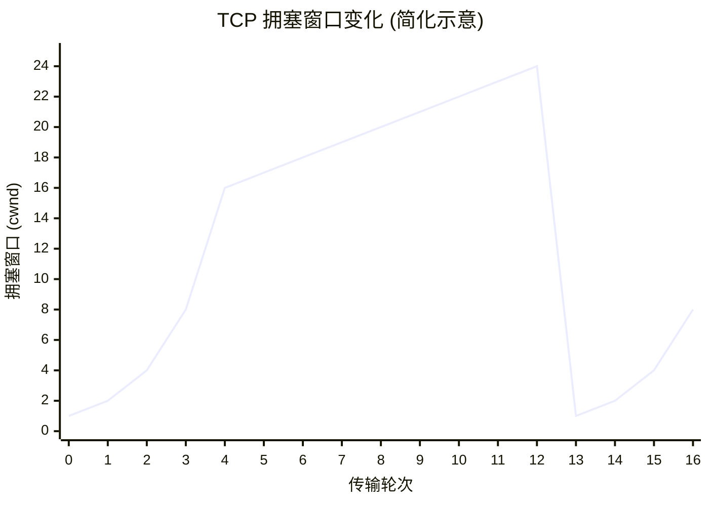

# 1 概述

## 1.1 因特网概述

**网络、互连网与因特网的基本概念**
* **网络**：由若干**结点** 和连接这些结点的**链路** 组成。
    * *结点*：计算机、集线器、交换机、路由器等。
* **互连网 (互联网, internet)**：网络的网络。
    * 通过**路由器**将多个网络互连起来，形成覆盖范围更大的网络。
* **因特网 (Internet)**：当前全球最大的、开放的、由众多网络互连而成的特定计算机网络。
    * 采用 **TCP/IP 协议族** 作为通信规则。

---

* **ISP (Internet Service Provider)**：因特网服务提供者（如中国电信、联通、移动）。
    * 用户通过 ISP 获取 **IP 地址** 接入因特网。

---

## 1.2 因特网的组成

### 1.2.1 边缘部分

* **定义**：由所有连接在因特网上的**主机 (Host)** 组成（台式机、手机、智能硬件等）。
* **使用者**：用户直接使用。
* **功能**：进行**通信**（数据传输）和**资源共享**。
* **通信方式**：
    * **C/S 方式** (Client/Server，客户-服务器方式)。
    * **P2P 方式** (Peer-to-Peer，对等方式)。

### 1.2.2 核心部分 

* **定义**：由大量**网络**和连接这些网络的**路由器**组成。
* **使用者**：为边缘部分提供服务。
* **功能**：提供**连通性**和**交换**。
* **关键设备**：**路由器**。
    * **作用**：实现**分组交换**，负责转发收到的分组。
    * **地位**：网络核心部分最重要的功能组件。

---
## 1.3 电路交换、分组交换和报文交换
### 1.3.1 电路交换

电路交换是最早出现的交换方式，最典型的应用是**传统电话网络**。
**核心原理**：
在数据传输之前，必须先建立一条**专用的物理通路**。这条通路在整个数据传输期间一直被独占，直到通信结束。

**三个阶段**
1.  **建立连接**：申请占用通信资源，建立物理通路。
2.  **通话/数据传输**：数据可以在已建立的通路上一直传输。
3.  **释放连接**：通信结束后，释放占用的物理资源。

**优缺点分析**
* **优点**：
    * **通信时延小**：一旦建立连接，数据直通，没有存储转发的开销。
    * **有序传输**：数据按序到达，无失序问题。
    * **适用场景**：适合实时性要求高、大数据量的连续传输。
* **缺点**：
    * **建立连接时间长**：对于突发式、短报文通信，建立连接的开销过大。
    * **信道利用率低**：当无数据传输时，线路资源被浪费，无法被其他用户共享。
    * **缺乏灵活性**：任何一个节点故障都可能导致连接中断。

---

### 1.3.2 报文交换

报文交换是早期的电报通信方式，现在较少直接使用，但其“存储转发”的思想是分组交换的基础。

**核心原理**
* **单位**：以**整个报文** 为单位进行传输。
* **机制**：**存储转发**。节点收到整个报文，检查无误后，暂存并在路由表中查找下一跳，然后转发。

**优缺点分析**
* **优点**：
    * 无需建立专用连接，动态分配线路。
    * 线路利用率高。
* **缺点**：
    * **转发时延大**：必须接收完整个长报文才能开始转发下一跳。
    * **缓存要求高**：中间节点需要足够大的缓存空间来存储整个长报文。
    * **灵活性差**：如果报文出错，需要重传整个报文，效率低。

---

### 1.3.3 分组交换

**核心原理**：
* **单位**：将长报文切分成若干个较小的**分组**。每个分组包含**首部** 和**数据段**。
* **机制**：**存储转发**。但因为分组小，路由器可以快速接收、快速处理、快速转发。

**特点**：
* **流水线传输**：当第一个分组在链路上传输时，第二个分组可以被节点处理，大大提高了效率。
* **动态分配**：分组可以独立选择路径。

**优缺点分析**：
* **优点**：
    * **高效**：相比报文交换，减少了转发时延。
    * **迅速**：无需像电路交换那样等待建立连接。
    * **适用场景**：突发式数据通信。
* **缺点**：
    * **首部开销**：每个分组都要加上首部（包含源/目的地址等），增加了额外的传输量。
    * **可能拥塞**：分组排队时可能会造成时延或丢包。
    * **无序**：分组可能不按顺序到达。

---

### 1.3.4 总结

| 特性         | 电路交换  | 报文交换 | 分组交换 |
| :--------- | :---- | :--- | :--- |
| **数据单元**   | 连续比特流 | 整个报文 | 分组   |
| **建立时间**   | 长     | 无    | 无    |
| **存储转发时延** | 无     | 高    | 低    |
| **节点缓存开销** | 无     | 高    | 低    |

---
## 1.4 计算机网络的定义和分类

### 1.4.1 按覆盖范围分类

| 分类名称    | 英文缩写    | 覆盖范围     | 核心特点与备注                                  |
| :------ | :------ | :------- | :--------------------------------------- |
| **广域网** | **WAN** | 几十到几千公里  | **因特网的核心部分**。跨越国家或洲际，为核心路由器提供远距离高速连接。    |
| **城域网** | **MAN** | 5 ~ 50公里 | 覆盖一个城市。通常作为城市的骨干网，连接多个局域网。               |
| **局域网** | **LAN** | 1公里左右    | **应用最广**。覆盖实验室、大楼或校园。具有高数据传输率。           |
| **个域网** | **PAN** | 10米左右    | 也称无线个域网 (**WPAN**)。连接个人电子设备（如耳机、鼠标、打印机）。 |

### 1.4.2 按拓扑结构分类

| 拓扑结构    | 结构描述                             | 优点                | 缺点                        |
| :------ | :------------------------------- | :---------------- | :------------------------ |
| **总线型** | 使用单根传输线连接所有计算机。                  | 建网容易、增减节点方便、节省线路。 | 重负载时效率低；**总线任一处故障则全网瘫痪**。 |
| **星型**  | 每个计算机通过单独线路连接到**中央设备**（交换机/路由器）。 | 易于集中控制和管理。        | 成本较高；**中央设备是单点故障源**。      |
| **环型**  | 所有接口连接成一个封闭的环（如令牌环网）。            | 信号单向传输，结构简单。      | 节点故障可能影响全网。               |
| **网状型** | 每个节点至少有两条路径与其他节点相连。              | **可靠性高**（多条路径冗余）。 | 控制复杂、线路成本高。**常用于广域网**。    |

## 1.5 计算机网络的性能指标
### 1.5.1 速率

速率是计算机网络中最重要的性能指标，指的是数据的传送速率，也称为**数据率** 或 **比特率**。

* **定义**：主机在数字信道上发送数据的速率。
* **基本单位**：比特/秒 (b/s 或 bps)。
* **常用单位换算**：
    * $k = 10^3$
    * $M = 10^6$
    * $G = 10^9$
    * $T = 10^{12}$ 

> 在计算机网络中，**速率**单位使用 $10$ 的幂（10进制）进行换算，而**存储容量**单位使用 $2$ 的幂（2进制）进行换算。

---

### 1.5.2 时延

- **发送时延/传输时延**：从发送分组的第一个比特开始，到最后一个比特发送完毕为止的时间。
- **传播时延**：一个比特从链路一端传播到另一端所需的时间。
- **处理时延**：分组在交换节点为存储转发而进行的处理的时间。
- **排队时延**：分组在路由器的输入队列或输出队列中等待的时间。

$总时延=发送时延+传播时延+处理时延+排队时延$

### 1.5.3 带宽

单位时间内网络中的**最高数据率**。

* **理解**：将网络链路想象成一条“水管”。
    * 带宽 = 水管的截面积。
    * 带宽越宽 = 单位时间内能流出的水（数据）越多。
* **核心概念**：在网络中，带宽表示的是**最高**的数据传输速率，即入口处的发送速率，而不是数据在链路上的传播速度（传播速度通常是光速或电磁波速度，是固定的）。

---
### 1.5.4 时延带宽积

**1. 定义与公式**
时延带宽积是**传播时延**与**带宽**的乘积。
$$\text{时延带宽积} = \text{传播时延} \times \text{带宽}$$

**2. 理解**
可以将传输链路想象成一个管道：
* **长度**：代表**传播时延**（数据在链路上跑的时间）。
* **横截面积**：代表**带宽**（单位时间能通过的数据量）。
* **体积**：代表**时延带宽积**（管道中充满了比特）。

**3. 物理意义**
* 表示若发送端连续发送数据，在发送的第一个比特即将到达终点时，发送端已经发送出的比特数量。
* 又称为**以比特为单位的链路长度**。

---

### 1.5.5 往返时间 (RTT)

**1. 定义**
从发送方发送数据开始，到发送方收到接收方的确认（确认分组）为止，所经历的时间。
* **注意**：互联网上的信息通常是双向交互的，RTT 包含了往返的过程。

**2. 影响因素案例分析**
不同链路对 RTT 的影响不同，距离越远，传播时延越大，RTT 越大。

---

### 1.5.6 信道利用率

**利用率与时延的关系**
利用率并非越高越好。根据排队论，当信道的利用率增大时，该信道引起的时延也会迅速增加。

* **公式关系**：
    若 $D_0$ 为空闲时延，$D$ 为当前时延，$U$ 为利用率，则：
    $$D = \frac{D_0}{1 - U}$$

**关键阈值**

| 利用率数值 | 时延变化 | 说明 |
| :--- | :--- | :--- |
| **< 50%** | 增长缓慢 | ISP 通常控制在此范围内，保证网络通畅。 |
| **= 50%** | **加倍** | 时延变为空闲时的2倍。 |
| **> 50%** | 急剧增大 | 网络产生明显拥塞。 |
| **接近 100%** | 趋于无穷大 | 网络瘫痪。 |

---

### 1.5.7 丢包率

**1. 定义**
即**分组丢失率**。指在一定时间内，传输过程中丢失的分组数量与总分组数量的比率。
* 丢包率反映了网络的**拥塞情况**。

**2. 分组丢失的主要原因**

| 原因 | 发生场景 | 详细过程 |
| :--- | :--- | :--- |
| **误码** | 传输线路 | 信号传输受干扰产生误码 $\rightarrow$ 节点交换机检测出误码 $\rightarrow$ 丢弃分组。 |
| **网络拥塞** | 路由器/交换机 |    分组到达时，路由器的**输入缓冲队列已满** $\rightarrow$ 路由器无空间暂存 $\rightarrow$ 主动丢弃分组。 |

---

## 1.6 常见的计算机网络体系结构

| 层次位置 (从下至上) | OSI体系结构                       | TCP/IP体系结构                | 五层原理体系结构             |
| :---------- | :---------------------------- | :------------------------ | :------------------- |
| **高层**      | **应用层** **表示层** **会话层** | **应用层**                   | **应用层**              |
| **传输控制**    | **运输层**                       | **运输层**                   | **运输层**              |
| **网络互连**    | **网络层**                       | **网际层** (IP)              | **网络层**              |
| **底层硬件与接口** | **数据链路层** **物理层**          | **网络接口层** *(并未规定具体内容)* | **数据链路层** **物理层** |

---
**五层原理体系结构**

| 层次名称      | 解决的核心问题                      | 关键标识/地址    | 典型设备/概念         |
| :-------- | :--------------------------- | :--------- | :-------------- |
| **应用层**   | **应用交互**：通过进程交互实现特定网络应用。     | 无 (使用URL等) | HTTP, SMTP, FTP |
| **运输层**   | **进程通信**：解决进程之间基于网络的通信；差错处理。 | **端口号**    | TCP, UDP        |
| **网络层**   | **路由与互连**：分组在多个网络上传输（路由选择）。  | **IP地址**   | 路由器             |
| **数据链路层** | **链路传输**：分组在一个网络（或一段链路）上传输。  | **MAC地址**  | 交换机, 网卡         |
| **物理层**   | **信号传输**：使用何种信号来传输比特。        | 无          | 网线, 接口, 电平      |

**OSI模型**

| 层     | 功能                                   |
| :---- | :----------------------------------- |
| 应用层   | 提供应用与网络的接口                           |
| 表示层   | 数据格式转换                               |
| 会话层   | 会话管理                                 |
| 传输层   | 复用和分用、差错控制、流量控制、连接管理、可靠传输管理          |
| 网络层   | 路由选择、拥塞控制、网际互联、差错控制、流量控制、连接管理、可靠传输管理 |
| 数据链路层 | 差错控制、流量控制                            |
| 物理层   | 定义电路接口参数、信号的含义电气特性等                  |

**TCP/IP**

| 层       | 功能                                            |
| :------ | :-------------------------------------------- |
| **应用层** | 集成 OSI 会话、表示、应用三层功能，包含 FTP、DNS、HTTP 等高层协议     |
| **传输层** | **发送端与接收端**主机上对等进程之间的逻辑通信。分组的**有序性**和**可靠性**。 |
| **网际层** | 将分组发送到任意网络，并为每个分组独立选择**路由**，不保证分组有序到达。        |

---

## 1.7 专用术语

### 1.7.1 实体
* **定义**：任何可发送或接收信息的**硬件**或**软件进程**。
* **举例**：
    * 通信双发的网卡。
    * 正在进行通信的应用进程。
* **对等实体**：通信双方**相同层次**中的实体。

### 1.7.2 协议
* **定义**：控制两个**对等实体**进行**逻辑通信**的规则的集合。
* **协议的三要素**：

| 要素        | 定义                 | 举例                     |
| :-------- | :----------------- | :--------------------- |
| **语法**    | 定义通信双方所交换信息的**格式** | 定义数据由哪些字段组成、字段长度、先后顺序。 |
| **语义**    | 定义通信双方所要完成的**操作**  | 发送方发出何种控制信息，接收方做出何种响应。 |
| **同步/时序** | 定义通信双方的**时序关系**    | 事件实现的顺序详细说明。           |

### 1.7.3 服务
* **定义**：在协议的控制下，两个对等实体间的逻辑通信，使得本层能够向**上一层**提供服务。
* **依赖关系**：要实现本层协议，还需要使用下面一层所提供的服务。
* **透明性**：实体看得见下层提供的服务，但并不知道实现该服务的具体协议。即**下层的协议对上层的实体是“透明”的**。

### 1.7.4 接口 
- **定义**：同一节点内相邻的两层实体交换信息的逻辑接口称为**服务访问点**。每层智能与相邻的上下层定义接口。

### 1.7.5 协议与服务的区别

* **方向不同**：
    * **协议是“水平的”**：控制对等实体之间（主机A的第N层 $\leftrightarrow$ 主机B的第N层）的通信规则。
    * **服务是“垂直的”**：由下层向上层（第N层 $\rightarrow$ 第N+1层）提供。
* **联系**：
    * 协议的实现保证了能够向上一层提供服务。
    * 本层的服务用户只能看见服务，而无法看见下面的协议。

### 1.7.6 PDU 、 SDU 和 PCI

* **协议数据单元 (PDU)**：**对等层次之间**传送的数据包（水平方向）。
* **服务数据单元 (SDU)**：**同一系统内，层与层之间**交换的数据包（垂直方向）。
* **协议控制信息 (PCI)**：用于**控制协议**的操作信息。

**各层协议数据单元 (PDU) 的名称：**

| 层次        | PDU 名称      | 备注                      |
| :-------- | :---------- | :---------------------- |
| **应用层**   | 报文          |                         |
| **运输层**   | 报文段 / 用户数据报 | TCP协议称为报文段；UDP协议称为用户数据报 |
| **网络层**   | 分组 / IP数据报  | 统称为分组，使用IP协议时也叫IP数据报    |
| **数据链路层** | 帧           |                         |
| **物理层**   | 比特流         |                         |

---
# 2 物理层
## 2.1 基本概念
### 2.1.1 传输媒体的分类

* **导引型传输媒体**
    * **双绞线**：通过将两根绝缘铜线**相互绞合**来抵御电磁干扰，是**成本最低**、布线方便，但传输距离较短。
    * **同轴电缆**：拥有良好的**屏蔽层**使其抗干扰能力较强，笨重且成本较高。
    * **光纤**：具有**极高带宽**、超远传输距离和**完全抗电磁干扰**的特性。
- **非导引型传输媒体**
    * **微波通信（例如Wi-Fi）**：无需铺设物理线缆，利用**直线传播**的高频电磁波在空气中传输，实现了**移动通信**的便利性，但信号易受建筑物阻挡、衰减大且易受干扰。

### 2.1.2 物理层设备
- **中继器**：中继器只有两个端口，主要功能是整形、放大并转发信号以消除信号失真和衰减，从而扩大网络的传输距离。其原理是**信号再生**。
- **集线器(Hub)**：集线器实质上是一个多端口的中继器，一个端口接收到数据信号后，将其再生，然后转发到除了输入端口外的所有端口。由集线器组成的网络在物理上是星形网络，但逻辑上仍是总线型网络。

### 2.1.3 物理层的基本概念与作用

物理层在计算机网络体系结构中处于最底层，其核心地位和作用如下：

* **核心任务**：解决如何在各种传输媒体上传输**比特 0 和 1** 的问题。
* **屏蔽差异**：物理层屏蔽了各种传输媒体的差异，使数据链路层只需专注于本层的协议和服务，而不必考虑网络具体的传输媒体是什么。

### 2.1.4 专有名词

* **数据**: 数据是信息的载体。
* **信号**: 数据的电磁表现。
    * **模拟信号**的取值是连续的。
    * **数字信号**的取值是离散的。
    * **基带信号**是由信源发出的未经过调制的原始电信号，传输方式被称为**基带传输**。
    * **宽带信号**是将基带信号调制到高频载波上形成的信号，传输方式被称为**宽带传输**。
- **信源**：产生和发送数据的源头。
* **信道**: 信号传输的通道。
- **信宿**：接收数据的终点。
- **码元**
	* **定义**: 在使用时间域的波形表示数字信号时，代表不同离散数值的**基本波形**。
	* **理解**: 码元是构成信号的一段波形。
	* **与比特的关系**:
	    * 在基本编码或调制中，1个码元可能只携带1比特信息。
	    * 在混合调制（如QAM）中，1个码元可以携带多个比特信息。
- **码元传输速率**：
	- **别称**：**波特率**、**调制速率**。
	- **含义**：每秒传输的码元数，单位是波特。**码元速率与进制无关**。

### 2.1.5 物理层协议的四大特性

| 特性名称     | 定义与描述                                                     |
| :------- | :-------------------------------------------------------- |
| **机械特性** | 指明接口所用接线器的**形状**和**尺寸**、**引脚数目**和**排列**、**固定**和**锁定**装置等。 |
| **电气特性** | 指明在接口电缆的各条线上出现的**电压的范围**。                                 |
| **功能特性** | 指明某条线上出现的**某一电平的电压表示何种意义**。                               |
| **过程特性** | 指明对于不同功能的各种可能事件的**出现顺序**。                                 |

---
## 2.2 传输方式
### 2.2.1 串行传输与并行传输

| 特性 | 串行传输 | 并行传输 |
| :--- | :--- | :--- |
| **定义** | 数据是一个比特一个比特依次发送的。 | 一次发送 n 个比特，而不是一个比特。 |
| **线路需求** | 收发双方之间只需 **1条** 数据传输线路。 | 收发双方之间需要 **n条** 传输线路。 |
| **优点** | 节省线路成本，适合远距离传输。 | 速度快，速度是串行传输的 n 倍。 |
| **缺点** | 传输速度相对较慢。 | 成本高（线路多），且存在干扰问题。 |
| **应用场景** | **计算机网络**（远距离传输）。 | **计算机内部**（如CPU与内存之间，总线宽度常见8位、16位、32位、64位）。 |

---
### 2.2.2 同步传输与异步传输

#### 2.2.2.1 同步传输
* **传输形式**：数据块以稳定的比特流形式传输，字节之间 **没有间隔**。
* **判别方式**：接收端在每个比特信号的 **中间时刻** 进行检测，判别是0还是1。
* **核心问题**：收发双方时钟频率若存在微小差异，大量数据传输会产生 **累积误差**，导致判别错位。
* **解决方案（时钟同步）**：必须使收发双方的时钟保持同步，主要有两种方法：
    * **外同步**：在收发双方之间添加一条 **单独的时钟信号线**。发送数据的同时发送时钟同步信号。
    * **内同步**：将时钟同步信号 **编码** 到发送数据中一起传输。

#### 2.2.2.2 异步传输
* **传输形式**：以 **字节** 为独立的传输单位。
* **时间间隔**：字节与字节之间的时间间隔 **是不固定的**（这就是“异步”的含义）。
* **同步机制**：虽然字节间异步，但字节内的每个比特仍然需要同步（持续时间相同）。
* **实现方法**：通常在每个字节前后分别加上 **起始位** 和 **结束位**。接收端仅在每个字节的起始处对字节内的比特实现同步。

---

### 2.2.3 通信双方的交互方式

| 通信方式      | 别名     | 描述                          | 信道需求       |
| :-------- | :----- | :-------------------------- | :--------- |
| **单工通信**  | 单向通信   | 通信双方只有一个数据传输方向，只能发或只能收。     | **1 条** 信道 |
| **半双工通信** | 双向交替通信 | 双方都可以发送和接收数据，但 **不能同时** 进行。 | **1 条** 信道 |
| **全双工通信** | 双向同时通信 | 双方可以 **同时** 发送和接收数据。        | **2 条** 信道 |

## 2.3 编码与调制

将数据转换为数字信号的过程称为**编码**，将数据转换为模拟信号的过程称为**调制**。

---
### 2.3.1 编码

| 编码方式              | 数据表示方式                                                                                         | 优缺点                                                |
| :---------------- | :--------------------------------------------------------------------------------------------- | :------------------------------------------------- |
| **不归零(NRZ)编码**    | 正电平代表1，负电平代表0（或相反）。                                                                            | **优点**：编码效率最高。 **缺点**: 存在**同步问题**。需要额外时钟线。      |
| **归零(RZ)编码**      | 每个码元传输结束后信号都**归零**。                                                                            | **优点**: 自同步。 **缺点**: 编码效率低，大部分带宽浪费在归零上。         |
| **反向非归零(NRZI)编码** | 以码元起始处是否有跳变来表示数据。                                                                              | **优点**：兼具高效率和一定的辅助同步能力。                            |
| **曼彻斯特编码**        | 每个码元**中间时刻**发生跳变。 例如：负跳变表示 1，正跳变表示0。 中间的跳变既是**时钟**也是**数据**。                           | **优点**: 中间跳变既作为时钟信号（自同步），又表示数据。 **缺点**: 占用频带较宽。 |
| **差分曼彻斯特编码**      | 码元**中间时刻**仅表示时钟。 码元**开始处**电平是否跳变表示数据。 例如：开始处跳变表示0，不跳变表示1。 中间跳变是**时钟**，位开始处的跳变是**数据**。 | **优点**: 抗干扰能力强于曼彻斯特编码，自同步。                         |

**PCM(脉冲编码调制)**：
1. **采样**：对模拟信号进行周期性采样，采样频率不得低于信号最高频率的两倍。
2. **量化**：将采样所得的幅值分级取整，将连续的电信号转换为离散的数值。
3. **编码**：将量化后的整数转换为对应的二进制码。

---
### 2.3.2 调制

| 调频方式             | 数据表示方式               | 优缺点                             |
| :--------------- | :------------------- | :------------------------------ |
| **幅移键控(ASK)**    | 通过载波是否有振幅表示0和1。      | **优点**：容易实现。 **缺点**: 抗干扰能力差。 |
| **频移键控(FSK)**    | 通过载波不同的频率来表示0和1。     | **优点**: 容易实现，且抗干扰能力强。           |
| **相移键控(PSK)**    | 通过载波的相位来表示0和1。       |                                 |
| **差分相移键控(DPSK)** | 通过载波的相位是否发生变化来表示0和1。 |                                 |

---
### 2.3.3 QAM

* **正交振幅调制 (QAM)**:
    * 原理：结合相位和振幅的调节。
    * **QAM-16 举例**:
        * 共可调制出 **16种** 不同的码元（波形）。
        * 因为 $2^4 = 16$，所以 **1个码元可以携带 4个比特** 的数据。
* **格雷码**:
    * 在混合调制的坐标图中，每个码元对应的比特串分配不是随意的。
    * **规则**: 任意两个相邻的码元，其代表的比特串**只有 1个比特不同**。
    * **目的**: 减小由于相位漂移或振幅失真导致的误码率（即使出错，也通常只错1个比特）。

## 2.4 信道的极限容量

### 2.4.1 奈氏准则
* **适用条件**：理想低通信道。
* **核心结论**：
    * 理想低通信道的最高码元传输速率 = $2W$ (Baud)。
    * 理想带通信道的最高码元传输速率 = $W$ (Baud)。
* **符号含义**：
    * $W$：信道带宽 (单位：Hz)
    * **Baud (波特)**：码元传输速率的单位，即码元/秒。
- **关系公式**：
        $$数据传输速率 = 波特率 \times \log_2(V)$$
	- 其中 $V$ 是码元所能采用的离散电平数（即状态数）。
    * 若1个码元携带 $n$ bit 的信息量，则 $n = \log_2 V$。
    * **推论**：要提高数据传输速率，必须设法使每个码元携带更多比特的信息量，这需要采用**多元制**。

### 2.4.2 香农公式

* **适用条件**：带宽受限且有高斯白噪声干扰的信道。
* **核心公式**：
    $$C = W \times \log_2(1 + \frac{S}{N})$$
* **符号含义**：
    * $C$：信道的极限信息传输速率 (单位：b/s)。
    * $W$：信道带宽 (单位：Hz)。
    * $S$：信道内所传信号的平均功率。
    * $N$：信道内的高斯噪声功率。
    * $S/N$：**信噪比** (比值，无单位)。
* **信噪比的分贝表示**：
    * 分贝 (dB) 形式的信噪比，需转换为比值代入公式。
    * 转换公式：$$信噪比(db) = 10 \times \log_{10}(\frac{S}{N})$$
---

### 2.4.3 总结

| 比较项目       | 奈氏准则                | 香农公式                     |
| :--------- | :------------------ | :----------------------- |
| **主要关注点**  | 限制**码元传输速率**以避免码间串扰 | 限制**信息传输速率** (比特率) 以应对噪声 |
| **适用信道**   | 理想无噪声信道             | 有噪声信道                    |
| **提升速率途径** | 提高带宽、采用多元制调制技术      | 提高带宽、提高信噪比               |
| **公式性质**   | 确定了码元速率的上限          | 确定了比特速率的理论上限             |

---

# 3 数据链路层

## 3.1 封装成帧
### 3.1.1 封装成帧的基本概念

* **定义**：指数据链路层给上层（网络层）交付的协议数据单元添加**帧头**和**帧尾**，使之成为帧。
* **作用**：
    1.  **帧定界**：接收方依据帧头和帧尾来区分帧的起始和结束。
    2.  **携带控制信息**：帧头和帧尾中包含重要的控制信息（如地址、类型、校验码等）。

---
### 3.1.2 帧定界的方法

#### 3.1.2.1 包含“帧定界标志”的协议
**（以PPP协议为例）**
* **机制**：在帧头和帧尾中包含特定的**标志字段**（Flag）。
* **数值**：通常为1个字节，例如十六进制的 `7E`（二进制 `01111110`）。
* **判别**：接收方读取到该标志，即认为是一个帧的开始或结束。

#### 3.1.2.2 不包含“帧定界标志”的协议
**（以以太网V2 MAC帧为例）**
* **MAC帧格式**：帧头和帧尾中**不包含**定界标志。
* **定界方式**：
    * **发送端**：数据链路层将帧交付给物理层后，物理层在帧前面添加8字节的**前导码**。
        * 前7个字节：前同步码（用于时钟同步）。
        * 第8个字节：**帧开始定界符**（表明后面紧跟的就是MAC帧）。
    * **结束判定**：以太网规定了**帧间间隔**（96比特发送时间）。发送完一帧后必须停顿这段时间，接收方据此判断帧结束，因此不需要帧结束定界符。

---

### 3.1.3 透明传输

**定义**：数据链路层对上层交付的传输数据没有任何限制。即使数据中出现了与“帧定界标志”相同的比特组合，也能被正确识别为数据，而不是误判为帧结束。

#### 3.1.3.1 字符计数法
- **操作规则**：在帧首部设置一个**计数字段**，用于记录该帧包含的总字节数(包含计数字段自身的1B)。
- **缺点**：如果计数字段出错，接收方将无法识别帧边界，导致收发双方失去同步。

#### 3.1.3.2 字节填充法 (字符填充)
* **适用场景**：面向**字节**的物理链路。
* **操作规则**：
    1.  **发送端扫描**：
        * 发现帧定界符：在它前面插入一个**转义字符**（ESC）。
        * 发现转义字符：在它前面也插入一个**转义字符**（ESC）。
    2.  **接收端处理**：
        * 遇到转义字符时，将其删除，并保留后面的字符作为数据。

| 原始数据情况 | 发送时的处理 | 接收时的还原 |
| :--- | :--- | :--- |
| 数据中出现 `Flag` | `ESC` + `Flag` | 去掉 `ESC`，保留 `Flag` |
| 数据中出现 `ESC` | `ESC` + `ESC` | 去掉第一个 `ESC`，保留第二个 `ESC` |

#### 3.1.3.3 零比特填充法 (位填充)
* **适用场景**：面向**比特**的物理链路。
* **标志字段**：通常为 `01111110`（中间有6个连续的1）。
* **操作规则（"5 1 1 0"）**：
    1.  **发送端**：扫描数据，只要发现**5个连续的1**，立即在后面插入一个**0**。
    2.  **接收端**：扫描比特流，发现**5个连续的1**，就把后面的**0**删除。
* **目的**：确保数据部分永远不会出现6个连续的1，从而与标志字段区分开。

#### 3.1.3.4 违规编码法
- **适用场景**：采用**冗余编码**的编码环境。
- **操作规则**：将违规的编码作为帧的起始/终止。

---

### 3.1.4 最大传送单元 (MTU)

* **概念**：数据链路层协议规定的**帧的数据部分**的长度上限。
* **效率原则**：为了提高传输效率，帧的数据部分长度应尽可能大。
* **限制**：由于差错控制、缓存大小等因素，数据部分不能无限大，必须受MTU限制。

---

## 3.2 差错检测

* **比特差错**：在传输过程中，1可能变成0，0可能变成1，这种现象称为比特差错。
* **误码率**：在一段时间内，传输错误的比特占所传输比特总数的比率。
* **检测机制**：
    * 数据链路层不仅传输数据，还会在帧尾部添加**帧检验序列 (FCS)**。
    * **目的**：让接收方检测帧在传输过程中是否产生了误码。
    * **常见应用**：以太网V2版本和PPP协议都在帧尾部包含FCS字段。

---
### 3.2.1 码距
* **概念**：对应位上数值不同的位数，即异或结果中1的数量。
* **检错/纠错能力关系式**：$l=d+c+1,d \ge c$，其中l为码距，d为检错位数，c为纠错位数。
- **结论**：
	- **为检测d位错误**：码距至少为$d+1$。
	- **为纠正c位错误**：码距至少为$2c+1$。

### 3.2.2 奇偶校验

#### 3.2.2.1 校验原理
在待发送的数据后面添加**1位**校验位。

| 校验方式 | 规则描述 | 目标 |
| :--- | :--- | :--- |
| **奇校验** | 添加校验位后，使整个数据（含校验位）中“1”的个数为**奇数**。 | 接收方检测“1”的个数，若为偶数则判定出错。 |
| **偶校验** | 添加校验位后，使整个数据（含校验位）中“1”的个数为**偶数**。 | 接收方检测“1”的个数，若为奇数则判定出错。 |

#### 3.2.2.2 缺点与局限性
* **漏检率高**：
    * 如果传输中**奇数个**位发生变化，奇偶性改变，**可以**检出错误。
    * 如果传输中**偶数个**位发生变化，奇偶性不发生变化，**无法**检出错误。
* **结论**：由于漏检率较高，计算机网络的数据链路层一般**不采用**这种方法。

---

### 3.2.3 循环冗余校验 (CRC)

#### 3.2.3.1 检错能力
- **所有的单比特错误**
- **双比特错误**：$数据帧长度 \le 2^r - 1$时，所有双比特错误都能检测出来。
- **奇数比特错误**：只要生成多项式中包含有因式x，就能够检测出所有的奇数比特错误。
- **所有长度小于等于r的错误**
#### 3.2.3.2 核心概念
* **生成多项式 G(x)**：收发双方预先约定好的一个多项式。
    * *注意*：生成多项式的最高次幂决定了校验码（冗余码）的位数。
    * *示例*：G(x) = x^3 + x^2 + 1。
        * 最高次幂为3，说明校验码是3位。
        * 对应比特串：看系数，有的项为1，缺的项为0。1*x^3 + 1*x^2 + 0*x^1 + 1*x^0 -> **1101**。
* **模2除法**：CRC计算中使用的除法。
    * 实质是**异或** 运算。

#### 3.2.3.3 发送方的处理步骤（计算冗余码）

1.  **构造被除数**：
    * 在待发送数据的后面添加生成多项式最高次数个**0**。
    * *例子*：数据 101001，生成多项式最高次为3，则补3个0 -> 101001000。
2.  **确定除数**：
    * 生成多项式各项系数构成的比特串。
    * *例子*：G(x) = x^3 + x^2 + 1 -> 除数为 1101。
3.  **做模2除法**：
    * 用构造的被除数除以除数。
    * 商是多少不重要，重要的是**余数**。
4.  **结果处理**：
    * **余数即为冗余码（FCS）**。
    * *注意*：余数的位数必须与生成多项式最高次数相同。如果位数不够，需要在前面补0。
    * 最终发送的数据 = 原始数据 + 余数。

#### 3.2.3.4 接收方的处理步骤

1.  **接收数据**：收到（数据 + FCS）的组合。
2.  **做模2除法**：用收到的数据除以同样的生成多项式（除数）。
3.  **判定规则**：
    * **余数 = 0** -> 判定传输过程**无误码**，接受。
    * **余数 != 0** -> 判定传输过程**有误码**，丢弃。

---

### 3.2.4 CRC模2除法计算流程

假设待发送信息：101001
生成多项式：G(x) = x^3 + x^2 + 1 （对应 1101）

**步骤演示：**

1.  **被除数**：101001 后补3个0 -> 101001000
2.  **除数**：1101
3.  **运算过程**（对其首位为1的位进行异或消去）：

              1 1 0 1 0 1  (商，仅作标记，不重要)
          ----------------
    1 1 0 1 ) 1 0 1 0 0 1 0 0 0  (被除数)
              1 1 0 1            (与除数异或)
              -------
                1 1 1 0          (余数首位为1，商1)
                1 1 0 1
                -------
                  0 1 1 1        (余数首位为0，商0，不够除，向后借位)
                  0 0 0 0        (实际就是直接落下一位，或者理解为与0000异或)
                  -------
                    1 1 1 0      (余数首位为1，商1)
                    1 1 0 1
                    -------
                      0 1 1 0    (余数首位为0，商0)
                      0 0 0 0
                      -------
                        1 1 0 0  (余数首位为1，商1)
                        1 1 0 1
                        -------
                          0 0 1  (最终余数)

**结果**：
* 计算出的余数为 001。
* 最终发送的数据帧为：101001 + 001 = **101001001**。

---

### 3.2.5 海明码
- **海明码位数**：
	- 设信息位有n位，检验位k位。
	- 共有$n+k$种单比特错误，再加上1种状态表示无错误。
	- 因此，需满足$2^k \ge n+k+1$。
- **检验位分布**：检验位$P_i$放在$H_{2^i-1}$处，其余位置放数据位$D_i$。
- **检验关系**：$D_i$位于$H_{i'}$，由$P_{j_1},P_{j_2}...P_{j_n}$检验，满足$i'=\sum_{k=1}^{n} 2^{j_{k}-1}$。即$i'$以二进制表示中，若从低到高的第$j$位为1，则检验位包含$P_j$。
- **检验位取值**：$P_i$取值为所有由它检验的$D_i$的异或和。
- **纠错**：$S_i$取值为$P_i$和所有由$P_i$检验的$D_i$的异或和。将所有$S_i$组成一个二进制数，若全为0，则无错误；否则，则表示对应位置出错，如$S_1 S_2 S_3=001$表示第1位出错。

---
## 3.3 流量控制

- **流量控制**是指限制发送方的发送速率，使其不超过接收方的接收能力，避免帧丢失。

### 3.3.1 停止-等待

停止-等待协议是实现可靠传输的一种基本机制。它的核心思想是：发送方每发送完一个数据分组，就停止发送，等待接收方的确认。在收到确认后，再发送下一个数据分组。

### 3.3.2 滑动窗口
- 发送方维持发送窗口，接收方维持接收窗口。
- 发送方每收到一个按序到达的确认帧，就将窗口向前滑动一个位置。
- 接收方每收到一个落在接收窗口内的帧，窗口向前滑动适当位置。

---
## 3.4 可靠传输

**传输差错的分类**

| 差错类型 | 描述 | 产生原因示例 |
| :--- | :--- | :--- |
| **比特差错** | 比特位翻转（0变1，1变0）。 | 信号在传输介质中受到干扰。 |
| **分组丢失** | 接收端根本没有收到分组。 | 路由器输入队列已满，主动丢弃到达的分组。 |
| **分组失序** | 分组到达接收端的顺序与发送顺序不一致。 | 分组在网络中传输路径不同，后发的先到了。 |
| **分组重复** | 接收端收到了重复的分组。 | 分组在网络滞留导致发送端超时重发，随后旧分组和新分组都到达了。 |

**不同链路对可靠传输的需求**：

1.  **有线链路（如光纤、双绞线）**：
    * **特点**：误码率非常低。
    * **策略**：为了减小开销，**不要求**数据链路层向上提供可靠传输服务。
    * **处理**：出现误码直接丢弃，可靠传输的问题由**上层**（如传输层 TCP）去处理。

2.  **无线链路（如 Wi-Fi）**：
    * **特点**：易受干扰，误码率比较高。
    * **策略**：**要求**数据链路层必须向上层提供可靠传输服务。
    * **原因**：如果在链路层不纠错，上层处理的代价和延迟会过大。

---
- **自动重传请求(ARQ)**：接收方收到数据帧后发送一个确认帧，发送方若规定时间内未收到确认帧则自动触发超时重传。

### 3.4.1 停止-等待协议(S-W)
- 从滑动窗口的角度看，发送窗口和接收窗口的大小均为1.
- **可能出现的差错**：
	- **数据帧丢失**：发送方每发送完启动计时器，当超时后仍未收到确认帧，则触发超时重传。
	- **数据帧出错**：直接丢弃。
	- **确认帧丢失**：发送方会触发超时重传，接收方则丢弃该重复帧，并再次发送确认帧。
- **编号**：数据帧编号交替使用0和1，确认帧分别标记为ACK0和ACK1。

### 3.4.2 回退N帧协议(GBN)

**核心思想：**
* **发送方**：维持一个发送窗口，可以连续发送多个帧。
* **接收方**：只维持一个大小为 1 的接收窗口，只接收按序到达的帧。
* **策略**：如果出现超时或错误，发送方重传所有**已发送但未被确认**的帧。通常仅维护一个最早未确认的帧的计时器。

**窗口大小**：
1.  **发送窗口 ($W_T$)**：
    * **公式**：$1 \le W_T \le 2^n - 1$
    * **注意**：发送窗口不能超过 $2^n - 1$，否则无法区分新旧帧。
2.  **接收窗口 ($W_R$)**：
    * **固定值**：$W_R = 1$。
    * 这意味着接收方只能按顺序一个个接收，任何乱序到达的帧都会被直接丢弃。

**累计确认机制**:
* **定义**：接收方发送确认帧 ACK $n$，表示**序号 $n$ 及以前的所有帧**都已正确接收，期望收到的下一帧是 $n+1$。
* **优点**：即使中间某个 ACK 丢失，只要后续的 ACK 到达，也能确认前面的帧已接收。

---
### 3.4.3 选择重传协议(SR)
**窗口大小**：
1.  **发送窗口 $W_T$**：
    * 取值范围：$1 \le W_T \le 2^{n-1}$
    * 若 $W_T > 2^{n-1}$，会导致接收方无法分辨新、旧数据分组（产生序号二义性）。
2.  **接收窗口 $W_R$**：
    * 取值范围：$1 \le W_R \le W_T$
    * 一般情况下取最大值，即 **$W_R = W_T = 2^{n-1}$**。
3.  **总体约束条件**：
    * **$W_T + W_R \le 2^n$**
    * 为了避免二义性，发送窗口和接收窗口之和不能超过序号空间的大小。

**工作原理**:
**1. 发送方**
* **发送数据**：可在未收到确认的情况下，将序号落在发送窗口内的多个数据分组全部发送出去。
* **超时重传**：每个发送的分组都有独立的计时器。一旦某个分组的计时器超时，**仅重传该特定的分组**。
* **收到确认**：收到确认帧后，标记该分组为已接收。
**2. 接收方**
* **正常接收**：发送该分组的确认帧。
* **收到重复/旧分组**：接收方必须**重发该分组的确认帧**，以防发送方不断重传。
* **丢弃**：收到误码分组或序号落在窗口之外的分组，直接丢弃。

---
## 3.5 广域网
### 3.5.1 广域网的基本概念

广域网由若干**节点交换机**及连接这些交换机的链路组成。节点交换机与路由器都用于转发分组，但节点交换机工作在单个网络内部，而路由器用于连接多个网络。

| 项目        | 广域网              | 局域网          |
| :-------- | :--------------- | :----------- |
| **覆盖范围**  | 很广，通常跨区域         | 较小，通常在一个区域内  |
| **连接方式**  | 通常采用点对点连接        | 普遍使用广播信道     |
| **OSI层次** | 三层：物理层，数据链路层，网络层 | 两层：物理层，数据链路层 |
| **着重点**   | 强调资源共享           | 强调数据传输       |

### 3.5.2 点对点协议PPP

PPP提供的是**有连接不可靠传输**服务，不提供纠错和流量控制，也不进行重传。
PPP仅支持**全双工的点对点**链路。
PPP是面向字节的协议。

**PPP协议由以下三个主要部分组成：**

1.  **封装方法**：定义了将网络层数据报封装成帧的方法。
2.  **链路控制协议 (LCP)**：用于建立、配置和测试数据链路连接（位于物理层连接建立之后）。
3.  **网络控制协议 (NCPs)**：这是一套协议，其中每一个协议支持不同的网络层协议，使得PPP能够同时支持多种网络层协议。

---
#### 3.5.2.1 PPP帧格式

PPP帧以字节为单位。

**各字段详细说明：**

| 字段名称            | 长度 (字节) | 十六进制值  | 说明                        |
| :-------------- | :------ | :----- | :------------------------ |
| **标志字段 (F)**    | 1       | `0x7E` | 帧的定界符，开头和结尾各一个，表示帧的开始和结束。 |
| **地址字段 (A)**    | 1       | `0xFF` | 预留字段，目前无实际作用。             |
| **控制字段 (C)**    | 1       | `0x03` | 预留字段，目前无实际作用。             |
| **协议字段 (P)**    | 2       | 见下表    | 指明信息部分是什么数据。              |
| **信息部分**        | 0~1500  | -      | 不超过1500字节 (MTU)。          |
| **帧检验序列 (FCS)** | 2       | -      | 使用CRC循环冗余校验。              |

**协议字段 (P) 的常见取值：**

| 协议字段值 | 说明 | 数据部分的内容 |
| :--- | :--- | :--- |
| `0x0021` | IP数据报 | 此时数据部分是IP数据报。 |
| `0xC021` | LCP分组 | 此时数据部分是链路控制协议LCP的数据。 |
| `0x8021` | NCP分组 | 此时数据部分是网络控制协议NCP的数据。 |

---
#### 3.5.2.2 PPP协议的工作状态
1.  **静止状态**：物理层连接尚未建立。
2.  **建立状态**：
    * 当物理层连接建立（如检测到载波）后进入此状态。
    * LCP开始协商配置选项（如最大帧长、是否鉴别等）。
    * 若协商失败，退回静止状态。
3.  **鉴别状态**：
    * 若LCP协商需要鉴别，则进入此状态。
    * 可使用PAP（口令鉴别）或CHAP（挑战握手鉴别）。
    * 若鉴别失败，链路终止，转入终止状态。
4.  **网络层协议状态**：
    * 鉴别通过后进入。
    * NCP根据网络层协议进行配置（如IPCP协议分配IP地址）。
5.  **打开状态**：
    * NCP配置完成后进入。
    * 此时链路可以进行数据传输。
6.  **终止状态**：
    * 数据传输完毕、链路故障或鉴别失败时进入。
    * 释放资源后回到静止状态。

---
## 3.6 介质访问控制

介质访问控制的主要任务是协调共享同一信道的各节点的传输行为，以避免信号产生冲突。
介质访问控制主要分为两大类：**静态划分信道**和**动态分配信道**。

**动态接入控制**：
动态接入又分为**受控接入**和**随机接入**。

| 分类       | 子分类      | 工作原理                                                        | 优缺点/现状                                                          |
| :------- | :------- | :---------------------------------------------------------- | :-------------------------------------------------------------- |
| **受控接入** | **集中控制** | 设有一个主站，以循环方式**轮询**每个站点是否有数据发送。只有被轮询到的站点才能发送。                | **缺点**：存在单点故障问题（主站坏了全网瘫痪）。                                      |
| **受控接入** | **分散控制** | 典型代表为**令牌传递**协议。各站点连接成环形网络，**令牌**（特殊控制帧）沿环逐站传递。获令牌者才有权发送数据。 | **现状**：因市场竞争失败，已逐步退出历史舞台                                        |
| **随机接入** | N/A      | 所有站点通过**竞争**，随机在信道上发送数据。                                    | **核心问题**： 1. 如何尽量避免冲突。 2. 发生冲突后如何尽快恢复通信。 **典型应用**：以太网。 |

---
### 3.6.1 静态划分信道

#### 3.6.1.1 频分复用(FDM)
* **基本原理**：将整个传输频带划分为若干个频率范围不同的子信道，每个子信道分配给一对用户专用。
* **特点**：
    * 所有用户在**同样的时间**占用**不同的带宽**资源。
    * 各用户信号在频域上是分开的，在时域上是混杂的。
    * 为了防止子信道之间的干扰，相邻子信道之间需要设置**保护频带**。
* **优点**：能充分利用传输介质的带宽，效率较高，实现简单。
* **适用场景**：适用于传输模拟信号（如无线电广播、有线电视）。

#### 3.6.1.2 时分复用(TDM)
* **基本原理**：将时间划分为一个个等长的时分复用帧（TDM帧），每个用户在每个TDM帧中占用固定序号的时隙。
* **特点**：
    * 所有用户在**不同的时间**占用**同样的频带宽度**。
    * 各用户信号在时域上是分开的，在频域上是混杂的。
    * **缺点**：子信道利用率可能不高。当用户无数据发送时，分配给他的时隙只能空闲，其他用户无法使用，导致信道资源浪费。
* **统计时分复用/异步时分复用(STDM)**：仅当用户有数据要发送时，才为其分配STDM帧的时隙。

#### 3.6.1.3 波分复用(WDM)
* **定义**：即**光的频分复用**。
* **原理**：在光纤通信中，利用棱镜或光栅将不同频率（波长）的光信号合并在一根光纤上传输。
* **特点**：光信号在光纤中传输时损耗极小，适合长距离、大容量传输。

#### 3.6.1.4 码分复用
* **基本概念**：
    * **码分多址 (CDMA)**：每个用户可以在**同样的时间**使用**同样的频带**进行通信。
    * **码片**：将每一个比特时间再划分为m个短的间隔，称为码片。通常m=64或128。
* **发送规则**：
    * **发送1**：发送该站点的**码片序列**（向量S）。
    * **发送0**：发送该站点**码片序列的反码**（向量-S）。
    * **不发送**：发送0向量。
* **码片序列的要求**：
    * 每个站点的码片序列必须各不相同。
    * 任意两个不同站点的码片序列必须**正交**（即规格化内积为0）。
    * **规格化内积公式**： $S \cdot T = 1/m \cdot \sum_{i=1}^{m}S_i \cdot T_i$ 。
* **计算性质**：
    * 任何一个码片向量和该向量自己的规格化内积都是1。
    * 一个码片向量和该向量反码的规格化内积是-1。
* **数据分离**：
    * 接收端接收到的是所有站点信号的线性叠加（总信号T）。
    * **提取特定站点A的数据**：用A的码片序列与收到的总信号T进行**规格化内积**运算。
        * 结果为 **1** $\rightarrow$ A发送了 **1**
        * 结果为 **-1** $\rightarrow$ A发送了 **0**
        * 结果为 **0** $\rightarrow$ A **未发送数据**

### 3.6.2 动态分配信道

#### 3.6.2.1 ALOHA 协议
* **纯 ALOHA 协议**
    * **基本思想**：当站点有数据要发送时**立即发送**。如果在一段时间内未收到确认，则认为传输过程中发生**冲突**。此时，该站点需等待一段**随机时间**后重传，直至发送成功。
    * **特点**：由于冲突概率较高，该协议的**吞吐量很低**。
* **时隙 ALOHA 协议**
    * **基本思想**：将时间划分为等长的**时隙**，并要求所有站点同步时钟。站点**只能在每个时隙的起始时刻**发送帧，且一帧的发送时间必须小于或等于一个时隙长度。
    * **特点**：这种约束减少了发送的随意性，从而**降低了冲突概率**，提高了信道利用率。重传策略与纯 ALOHA 协议类似。

#### 3.6.2.2 CSMA 协议
在 ALOHA 协议基础上引入了**载波监听机制**（即**先听后发**），根据监听策略和信道忙时的处理方式不同，分为以下三种类型：

| 协议类型     | 信道空闲时                         | 信道忙时                         | 核心特点与优缺点                                         |
| :------- | :---------------------------- | :--------------------------- | :----------------------------------------------- |
| **1-坚持** | 立即发送                          | **持续监听**，直至信道变为空闲后立即发送（概率为1） | 减少了信道空闲时间的浪费；但若多个站点同时等待空闲，一旦空闲**必定发生冲突**。        |
| **非坚持**  | 立即发送                          | **放弃监听**，等待一段**随机时间**后重新尝试监听 | 避免了多个站点在信道刚空闲时同时发送导致的冲突；但随机等待增加了**平均传输时延**。      |
| **p-坚持** | 以概率 $p$ 发送，以概率 $1-p$ 推迟到下一个时隙 | **持续监听**（等到下一个时隙再监听）         | 适用于**时隙化信道**；是 1-坚持与非坚持的折中方案，既降低了冲突概率，又避免了过长的延迟。 |

#### 3.6.2.3 轮询访问介质控制协议

在轮询访问机制中，各站点不能随机发送信息，而是通过集中控制的监控站，以**循环方式轮询**每个节点。**令牌**是一个特殊的控制帧，本身不包含数据，仅用于控制信道的使用，确保同一时刻只有一个站点独占信道。

* **工作流程**：
    1.  **令牌循环**：网络空闲时，令牌沿着环形网络在各站点之间依次传递。
    2.  **获取发送权**：当某站点需要发送数据时，必须等待并截获令牌，修改令牌中的标志位，并在其后附加数据转变为**数据帧**发送出去。
    3.  **数据传输与复制**：数据帧沿环路传输，各中间站点一边转发该帧，一边检查目的地址。若目的地址与本地相同，则**复制**该数据帧用于本地处理，但仍继续转发。
    4.  **源站校验**：数据帧沿环路继续传输并**返回源站点**。源站识别出自己发出的帧后便不再转发，并通过检验返回的帧判断传输过程是否出错。
    5.  **释放令牌**：源站点收到自己发送的数据帧后，重新生成一个**新令牌**，并传递给下一站，交出信道控制权。
* **核心特点**：
    * **无冲突**：通过严格限制同一时刻仅有一个站点拥有发送权限，从根本上**避免了冲突**。
    * **公平性**：所有联网计算机对信道的访问权是公平的。
    * **适用场景**：非常适合**高负载**的广播信道。
---
## 3.7 以太网
以太网采用**无连接不可靠**方式传输，且所有数据均使用**曼彻斯特编码**。

### 3.7.1 CSMA_CD协议
#### 3.7.1.1 概念
**CSMA/CD** 即 **载波监听多点接入/碰撞检测**。它是总线型网络中用于解决多个节点如何共享信道问题的协议。

* **多点接入**：说明这是总线型网络，许多计算机以多点接入的方式连接在一根总线上。
* **载波监听**：**“发送前先监听”**。即每一个站在发送数据之前先要检测一下总线上是否有其他计算机在发送数据。如果有，则暂时不发送，以免发生碰撞。
* **碰撞检测**：**“边发送边监听”**。即适配器边发送数据边检测信道上的信号电压变化情况。
    * 一旦发现总线上出现了碰撞，适配器就要**立即停止发送**，免得继续浪费网络资源，并等待一段随机时间后再次发送。

#### 3.7.1.2 传播时延与争用期
* **电磁波在总线上的单程传播时延**：记为 **$\tau$**。
* **最迟检测到碰撞的时间**：**$2\tau$**。
* **争用期**：将 **$2\tau$** 称为争用期（或碰撞窗口）。
    * 只要经过争用期还没有检测到碰撞，就可以肯定这次发送不会发生碰撞。

#### 3.7.1.3 最小帧长
**为了保证发送方在停止发送前能够检测到可能发生的碰撞，帧不能太短。**
* **原理**：必须保证 **发送时延 > 争用期 ($2\tau$)**。否则，如果帧太短，发完了才传回来碰撞信号，发送方会误以为数据已成功发送，导致数据丢失且不重传。
* **计算公式**：
    $$\text{最小帧长} = \text{争用期} (2\tau) \times \text{数据传输速率}$$
#### 3.7.1.4 截断二进制指数退避算法
1.  **确定基本退避时间**：一般取争用期 $2\tau$。
2.  **定义参数 $k$**：
    $$k = \min(\text{重传次数}, 10)$$
3.  **随机选择等待时间**：
    * 从整数集合 $[0, 1, \dots, 2^k - 1]$ 中随机取出一个数，记为 $r$。
    * 重传所需的等待时间 = $r \times \text{基本退避时间}$。
4.  **丢弃限制**：若重传达 **16次** 仍不能成功，则丢弃该帧，并向高层报告。

---
### 3.7.2 CSMA_CA协议

在无线局域网中，难以检测碰撞。因此，无线局域网使用 **CSMA/CA** 协议，即 **载波监听多点接入 / 碰撞避免**。

#### 3.7.2.1 核心思想
* **停止-等待协议**：无线链路不可靠，为了保证数据正确接收，发送方每发送完一帧，必须在规定时间内收到接收方的确认帧 (ACK)，才算发送成功。若未收到 ACK，则重传。

#### 3.7.2.2 介质访问控制方式
- **分布式协调功能(DCF)**:各站点通过争用信道获得发送权。
- **点协调功能(PCF)**:使用AP集中控制，用探询的方式将发送权轮流分配给各站。数据均通过 AP 转发。

#### 3.7.2.3 帧间间隔 (IFS)

| 类型       | 名称       | 长度  | 用途                                       |
| :------- | :------- | :-- | :--------------------------------------- |
| **SIFS** | 短帧间间隔    | 最短  | 发送**ACK 确认帧**、**CTS 允许发送帧**、**分片后的数据帧**。 |
| **PIFS** | 点协调IFS   | 中等  | PCF方式下使用                                 |
| **DIFS** | 分布式协调IFS | 长   | 直接发送**数据帧**和**RTS**。                     |

#### 3.7.2.4 CSMA/CA 的工作原理
1.  **监听信道**：
    * 若检测到信道空闲，且空闲时间持续了 **DIFS**，则直接发送数据帧。
    * 若检测到信道空闲，且当前数据帧是要发送的第一个数据帧，则不执行退避算法。
    * 若检测到信道忙，则执行**退避算法**。
2.  **退避算法**：
    * 第k次退避，站点在$[0,\cdots ,(2^{min(4+k,10)}-1)]$中选取一个随机的退避时间。
    * 若信道变忙，倒计时冻结，直到信道**再次空闲并持续 DIFS** 后，继续倒计时。
    * 当倒计时减为 0 时，发送数据帧。
3.  **等待确认**：
    * 发送完数据帧后，等待接收方的 ACK。
    * 接收方在正确收到数据帧后，等待 **SIFS** 时间，回复 ACK。
    * 发送方若在规定时间内收到 ACK，则通信成功；否则认为发生碰撞/丢包，进行重传（重传时会再次使用退避算法）。

---
#### 3.7.2.5 虚拟载波监听机制 (RTS/CTS)

为了解决“隐蔽站”问题，CSMA/CA 引入了可选的 RTS/CTS 机制。

1.  **RTS (请求发送)**：源站先发送一个短的 RTS 控制帧，包含源地址、目的地址以及**预计占用信道的时间**。
2.  **CTS (允许发送)**：AP收到 RTS 后，若空闲，等待 SIFS 后广播发送 CTS 控制帧，也包含预计占用时间。
3.  **作用**：
    * CTS 既是给源站的许可，也是给其他站点的“通知”。
    * 其他站点（如隐蔽站）收到 CTS 后，会读取其中的持续时间，在持续时间内不竞争信道，从而避免碰撞。

> RTS 和 CTS 帧很短，发生碰撞的代价小。用短帧的碰撞来避免长数据帧的碰撞。

### 3.7.3 高速以太网

速率达到或超过 100Mb/s 的以太网统称为**高速以太网**。

| 标准名称 | 传输速率 | 传输介质 | 通信方式 | 介质访问控制协议 |
| :--- | :--- | :--- | :--- | :--- |
| **100Base-T以太网** | 100Mb/s | 双绞线 | 支持**半双工**和**全双工** | 半双工模式下使用**CSMA/CD协议** |
| **吉比特以太网** | 1Gb/s | 双绞线或光纤 | 支持**半双工**和**全双工** | 半双工模式下使用**CSMA/CD协议** |
| **10吉比特以太网** | 10Gb/s | 双绞线或光纤 | **仅支持全双工** | **无**（不使用CSMA/CD协议） |

* **100Base-T以太网**：在双绞线上以基带信号星形组网。使用以太网交换机时通常在全双工模式下运行，无冲突。在半双工模式下需依赖**CSMA/CD协议**处理冲突。帧格式遵循IEEE 802.3标准，**保持最小帧长 64B 不变**，但帧间最小间隔从 9.6μs 缩短至 0.96μs，以适应更高的传输速率。单网段最大长度缩短至 100m。
* **10吉比特以太网**：帧格式与低速以太网完全相同，保留最小和最大帧长规定。由于**仅工作在全双工模式**，不存在争用问题，因此**完全不使用CSMA/CD协议**。

---

### 3.7.4 无线局域网

#### 3.7.4.1 有固定基础设施的无线局域网
采用**星形拓扑**，中心节点为**接入点**。
* **基本服务集**：无线局域网的最小构件。包含一个接入点和若干移动站。站内或站外的通信都**必须**通过该接入点。
* **服务集标识符**：配置接入点时分配的无线网络名称，不超过 32B。
* **基本服务区**：基本服务集的覆盖地理范围，一般不超过 100m。
* **扩展服务集与分配系统**：多个基本服务集可通过接入点连接到**分配系统**，构成**扩展服务集**。
* **门户**：相当于网桥，为无线用户提供接入非802.11网络（如有线以太网）的能力。
* **漫游**：移动站在同一个扩展服务集内的不同基本服务集之间移动时，能够保持通信不中断，但所连接的接入点会发生改变。

#### 3.7.4.2 无固定基础设施的移动自组织网络
又称**自组网络**，由若干处于**平等地位**的移动站临时组成。
* **网络特征**：**不包含接入点**，各节点地位平等。中间节点具备**转发数据**的功能，兼具终端与路由器的双重作用。
* **动态拓扑**：移动设备彼此邻近且存在通信需求时自发组建网络。随着节点移动，网络拓扑变化频繁且迅速。
* **路由机制**：由于拓扑动态变化，传统固定网络的路由协议难以适用，必须采用专门为其设计的路由机制。

### 3.7.5 虚拟局域网VLAN

* **定义**：一种将局域网内的设备划分成与物理位置无关的**逻辑组**的技术。
* **核心特性**：
    * **逻辑分组**：VLAN 的划分不看设备的物理位置，而是看逻辑需求。
    * **广播控制**：
        * **同一 VLAN 内**：可以进行广播通信。
        * **不同 VLAN 间**：**不能**直接进行广播通信（广播帧不会跨越 VLAN 边界）。
* **效果**：
    * 通过划分 VLAN，原来的一个大局域网被变成了多个小的逻辑局域网（网段）。
    * 每个 VLAN 都是一个独立的广播域。

---
#### 3.7.5.1 IEEE 802.1Q 帧格式

对以太网的MAC帧格式进行了扩展，在以太网帧中插入 **4字节** 的标识符，称为 **VLAN 标记** (VLAN Tag)，用于指明该帧属于哪一个 VLAN。

802.1Q帧是由交换机来处理的，而不是由用户主机来处理的。

* **插入位置**：源地址字段和类型字段之间。
* **格式示意图**：

| 目的地址 (6字节) | 源地址 (6字节) | **VLAN 标记 (4字节)** | 类型 (2字节) | 数据 (46~1500字节) | FCS (4字节) |
| :---: | :---: | :---: | :---: | :---: | :---: |

---
#### 3.7.5.2 VLAN 标记字段详解

VLAN 标记的 4 个字节包含以下重要信息：

1.  **TPID (标签协议标识符)**：
    * 长度：2 字节。
    * 固定值：**0x8100**。
    * 作用：表明这是一个携带 802.1Q 标记的帧。
2.  **TCI (标签控制信息)**：
    * 长度：2 字节。
    * **VID (VLAN 标识符)**：
        * 长度：**12 位**。
        * 取值范围：0 ~ 4095。
        * **有效范围**：**1 ~ 4094** (0 和 4095 保留不用)。
        * **作用：唯一标识该帧所属的 VLAN**。

#### 3.7.5.3 交换机的端口类型

交换机内部处理的数据帧**一律是带 VLAN 标记的**。端口类型的核心区别在于对**接收**和**发送**帧的处理逻辑不同。

缺省VLAN ID是默认的VLAN ID，通常简记为PVID。

**1. Access 端口**
* **连接对象**：通常连接用户计算机。
* **特点**：只能属于 **1 个** VLAN。

**2. Trunk 端口**
* **连接对象**：通常连接交换机或路由器。
* **特点**：可以允许 **多个** VLAN 的帧通过。
* **收发方式**：Trunk 端口也有一个默认 VLAN ID，对于属于该 ID 的帧，发送时不带标签，若不属于该ID的帧则去掉ID发送。如果收到的帧没有标签，则加上标签。

**3. Hybrid 端口**
- **连接对象**：可以连接用户计算机和交换机，也可以连接交换机或路由器
- **特点**：可以允许 **多个** VLAN 的帧通过。
- **收发方式**：接收处理方法同Trunk端口。发送处理方法为检查查看帧的VID是否在“去标签”列表中，若存在，则“去标签”后转发，若不存在，则直接转发。

### 3.7.6 MAC地址

MAC 地址主要用于在局域网中唯一标识一个网络接口。严格来说,MAC地址是对网络上各接口的唯一标识,而不是对网络上各设备的唯一标识。在数据链路层中，它用于帧的寻址。

* **别名**：局域网地址、物理地址、硬件地址。
* **作用**：在广播信道（如以太网）中，用于区分不同的网络设备。
* **固化**：通常由生产厂家固化在网卡的 ROM 中，因此被称为硬件地址。

#### 3.7.6.1 MAC 地址的组成与格式
MAC 地址采用 **48 位（6 字节）** 二进制数表示。

* **表示方法**：通常使用 **十六进制** 表示，每字节之间用冒号 `:` 或短杠 `-` 分隔。
    * 例如：`00-0C-29-3E-4F-5A` 或 `00:0C:29:3E:4F:5A`。
* **结构划分**：
    * **前 24 位（3 字节）**：组织唯一标识符 (OUI)，由 IEEE 的注册管理机构分配给厂商。
    * **后 24 位（3 字节）**：扩展标识符，由厂商自行指派，需保证同一厂商生产的网卡不重复。

#### 3.7.6.2 MAC 地址的类型

| 地址类型     | 定义     | 识别特征                                 | 接收规则                        |
| :------- | :----- | :----------------------------------- | :-------------------------- |
| **单播地址** | 一对一通信  | **第一个字节**的**最低位**为 **0**             | 只有目的地址与适配器 MAC 地址相同的帧才会被接收。 |
| **组播地址** | 一对多通信  | **第一个字节**的**最低位**为 **1**             | 被配置为属于该组的所有适配器都会接收该帧。       |
| **广播地址** | 一对全体通信 | **48 位全为 1** (即 `FF-FF-FF-FF-FF-FF`) | 局域网内所有适配器都会接收该帧。            |

| 去往 AP | 来自 AP | 地址 1         | 地址 2         | 地址 3 |
| :---: | :---: | :----------- | :----------- | :--- |
|   0   |   1   | 接收地址 = 目的地址  | 发送地址 = AP 地址 | 源地址  |
|   1   |   0   | 接收地址 = AP 地址 | 发送地址 = 源地址   | 目的地址 |

#### 3.7.6.3 为什么需要 MAC 地址？
虽然网络层有 IP 地址，但数据链路层仍需要 MAC 地址，原因如下：
* **分层解耦**：IP 地址是逻辑地址，可能会随网络环境变化；MAC 地址是物理地址，固定不变。
* **硬件独立性**：数据链路层协议（如以太网）应独立于网络层协议（如 IP、IPX）。使用 MAC 地址可以让底层硬件不依赖于上层协议。

---
## 3.8 交换机
### 3.8.1 集线器与交换机的区别

#### 3.8.1.1 以太网交换机

**1. 基本概念**
* **演进：** 是随着集成电路发展而出现的更先进的网络互连设备。
* **层次：** 工作在**数据链路层**（当然也包含物理层）。
* **通信模式：** 接口通常支持**全双工**模式，收发可同时进行，不需要使用CSMA/CD协议（无碰撞）。

**2. 工作原理**
* **端口独立：** 每个接口可以直接与主机或另一个交换机相连，独占传输媒体带宽。
* **帧转发机制：**
    * 交换机内部维护一张**帧交换表**（也称MAC地址表）。
    * 该表是通过**自学习算法**建立的（即记录源MAC地址与接口的对应关系）。
    * 收到帧后，根据**目的MAC地址**查找转发表：
        * **单播：** 明确转发给特定的目的端口。
        * **广播/未知单播：** 转发给除源端口外的所有端口。
* **并行性：** 具有并行性，能同时连通多对接口，使多对主机能同时通信而**无碰撞**。

**3. 交换方式**
* **存储转发：** 接收整个帧，进行CRC差错检测，无误后再转发。可靠性高，但延迟大。
* **直通交换：** 接收到帧的前几个字节（只要读到目的MAC地址）就立即转发。延迟极小，但不进行差错检测，可能转发坏帧。

---

#### 3.8.1.2 网络扩展与域

1.  **扩展方式：**
    * 使用**集线器**级联扩展：扩大了网络覆盖范围，但也形成了一个更大的冲突域，吞吐量下降。
    * 使用**交换机**级联扩展：扩大了网络，但隔离了冲突域，性能优于集线器。

2.  **域的隔离能力：**

| 设备名称    |        能否隔离冲突域        |          能否隔离广播域          |
| :------ | :-------------------: | :-----------------------: |
| **集线器** | **不能** (所有端口属同一个冲突域)  |          **不能**           |
| **交换机** | **能** (每个端口是一个独立的冲突域) | **不能** (默认情况下所有端口属同一个广播域) |

---
### 3.8.2 自学习和转发帧

#### 3.8.2.1 自学习与转发帧的流程

**1. 自学习**
交换机检查进入接口的帧的**源MAC地址**：
* **机制**：将帧的 **源MAC地址** 与 **进入接口的接口号** 建立映射关系，写入帧交换表。
* **目的**：为了以后能够明确转发发往该MAC地址的帧。

**2. 转发**
交换机检查帧的**目的MAC地址**，在帧交换表中进行查找，根据查找结果决定如何处理。

| 查找结果    | 端口关系             | 处理方式          | 说明                                   |
| :------ | :--------------- | :------------ | :----------------------------------- |
| **查不到** | N/A              | **盲目转发 (泛洪)** | 向除进入接口外的**所有**接口转发该帧。                |
| **查到了** | 目的端口 $\neq$ 进入端口 | **明确转发**      | 按照表中记录的接口号，点对点转发到对应接口。               |
| **查到了** | 目的端口 $=$ 进入端口    | **丢弃**        | 说明目的主机就在该接口连接的网段上（如通过集线器连接），无需交换机转发。 |

#### 3.8.2.2 帧交换表的有效时间

* **机制**：帧交换表中的每条记录都有自己的有效时间（TTL）。
* **原理**：记录到期后会自动删除。
* **原因**：MAC地址与交换机接口的对应关系并非永久不变。
    * 接口连接的主机可能更换。
    * 主机可能更换了网卡（MAC地址改变）。
    * 主机可能移动到了其他接口。
* **类比**：类似于ARP高速缓存表中的老化机制。

---
### 3.8.3 生成树协议STP(无？)
#### 3.8.3.1 提高以太网可靠性的方法与代价

1.  **方法**：
    * 通过**添加冗余链路**（即在交换机之间增加多条连接）来提高以太网的可靠性。
    * **目的**：当某条链路或交换机出现故障时，网络依然能够保持连通。

2.  **代价**：
    * 冗余链路会形成**网络环路**。
    * 网络环路会导致严重的网络问题，甚至导致网络瘫痪。

---

#### 3.8.3.2 网络环路带来的三大问题

如果交换机之间存在物理环路且没有启用相关协议，会产生以下三个主要问题：

| 名称             | 详细描述                                                 | 后果                        |
| :------------- | :--------------------------------------------------- | :------------------------ |
| **广播风暴**       | 广播帧在各个交换机之间反复转发，分别按顺时针和逆时针方向不停兜圈。                    | 大量消耗网络资源，使得网络无法正常转发其他数据帧。 |
| **主机收到重复的广播帧** | 由于广播帧在环路中不断被转发，主机也会反复收到同一个广播帧。                       | 大量消耗主机的处理资源。              |
| **交换机的帧交换表震荡** | 交换机从不同接口反复收到同一个源MAC地址发来的帧，导致MAC地址与接口的映射关系在不同接口间不断跳变。 | 交换机无法构建稳定的转发表，影响数据转发。     |

---

#### 3.8.3.3 生成树协议 STP 的核心概念

1.  **基本原理**：
    * 不改变网络的**物理拓扑**。
    * 通过协议计算，逻辑上**阻塞**某些接口。
    * 将有环路的物理拓扑，构建成一个**逻辑上无环路的树形拓扑**。

2.  **主要功能**：
    * **消除环路**：逻辑上断开环路，防止广播风暴。
    * **链路备份**：当网络中正在使用的链路出现故障时，STP 会重新计算，自动激活原本被阻塞的接口，恢复网络连通性。

---
# 4 网络层

## 4.1 网络层提供的两种服务

### 4.1.1 面向连接的虚电路服务
这种服务核心思想是：**可靠通信由网络自身来保证**。

1.  **通信过程：**
    * **建立连接：** 通信前必须先建立网络层的连接，称为“虚电路”。该连接一旦建立，其对应的**端到端传输路径即被固定**。
    * **数据传送：** 双方沿着已建立的虚电路发送分组。
    * **释放连接：** 通信结束后，释放之前建立的虚电路。

2.  **关键特征：**
    * **逻辑连接：** “虚电路”是一条**逻辑上**的连接，分组按照存储转发方式传送，而不是像电话网那样建立真正的物理连接。
    * **地址信息：** 仅在建立连接阶段需要完整的目的主机地址。连接建立后，每个分组首部只需携带一个短的**虚电路编号**。
    * **可靠性：** 网络节点（路由器）提供可靠传输协议，**保证分组无差错**、**不丢失**、**不重复**、**按序到达**。

---

### 4.1.2 无连接的数据报服务
这种服务的核心思想是：**可靠通信应由用户主机来保证**。

1.  **通信过程：**
    * **无需连接：** 网络层不需要先建立连接。
    * **独立路由：** 每个分组独立发送，可以走不同的路径。

2.  **关键特征：**
    * **地址信息：** 每个分组的首部必须携带**完整的目的主机地址**。
    * **尽最大努力交付：** 网络层**不提供**端到端的可靠传输服务。
        * 分组可能出现：误码、丢失、重复、失序。
        * 路由器处理简单，造价低廉。
    * **灵活性：** 能够适应多种应用，运行方式灵活。

## 4.2 SDN

网络层的核心任务是分组转发与路由选择。从功能架构上，网络层可逻辑划分为**数据平面**（负责执行分组转发）与**控制平面**（负责实现路由选择、生成并维护路由信息）。

### 4.2.1 传统网络与SDN架构对比

| 架构维度 | 传统网络 | 软件定义网络 |
| :--- | :--- | :--- |
| **控制平面部署** | **分布式**部署在每台路由器中 | **集中式**部署，由逻辑集中的远程**控制器**掌握全局视图 |
| **路由器功能** | 同时承担控制与转发，运行路由协议 | 仅保留**数据平面**功能，不运行路由选择软件 |
| **节点间交互** | 路由器彼此之间互相交换路由信息 | 路由器之间无须交互路由信息，由控制器统一下发**流表** |
| **工作机制** | 各节点基于分布式算法独立计算路径 | 控制器计算最优路径，路由器仅负责：接收分组 $\rightarrow$ 匹配流表 $\rightarrow$ 执行转发 |

### 4.2.2 编程接口

| 接口类型 | 通信主体 | 核心功能与作用 |
| :--- | :--- | :--- |
| **北向接口** | 控制器 $\rightarrow$ 上层应用 | 提供标准化 API，支持开发者高效构建**定制化网络应用**，无须关注底层转发设备的具体实现细节。 |
| **南向接口** | 控制器 $\leftrightarrow$ 转发设备 | 实现双向通信（如通过 OpenFlow 等协议），控制器可统一管理异构硬件，并将逻辑动态下发至数据平面。 |
| **东西向接口** | 控制器集群内部 | 用于多个控制器之间的内部通信，提升控制平面的**可靠性**和**可拓展性**。 |

### 4.2.3 优缺点

| 维度     | 具体表现                                                                                                                                                |
| :----- | :-------------------------------------------------------------------------------------------------------------------------------------------------- |
| **优点** | 1. **集中控制与分布转发**：控制平面具备全局视图便于统一优化，数据平面分布执行保障高速转发性能。 2. **灵活可编程性**：通过标准化接口，开发者能以软件方式动态定义网络行为。 3. **降低成本**：控制与转发分离使硬件设备极度简化（仅需基础转发能力），有效降低组网成本。 |
| **缺点** | 1. **安全风险**：集中化的控制器易成为攻击靶点，存在**单点故障**风险，一旦崩溃将影响整个网络。 2. **性能瓶颈**：随着网络规模急剧扩大，控制器的处理能力可能成为整个网络性能的瓶颈。                                               |

---
## 4.3 IPv4

**定义**：在TCP/IP体系中，IPv4地址是给因特网上的每一台主机（或路由器）的每一个接口分配一个在全世界范围内**唯一**的**32比特**的标识符。

---
### 4.3.1 分类编址

#### 4.3.1.1 分类编址的 IPv4 地址结构

| 类别 | 前缀位 (二进制) | 网络号长度 | 主机号长度 | 适用范围/备注 |
| :--- | :--- | :--- | :--- | :--- |
| **A 类** | **0** | 8位 | 24位 | 适用于大型网络 |
| **B 类** | **10** | 16位 | 16位 | 适用于中型网络 |
| **C 类** | **110** | 24位 | 8位 | 适用于小型网络 |
| **D 类** | **1110** | - | - | **多播地址** (组播) |
| **E 类** | **1111** | - | - | **保留**为今后使用 |

1.  只有 **A类、B类和 C类** 地址可以分配给网络中的主机或路由器的各接口。
2.  **主机号为“全0”**：代表**网络地址**，不能分配给主机或路由器接口。
3.  **主机号为“全1”**：代表**广播地址**，不能分配给主机或路由器接口。

---

#### 4.3.1.2 A 类地址

* **组成结构：** 0 + 7位网络号 + 24位主机号。
* **网络号范围：**
    * **最小网络号：** 0（保留，不指派）。
    * **第一个可指派网络号：** 1 (网络地址 **1.0.0.0**)。
    * **最大网络号：** 127（作为本地环回测试地址，不指派）。
        * 最小环回地址：127.0.0.1
        * 最大环回地址：127.255.255.254
    * **最后一个可指派网络号：** 126 (网络地址 **126.0.0.0**)。
* **计算公式：**
    * **可指派的网络数量：** $2^{(8-1)} - 2 = 126$
        * *(减2原因：除去最小网络号0和最大网络号127)*
    * **每个网络中可分配的IP地址数量：** $2^{24} - 2 = 16,777,214$
        * *(减2原因：除去主机号全0的网络地址和全1的广播地址)*

---

#### 4.3.1.3 B 类地址

* **组成结构：** 10 + 14位网络号 + 16位主机号。
* **网络号范围：**
    * **最小网络号：** 192.0.0。
    * **最大网络号：** 223.255.255。
* **计算公式：**
    * **可指派的网络数量：** $2^{(16-2)} = 16,384$
    * **每个网络中可分配的IP地址数量：** $2^16 - 2 = 65,534$

---
#### 4.3.1.4 C 类地址详解

* **组成结构：** 110 + 21位网络号 + 8位主机号。
* **网络号范围：**
    * **最小网络号：** 192.0.0（第一个可指派）。
    * **最大网络号：** 223.255.255（最后一个可指派）。
* **计算公式：**
    * **可指派的网络数量：** $2^{(24-3)} = 2,097,152$
    * **每个网络中可分配的IP地址数量：** $2^8 - 2 = 254$

---

**判断网络类别 (看第一字节)**
* **A类：** 小于 127 (1 - 126)
* **B类：** 128 ~ 191
* **C类：** 192 ~ 223
* **D类**： 224 ~ 239

---
#### 4.3.1.5 特殊 IP 地址及其使用规则

| 网络号 | 主机号 | 作为源地址 | 作为目的地址 | 代表的意义 |
| :--- | :--- | :---: | :---: | :--- |
| **0** | **0** | **可以** | **不可** | **在本网络上的本主机** (例如 DHCP 协议初始化时使用) |
| **0** | **host-id** | **可以** | **不可** | **在本网络上的某台主机** (指定主机ID) |
| **全1** | **全1** | **不可** | **可以** | **受限广播地址** (只在本网络上进行广播，路由器不转发，即 255.255.255.255) |
| **net-id** | **全1** | **不可** | **可以** | **直接广播地址** (对特定网络 net-id 上的所有主机进行广播) |
| **127** | **非全0或全1** | **可以** | **可以** | **本地环回测试** (数据报不会发送到物理网络接口) |

---

### 4.3.2 划分子网

#### 4.3.2.1 子网掩码

1.  **定义与作用**
    * **长度**：32位。
    * **构成**：由一串连续的**1**和一串连续的**0**组成。
        * 对应网络号和子网号的部分：全为 **1**。
        * 对应主机号的部分：全为 **0**。
    * **作用**：将IP地址与子网掩码进行**逻辑与 (AND)** 运算，即可得出该IP地址所在的**网络地址**。

#### 4.3.2.2 默认子网掩码
    指在未划分子网的情况下使用的子网掩码。

| 类别 | 默认子网掩码 (点分十进制) | 结构特征 |
| :--- | :--- | :--- |
| **A类** | 255.0.0.0 | 8位网络号，24位主机号 |
| **B类** | 255.255.0.0 | 16位网络号，16位主机号 |
| **C类** | 255.255.255.0 | 24位网络号，8位主机号 |

---

### 4.3.3 无分类编址

#### 4.3.3.1 无分类编址 CIDR (无分类域间路由选择)

* **背景**：
    * 解决B类地址利用率低、路由表过大、IPv4地址耗尽的问题。
    * **核心改变**：消除了传统的A类、B类、C类地址划分，也取消了“划分子网”的概念。
* **特点**：
    * 更加有效地分配IPv4地址空间。
    * 支持**路由聚合**（也称构造超网）。

---

#### 4.3.3.2 CIDR斜线记法与地址块计算

CIDR使用**斜线记法**，即：`IP地址 / 网络前缀位数`。

* **计算公式**：
    * **网络前缀位数** = $n$
    * **主机号位数** = $32 - n$
    * **地址总数** = $2^{(32-n)}$

---

#### 4.3.3.3 路由聚合 (构造超网)

**定义**：将网络前缀相同的连续IP地址组成一个“CIDR地址块”，在路由表中用一个项目代替多个项目，减少路由表占用。

**计算方法：找共同前缀**
1.  将所有需要聚合的目标网络地址转换为**二进制**。
2.  从左向右对比，找到**最长的相同比特位**。
3.  相同位数的长度即为新的网络前缀。

#### 4.3.3.4 最长前缀匹配

**规则**：
当路由表中有多条路由都能匹配同一个目的IP地址时，选择**网络前缀最长**（即掩码最长、地址块最小、路由最具体）的那条进行转发。

---
### 4.3.4 ARP协议
#### 4.3.4.1 ARP协议的作用
* **核心功能**：实现从 **IP地址** 到 **MAC地址** 的映射。
* **应用场景**：当主机知道目的主机的IP地址，但不知道其MAC地址时，无法封装数据链路层的MAC帧，此时需要通过ARP协议来获取对方的MAC地址。

#### 4.3.4.2 ARP协议工作原理
假设主机B要向主机C发送数据，已知C的IP地址，但未知C的MAC地址。

1.  **查询本地缓存**
    * 主机B首先查找自己的 **ARP高速缓存表**。
    * 如果表中已有主机C的IP与MAC对应关系，直接写入MAC帧发送。
    * 如果未找到，则执行下一步。

2.  **发送ARP请求报文（广播）**
    * **报文内容**：包含发送方（主机B）的IP与MAC地址，以及询问的目标IP地址（主机C的IP）。
    * **封装方式**：封装在MAC帧中发送。
    * **目的MAC地址**：**广播地址**（`FF-FF-FF-FF-FF-FF`）。
    * **接收处理**：
        * 总线上的所有主机都能收到该广播帧。
        * **非目的主机（如主机A）**：检查IP发现不匹配，直接丢弃。
        * **目的主机（主机C）**：检查IP发现正是自己的IP，收下并进行处理。

3.  **发送ARP响应报文（单播）**
    * **前置动作**：主机C在响应前，会先把主机B的IP和MAC地址记录到自己的ARP高速缓存表中。
    * **报文内容**：告知自己的IP地址和对应的MAC地址。
    * **封装方式**：封装在MAC帧中发送。
    * **目的MAC地址**：**主机B的MAC地址**（单播，不是广播）。
    * **结果**：主机B收到单播帧后，将主机C的IP与MAC映射关系写入自己的ARP高速缓存表，随后即可发送数据。

#### 4.3.4.3 ARP高速缓存表类型
ARP缓存表中的记录分为两种类型：

| 类型     | 获取方式   | 由于          | 备注                                             |
| :----- | :----- | :---------- | :--------------------------------------------- |
| **动态** | 主机自动获取 | ARP协议交互自动生成 | 生命周期结束自动删除。这是因为IP与MAC的对应关系不是永久的（例如更换网卡后MAC会变）。 |
| **静态** | 手工配置   | 用户或网管人员手工设置 | 不同系统下，重启后的有效性不同（有的重启丢失，有的依然有效）。                |

#### 4.3.4.4 ARP协议的使用范围
* **局限性**：ARP协议只能在 **一段链路** 或 **一个网络** 上使用。
* **跨网络情况**：ARP协议 **不能** 跨越网络（路由器）寻找另一网络中主机的MAC地址。若目标在另一网络，ARP只能解析出本网络网关（路由器接口）的MAC地址。

#### 4.3.4.5 补充
1.  **无故ARP（免费ARP）**：
    * 用于检测 **IP地址冲突**。
    * 主机启动时广播发送针对自己IP的ARP请求，若收到响应，说明网络中已有该IP。
    * 可以防止IP冲突和更新ARP缓存的MAC地址。
2.  **安全问题**：
    * ARP协议没有安全验证机制。
    * 容易遭受 **ARP欺骗** 或 **ARP攻击**（例如恶意主机伪造ARP响应，截获流量）。

### 4.3.5 IPv4数据报的首部格式

* **组成结构**：
    * **固定部分**：**20字节**，所有IPv4数据报必须包含的部分。
    * **可变部分**：**40字节**，包含可选字段和填充，长度可变。
* **首部总长度**：最小20字节，最大60字节。

---

#### 4.3.5.1 版本
* **长度**：4比特。
* **作用**：表示IP协议的版本。
* **当前值**：通信双方必须一致，目前广泛使用的版本号为 **4** (即IPv4)。

#### 4.3.5.2 首部长度
* **长度**：4比特。
* **单位**：**4字节**。
* **取值范围**：
    * **最小值 5**：表示首部只有20字节固定部分（$5 \times 4 = 20$）。
    * **最大值 15**：表示首部包含20字节固定部分 + 40字节最大可变部分（$15 \times 4 = 60$）。

#### 4.3.5.3 区分服务
* **长度**：8比特。
* **作用**：利用该字段的不同数值提供不同等级的服务质量。
* **现状**：只有在使用区分服务时才起作用，一般情况下不使用。

#### 4.3.5.4 总长度
* **长度**：16比特。
* **含义**：首部 + 数据载荷的总长度。
* **单位**：字节。
* **最大值**：65535字节。
* **计算关系**：$数据载荷长度 = 总长度 - 首部长度$。

#### 4.3.5.5 生存时间 (TTL)
* **长度**：8比特。
* **单位**：**跳数**。
* **作用**：防止无法交付的数据报在网络中无限兜圈。
* **机制**：路由器转发IP数据报时，将TTL值减1。若结果不为0就转发，**若为0则丢弃**。
* **最大值**：255。

#### 4.3.5.6 协议
* **长度**：8比特。
* **作用**：指出IPv4数据报的数据部分是何种协议数据单元（即上层协议是什么）。
* **常用协议对照表**：

| 协议名称 | 协议字段值 |
| :--- | :---: |
| **ICMP** | 1 |
| **IGMP** | 2 |
| **TCP** | 6 |
| **UDP** | 17 |
| **IPv6** | 41 |
| **OSPF** | 89 |

#### 4.3.5.7 首部检验和
* **长度**：16比特。
* **校验范围**：**只检验首部**，不检验数据部分。
* **机制**：
    * 每经过一个路由器都需要重新计算（因为TTL、标志、片偏移等字段会发生变化）。
    * IPv6中为了加快转发速度，路由器不再计算首部校验和。

### 4.3.6 应用规划

**需求总数 = 主机数量 + 路由器接口数量 + 1个网络地址 + 1个广播地址**

* **注意**：链路网络（如两个路由器之间的连接）通常没有主机，但需要2个路由器接口地址，加上网络地址和广播地址，共需4个IP地址。

**变长子网掩码规划**：

**1. 核心原理**
* 使用**不同**的子网掩码来划分子网。
* 每个子网分配的IP地址数量可以**不相同**，按需分配。

**2. 划分原则**
* **分配顺序**：必须按照IP地址需求量**从大到小**的顺序进行分配。
    * 先分配需求最大的子网，最后分配需求最小的（如路由器互联链路）。
* **起止位置**：每个地址块的起始地址，必须是该块大小的整数倍。

---
## 4.4 IPv6
### 4.4.1 IPv6 协议概述与特点

目前为解决互联网地址耗尽问题，采取了**无类别编址**、**网络地址转换**等延缓措施，但采用更大地址空间的新版本协议 **IPv6** 才是根本解决地址耗尽问题的方法。

**IPv6 的主要特点（与 IPv4 对比）：**

| 对比维度 | IPv4 | IPv6 |
| :--- | :--- | :--- |
| **地址空间** | 32位 | **128位**（增大了 $2^{96}$ 倍），支持更多层次，地址绝对够用 |
| **首部长度** | 可变（必须是4字节的整数倍） | **固定为 40 字节** |
| **首部格式** | 包含选项字段，影响路由器处理效率 | 采用**灵活的扩展首部**，路由器通常不对扩展首部进行处理 |
| **分片控制** | 路由器和主机均可分片 | **只有源主机才能分片**（端到端分片），不允许中间路由器分片 |
| **网络配置** | 需要动态主机配置协议分配 | 支持**即插即用**（自动配置），简化了网络管理 |
| **服务质量** | 尽力而为 | 支持**资源的预分配**，保障实时音视频等应用的带宽和时延 |
| **安全性** | 附加选项 | 身份鉴别和保密功能由扩展首部提供，**安全性更大** |

### 4.4.2 IPv6 数据报格式与基本首部

IPv6 数据报由两部分组成：**基本首部**和**有效载荷**（又称净负荷）。
- **基本首部**：固定为 **40 字节**。
- **有效载荷**：允许包含零个或多个**扩展首部**以及后面的数据部分。有效载荷长度不超过 65535 字节。

**IPv6 对首部字段的精简与调整（与 IPv4 首部对比）：**

| 调整动作 | IPv4 原字段 | IPv6 新实现方式与说明 |
| :--- | :--- | :--- |
| **取消** | 首部长度字段 | IPv6 基本首部固定为 **40 字节**，无需该字段。 |
| **取消** | 服务类型字段 | 功能由 IPv6 基本首部中的**通信量类**和**流标号**字段实现。 |
| **取消** | 总长度字段 | 改用**有效载荷长度**字段。 |
| **取消** | 标识、标志、片偏移 | 相关分片功能移至**分片扩展首部**中。 |
| **取消** | 首部检验和字段 | 传输层已提供差错检测，取消该字段可**加快路由器处理速度**。 |
| **更名** | 跳数限制字段 | 作用等同于原字段，每经过一个路由器减1，减至0丢弃，名称更贴合实际。 |
| **更名** | 协议字段 | 改用**下一个首部**字段。 |

**基本首部各核心字段含义：**
- **版本**：占4位，指明协议版本，值为 **6**。
- **通信量类**：占8位，用于区分不同数据报的类别或优先级。
- **流标号**：占20位，属于同一个流（如实时音视频传输）的数据报具有相同的流标号，用于支持资源预分配。
- **有效载荷长度**：占16位，表示基本首部之后的所有字节数（包含扩展首部）。
- **下一个首部**：占8位。若无扩展首部，则标识上层协议类型；若有扩展首部，则标识紧随其后的第一个扩展首部的类型。
- **跳数限制**：占8位，防环机制。
- **源地址与目的地址**：各占 **128 位**。

### 4.4.3 IPv6 地址分类与表示

**IPv6 目的地址的三种基本类型：**

| 地址类型 | 传输特点 |
| :--- | :--- |
| **单播** | 传统的点对点通信，数据报发送给唯一指定的接收方。 |
| **多播** | 一点对多点的通信，数据报发送给所有加入该多播组的接口。 |
| **任播** | IPv6 新增类型，数据报交付给其中距离最近的一个接口（即**一址多用，就近交付**）。 |

**地址书写与缩写规则：**
IPv6 地址采用**冒号十六进制记法**，128 位划分为 8 组，每组 16 位（4个十六进制数），组之间用冒号分隔。
1. **省略前导零**：每组中前面的连续零可以省略（例如 `039A` 可简写为 `39A`，`0000` 可简写为 `0`）。
2. **零压缩（双冒号替换）**：当出现一个或多个连续的全零组时，可用双冒号 `::` 替代。**注意：在一个地址中，双冒号 `::` 只能使用一次**，否则无法确定省略了多少个全零组。

**全球单播地址的结构划分：**
可以将 128 位作为一个节点的地址，也可采用更灵活的三级划分方式：
- **全球路由选择前缀**：占 $n$ 位。
- **子网标识符**：占 $m$ 位。
- **接口标识符**：占 $128 - n - m$ 位。

### 4.4.4 从 IPv4 向 IPv6 过渡

由于互联网协议的全面升级无法一蹴而就，目前主要采用以下两种过渡策略：

| 过渡技术     | 核心原理                                                                                                          |
| :------- | :------------------------------------------------------------------------------------------------------------ |
| **双协议栈** | 在一台主机上**同时安装** IPv4 和 IPv6 两个协议栈。通过域名系统获知目的主机使用的地址类型，若返回 IPv6 地址则使用 IPv6，若返回 IPv4 地址则使用 IPv4。                 |
| **隧道技术** | 当 IPv6 数据报需要穿过 IPv4 网络时，将其整体**封装**为 IPv4 数据报的数据部分，使其能够如同正常的 IPv4 数据报一样在 IPv4 网络（隧道）中传输；离开 IPv4 网络后再由主机剥离进行处理。 |

---
## 4.5 IP数据报的发送和转发过程

### 4.5.1 主机发送IP数据报

主机在发送数据前，需要判断目的主机是否与自己在同一个网络中。

**1. 判断逻辑**
主机通过**子网掩码**进行运算来判断：
* **源网络地址** = 源IP地址 & 源子网掩码
* **目的网络地址** = 目的IP地址 & 源子网掩码

**判断结果：**
* **若两个网络地址相同**：说明在同一个网络，进行**直接交付**。主机直接将数据报封装成帧发送给目的主机（不经过路由器）。
* **若两个网络地址不同**：说明不在同一个网络，进行**间接交付**。主机需要将数据报发送给本网络的**默认网关**（路由器接口），由路由器帮忙转发。

**2. 默认网关**
* **定义**：为了让本网络主机能与其他网络通信，必须指定本网络中的一个路由器接口作为“默认网关”。
* **作用**：当主机需要跨网络通信时，会将数据报传输给默认网关。
* **配置**：主机的默认网关地址必须配置为该主机所在子网的路由器接口IP地址。

---

### 4.5.2 路由器转发IP数据报

当路由器收到一个IP数据报时，处理流程如下：

**1. 检查数据报首部**
* 路由器首先检查IP数据报首部是否出错（如校验和）。
* **若出错**：丢弃该数据报，并通告源主机（通常发送ICMP差错报文）。
* **若未出错**：进行下一步查表转发。

**2. 查表转发**
路由器根据IP数据报首部中的**目的IP地址**，在**路由表**中查找匹配的条目。

**查表算法流程：**
1.  **逐条检查**路由表中的路由条目。
2.  **运算**：将数据报中的“目的IP地址”与路由条目中的“子网掩码”进行**按位与**运算。
3.  **比较**：将运算结果与路由条目中的“目的网络地址”进行比较。
    * **匹配成功**：若结果相等，则按照该条目指示的“下一跳”或“接口”进行转发。
    * **匹配失败**：若结果不相等，则检查下一条路由条目。
4.  **丢弃**：若检查完所有路由条目（包括默认路由）均未找到匹配项，则丢弃数据报并通告源主机。

---

### 4.5.3 广播域与冲突域的隔离

路由器具有隔离广播域的重要特性。

* **全网广播地址**：255.255.255.255
* **本网广播地址**：网络号.全1主机号（例如 192.168.0.255）
* **处理机制**：当路由器收到广播IP数据报时，**不会进行转发**。
* **意义**：路由器隔离了广播域，防止产生“广播风暴”，节省网络资源。

---
### 4.5.4 数据包转发过程中地址的变化

* **核心法则**：
    * **IP地址**：在传输过程中**始终保持不变**（源IP是最初发送者，目的IP是最终接收者）。
    * **MAC地址**：在传输过程中**逐跳（逐链路）改变**（源MAC是当前链路发送端，目的MAC是当前链路接收端）。

### 4.5.5 重点

1.  **网络层提供的服务性质**
    * TCP/IP体系的网络层（IP层）提供的是**不可靠**、**无连接**的数据报服务。
    * **不可靠**：路由器发现数据报首部出错会直接丢弃，**不保证**数据报一定能送达，也不保证不丢失。可靠传输由传输层（如TCP）负责。
    * **无连接**：发送数据之前**不需要**建立连接（握手），每个数据报被视为**独立**的个体，可能经过**不同**的路径传输，因此**不保证**按发送顺序到达（可能乱序）。

2.  **默认网关配置错误**
    * **现象**：主机可以访问局域网内的其他主机，但无法访问互联网。
    * **原因**：主机的IP地址和子网掩码配置正确（保证了局域网通信），但**默认网关**配置错误（例如配成了局域网内某台服务器的IP，而不是路由器的接口IP）。
    * **后果**：因为找不到正确的路由器出口，跨网络的数据包无法被转发。

3.  **路由表查找过程**
    * 务必记住是拿**目的IP**和路由表中的**子网掩码**做与运算，而不是拿源IP。

---

## 4.6 静态路由

### 4.6.1 静态路由配置概述

* **定义**：用户或网络管理员使用路由器的相关命令，给路由器人工配置的路由表。
* **特点**：
    * **优点**：配置方式简单、开销小（不需要运行复杂的路由协议）。
    * **缺点**：不能及时适应网络状态（如流量、拓扑结构）的变化。
* **适用场景**：一般只在小规模网络中采用。

### 4.6.2 路由条目的类型与比较

| 路由类型 | 来源/配置方式 | 目的网络特征 | 典型应用/备注 |
| :--- | :--- | :--- | :--- |
| **直连路由** | 路由器接口配置IP并开启后**自动生成** | 与接口直接相连的网络 | 接口必须物理连接正常 |
| **静态路由** | **人工配置** | 指定的目的网络 | 需指定下一跳地址或出接口 |
| **默认路由** | **人工配置** | **0.0.0.0/0** (掩码为0) | 用于访问互联网或未明确指向的网络；路由最模糊 |
| **特定主机路由** | **人工配置** | 特定主机的IP地址 (掩码为**32位**) | 用于网络管理、测试或特定安全需求；路由最具体 |

### 4.6.3 最长前缀匹配原则

- 优先选择目的网络前缀最长（子网掩码最长、最具体）的路由条目进行转发。
-  **优先级排序**：特定主机路由 > 普通静态/直连路由 > 聚合路由 > 默认路由。

### 4.6.4 静态路由可能导致的路由环路问题

静态路由配置不当会出现路由环路，主要分为以下三种情况：
#### 4.6.4.1 配置错误导致的环路
* **原因**：管理员将下一跳地址配置错误，导致数据包在两台路由器之间循环转发（例如 R1 指向 R2，R2 错误地指回 R1）。
* **防止无限循环机制**：
    * **生存时间 (TTL)**：IP数据包首部包含 TTL 字段。
    * 每经过一个路由器，TTL 值减 1。
    * 当 TTL 变为 0 时，路由器丢弃该数据包，防止数据包在环路中永久兜圈。

#### 4.6.4.2 聚合了不存在的网络导致的环路
* **背景**：使用路由聚合（构造超网）减少路由表条目时，聚合后的地址块可能包含实际不存在的网络。
* **现象**：
    * 当数据包发往这些不存在的网络时，聚合路由器若配置了默认路由，数据包可能在聚合路由器和上一级路由器之间形成环路。
* **解决方案**：**配置黑洞路由**。
    * 在聚合路由器上，为聚合后的地址块配置一条静态路由。
    * **下一跳接口**：设置为虚拟接口 **Null0**。
    * **原理**：Null0 是一个“黑洞”，进入该接口的数据包会被直接丢弃，不再转发，从而截断环路。

#### 4.6.4.3 网络故障导致的环路
* **原因**：
    * 路由器某个接口（直连网络）发生故障，直连路由自动删除。  
    * 如果该路由器配置了指向别处的默认路由，原本发往该直连网络的数据包会被匹配到默认路由并发出去。
    * 如果对端路由器又将数据包发回来，就会形成环路。
* **解决方案**：**添加黑洞路由**。
    * 在路由器上，针对该直连网段添加一条黑洞路由（下一跳为 Null0）。
    * 当直连网络正常时，数据正常转发。
    * 当直连网络故障（直连路由消失）时，黑洞路由生效，数据包被丢弃，避免环路。

---
## 4.7 IP 多播和移动 IP
### 4.7.1 多播的概念

* **定义**：多播（也称组播）是指让源主机一次发送的单个分组可以抵达用一个组地址标识的若干目的主机，实现**一对多**的通信。
* **核心优势**：在遇到分叉节点时，由支持**多播路由协议**的**多播路由器**对分组进行复制并转发。这种机制大幅减轻了源服务器的负担和整体网络的负载。
* **单播与多播特性对比**：

| 对比维度 | 单播 | 多播 |
| --- | --- | --- |
| **发送机制** | 需要为每台目的主机单独发送一份完整分组 | 源主机仅发送一份分组 |
| **网络资源消耗** | 随接收者数量成倍增加，极度浪费 | 显著节省网络资源，带宽利用率高 |
| **分组复制节点** | 源主机负责多次复制发送 | 途经的**多播路由器**在链路分叉处负责复制 |
| **适用协议** | 适用 TCP 或 UDP | **仅适用 UDP**（无法建立一对多连接） |

### 4.7.2 IP 多播地址

* **地址规范**：目的地址使用 **D类地址**。其前四位固定为 **1110**，范围是 **224.0.0.0 ~ 239.255.255.255**，共支持 $2^{28}$ 个不同的多播组。
* **传输协议**：多播数据报使用 **UDP** 协议，提供“尽最大努力交付”，**不保证可靠交付**。
* **差错控制**：对多播数据报**绝对不产生 ICMP 差错报文**。
* **地址限制**：多播地址**只能用于目的地址**，绝不能作为源地址。

### 4.7.3 局域网上的硬件多播

* **映射机制**：通过将 IP多播地址 映射为对应的 **多播MAC地址**，可以直接利用局域网的硬件多播能力完成高效传输。
* **MAC地址结构**：保留给 IP 多播的以太网 MAC 地址范围是 **01-00-5E-00-00-00** 到 **01-00-5E-7F-FF-FF**。在 48 位 MAC 地址中，前 25 位固定不变，仅有**后 23 位**用于多播映射。
* **多对一映射缺陷**：D类 IP 地址中共有 28 位标识多播组，但对应 MAC 地址只有 23 位可用，丢失了最高 5 位（即 $2^5 = 32$ 种组合）。这导致 **32 个不同的 IP 多播地址会映射到同一个多播 MAC地址**。
* **软件过滤**：由于存在多对一映射，主机网卡收到多播数据帧后，必须在 **IP层利用目的IP地址进行软件过滤**，仅保留本机所属多播组的数据报，丢弃其他无用数据报。

### 4.7.4 网际组管理协议与多播路由

#### 4.7.4.1 网际组管理协议（IGMP）
* **作用范围**：IGMP 仅作用于**本地子网**。用于让连接到本地局域网的多播路由器知道，本局域网上是否有主机加入或退出了某个多播组。路由器**不知道**多播组的总成员数及具体分布。
* **封装与地位**：IGMP 报文封装在 **IP数据报** 中传送（协议字段值为 2），它是整个 IP 协议的重要组成部分，而非独立协议。
* **工作阶段**：
    1.  **加入声明阶段**：主机加入新组时，向该组多播 IP 地址发送 IGMP 报文声明加入。本地多播路由器收到后，利用多播路由协议向互联网其他路由器通告。
    2.  **动态探询阶段**：本地多播路由器**周期性**查询本地局域网主机。只要有**一台**主机响应，该组即视为活跃；若连续多次查询均无任何响应，路由器判定该组在本地无成员，并停止向外部通告该组关系。

#### 4.7.4.2 多播路由协议
* **转发树构造**：多播路由选择的核心是构造一棵以**源主机为根节点**的多播转发树。
* **转发特性**：在这棵树上，每个分组在每条链路上**仅传送一次**，**避免路由器收到重复数据报**。不同的多播组对应不同的转发树。

### 4.7.5 移动 IP

**移动 IP** 是一种允许移动主机在切换网络接入点时，仍能保持其**永久 IP 地址不变**的网络协议机制。

其核心目标是：无论移动主机当前位于哪个网络，都能确保发往该站的数据分组被自动、透明地正确投递。该机制对上层应用（如 TCP 连接）完全透明，从而保障了会话的连续性。

---

### 4.7.6 移动 IP 功能实体

实现移动 IP 机制依赖以下三种核心实体：

| 功能实体 | 所在网络 | 核心作用 |
| :--- | :--- | :--- |
| **移动节点** | 任意网络（可移动） | 拥有**永久 IP 地址**、可在不同网络间移动的主机。 |
| **归属代理** | 归属网络（初始网络）| 连接在初始接入网络上的路由器，负责**截获**并利用隧道**转发**发往移动节点的数据分组。 |
| **外地代理** | 被访网络（当前网络）| 连接在当前接入网络上的路由器，负责为移动节点分配**转交地址**，并将其注册给归属代理，协助移动节点解封并接收数据。 |

---

### 4.7.7 移动 IP 通信过程

以移动节点 A 漫游至外网，且固定节点 B 与 A 进行通信为例，其基本通信流程如下：

1. **本地通信**：当 A 位于其归属网络时，按传统的 TCP/IP 方式直接与外界通信。
2. **漫游与注册**：
   * 当 A 漫游到被访网络时，先向该网络中的**外地代理**登记，并获得一个临时的**转交地址**。
   * 外地代理将该转交地址注册至 A 的**归属代理**，完成位置更新。
3. **接收数据 ($B \rightarrow A$)**：
   * B 发给 A 的数据包（目的地址为 A 的永久地址）被 A 的**归属代理**截获。
   * 归属代理将原始 IP 分组封装在新的 IP 包中（构建**IP 隧道**），发往外地代理的转交地址。
   * **外地代理**收到后，解除隧道封装，还原出原始 IP 分组，并直接交付给 A。
4. **发送数据 ($A \rightarrow B$)**：
   * A 在被访网络向 B 发送数据时，依然使用其**永久地址**作为源地址。
   * 数据包直接通过被访网络的外地代理按常规路由转发给 B，**无须**绕行归属代理。
5. **移动与返回**：
   * 若 A 再次漫游至新网络，新外地代理会将新转交地址注册给归属代理以覆盖旧记录。
   * 当 A 返回归属网络后，向归属代理**注销**转交地址，恢复传统的本地直接通信。

---

### 4.7.8 网络层新增功能

为支持移动 IP 机制，网络层需要增加以下协议功能：

| 协议名称       | 作用对象                    | 核心功能                                |
| :--------- | :---------------------- | :---------------------------------- |
| **登记协议**   | 移动节点 $\rightarrow$ 外地代理 | 移动节点到达新网络后，向外地代理申请接入和转交地址。          |
| **注册协议**   | 外地代理 $\rightarrow$ 归属代理 | 外地代理将移动节点的新位置（转交地址）通知给归属代理。         |
| **隧道封装协议** | 归属代理                    | 将发往移动节点永久地址的数据报，封装在目的地址为转交地址的新数据报中。 |
| **隧道拆封协议** | 外地代理                    | 剥离外层 IP 头部，提取出原始数据报并交付给移动节点。        |

---
## 4.8 路由选择协议概述

### 4.8.1 静态路由与动态路由

| 特性 | 静态路由选择 | 动态路由选择 |
| :--- | :--- | :--- |
| **定义** | 由人工配置（添加网络路由、默认路由、特定主机路由等）。 | 路由器通过路由选择协议自动获取和更新路由信息。 |
| **复杂度** | 简单。 | 比较复杂。 |
| **开销** | 开销小（路由器无需频繁交互信息）。 | 开销较大（需要交互信息、计算路径）。 |
| **适应性** | **不能**及时适应网络状态（流量、拓扑）的变化。 | 能**较好地**适应网络状态的变化。 |
| **适用场景** | 小规模网络。 | 大规模网络（如因特网）。 |

### 4.8.2 因特网的分层次路由结构

因特网采用**自适应**、**分布式**、**分层次**的路由选择协议。

**1. 自治系统 (AS)**
* **定义**：将因特网划分为许多较小的范围，每个范围称为一个自治系统（AS）。
* **特点**：一个较大的ISP可以划分为一个AS。
* **原则**：AS内部使用什么协议与AS外部无关。

**2. 两类路由选择协议**
由于分层次的结构，路由协议分为两类：

* **域间路由选择**：
    * **位置**：自治系统**之间**。
    * **协议类别**：外部网关协议 (EGP)。
    * **目标**：在不同AS之间交换路由信息。
* **域内路由选择**：
    * **位置**：自治系统**内部**。
    * **协议类别**：内部网关协议 (IGP)。
    * **目标**：在AS内部进行路由选择。

> **注意**：名称中的“网关”是因为早期RFC文档将路由器称为网关。EGP和IGP只是分类名称，不是具体的协议。因此，EGP和IGP也可称为ERP和IRP。

### 4.8.3 常见的路由选择协议分类

* **内部网关协议 (IGP)**：
    * **RIP (路由信息协议)**：
        * 基于**距离向量**。
        * 因特网上最早使用。
    * **OSPF (开放式最短路径优先)**：
        * 基于**链路状态**。
        * 在各种网络中广泛使用。
    * **IS-IS (中间系统到中间系统)**：
        * 基于**链路状态**。
        * ISP骨干网上常用。
    * **IGRP / EIGRP (思科私有)**：
        * IGRP已淘汰。
        * EIGRP是混合型（结合距离向量和链路状态），用于取代IGRP。

* **外部网关协议 (EGP)**：
    * **BGP (边界网关协议)**：
        * 目前因特网中**唯一**使用的外部网关协议。

### 4.8.4 路由器的基本结构

路由器是一种具有多个输入/输出端口的专用计算机，其任务是**转发分组**。结构上可分为两大部分：

**1. 路由选择部分 (控制层面)**
* **核心构件**：路由选择处理机。
* **功能**：
    * 执行路由选择协议。
    * 与相邻路由器交换路由信息。
    * 计算并更新**路由表**。

**2. 分组转发部分 (数据层面)**
由三部分组成：
* **交换结构**：核心组件，将数据从输入端口交换到输出端口。
* **输入端口**：
    * **物理层**：接收比特流。
    * **链路层**：拆帧，处理帧头帧尾。
    * **网络层**：分组处理（查表转发），若为普通数据则查表，若为路由报文则送交路由处理机。
* **输出端口**：
    * **网络层**：更新首部（如TTL减1）。
    * **链路层**：封装成帧。
    * **物理层**：发送比特流。

**3. 信号处理流程图解**

    <svg style="position: absolute; top: 110px; left: 50%; transform: translateX(20px); width: 60px; height: 140px; pointer-events: none; z-index: 10; overflow: visible;" viewBox="0 0 60 140">
        <path d="M 0 0 Q 60 70 0 140" stroke="#c0506d" stroke-width="4" fill="none" stroke-dasharray="8,4" marker-end="url(#arrowhead_inline)"/>
        <defs>
            <marker id="arrowhead_inline" markerWidth="6" markerHeight="6" refX="5" refY="3" orient="auto">
                <polygon points="0 0, 6 3, 0 6" fill="#c0506d" />
            </marker>
        </defs>
    </svg>

    

        

            
路由选择处理机

            
路由报文/协议

            
路由表

        

        
⇩⇧

    

    

        
        

            
输入端口

            
            

                →
                
物理层

                →
                
链路层

                →
                

                    
网络层

                    
分组

                

                →
            

            
...

            

                →
                
物理层

                →
                
链路层

                →
                
网络层

                →
            

        

        

            

                
分组处理

                
转发表

            

            
交换结构

        

        

            
输出端口

            
            

                →
                
网络层

                →
                
链路层

                →
                
物理层

                →
            

            
...

            

                →
                
网络层

                →
                
链路层

                →
                
物理层

                →
            

        

    

---
## 4.9 路由算法和路由协议

### 4.9.1 RIP
RIP是**应用层**协议，它使用UDP传送数据。

#### 4.9.1.1 路由信息协议 RIP 的基本工作原理

**1. 协议概述**
* **地位：** 内部网关协议 IGP 中最早得到广泛使用的协议之一。
* **核心算法：** 基于**距离向量 D-V** 算法。
* **维护内容：** 要求自治系统 AS 内的每一个路由器都维护从它自己到 AS 内其他每一个网络的距离记录。

**2. 距离的度量**
RIP 使用 **“跳数”** 作为度量来衡量到达目的网络的距离：
* **直连网络：** 距离定义为 **1**。
* **非直连网络：** 距离定义为所经过的路由器数加 1。
* **最大限制：** 允许一条路径最多只能包含 15 个路由器。
    * **距离 = 16** 时：表示网络**不可达**。
* **适用范围：** RIP 只适用于**小型互联网**。

**3. 路由选择策略**
* **最佳路由：** RIP 认为“好”的路由就是“距离短”的路由（即通过路由器数量最少）。
* **负载均衡：** 当到达同一目的网络有多条“距离相等”的路由时，可以进行**等价负载均衡**。

---
#### 4.9.1.2 RIP 的工作过程与收敛

1.  **初始状态：** 路由器刚开始工作时，只知道自己到**直连网络**的距离为 1。
2.  **交互过程：** 每个路由器仅和相邻路由器周期性地交换并更新路由信息，若超过180秒未收到相邻路由器的更新报文，则将其标记为不可到达。
3.  **最终状态（收敛）：** 经过若干次交换和更新后，每个路由器都知道到达本自治系统 AS 内各网络的最短距离和下一跳地址。

---

#### 4.9.1.3 RIP 路由条目的更新规则

假设路由器 C 将自己的路由表发送给路由器 D，路由器 D 需要根据 C 的表进行更新。

**第一步：改造路由表**
路由器 D 收到 C 的路由表后，先将 C 表中所有条目进行改造：
* **距离：** 全部 **+1**。
* **下一跳：** 全部改为 **C**。

**第二步：更新路由表（对比逻辑）**
路由器 D 将“改造后的 C 表”与“D 自己原本的表”进行对比，规则如下表：

| 场景 | 情况描述 | 处理动作 | 原因/逻辑 |
| :--- | :--- | :--- | :--- |
| **新网络** | 原表中没有该目的网络 | **添加** | 发现了新的网络。 |
| **相同下一跳** | 原表中有该网络，且下一跳也是 C | **更新** | 必须采纳最新消息（哪怕距离变大了），因为是同一个人汇报的。 |
| **不同下一跳** | 原表中有，下一跳不是 C，但**新路由距离更短** | **更新** | 发现了更优的路径。 |
| **不同下一跳** | 原表中有，下一跳不是 C，且**距离相等** | **添加/更新** | 进行**等价负载均衡**。 |
| **不同下一跳** | 原表中有，下一跳不是 C，且**新路由距离更长** | **不更新** | 新路由处于劣势，保持原有更短路径。 |

---

#### 4.9.1.4 RIP 的固有问题：坏消息传播得慢

**1. 问题描述**
* 又称为**路由环路**或**距离无穷计数**问题。
* **现象：** 当网络出现故障（如断网）时，由于路由器之间反复互传错误信息（“谣言”），导致直到距离计数增加到 16 才知道网络不可达，收敛时间长达数分钟。
* **本质：** 这是距离向量算法的一个**固有问题**。

**2. 解决措施**
为了减少该问题出现的概率或危害，通常采取以下措施：
* **限制最大路径距离：** 设置为 15（16 表示不可达）。
* **触发更新：** 当路由表发生变化时，**立即**发送更新报文，而不是等待周期性发送。
* **水平分割：** 路由器从某个接口收到的路由信息，**不再**通过此接口向反方向传送（即“从哪儿听来的，就不告诉谁”）。

---
### 4.9.2 OSPF
OSPF是**网络层协议**，直接封装在**IP数据报**中。

#### 4.9.2.1 OSPF的基本工作原理
* **核心机制**：
    * OSPF是**基于链路状态**的，而不像RIP那样基于距离向量。
    * 从算法上保证了**不会产生路由环路**。
    * **不限制网络规模**，更新效率高，收敛速度快。
    * OSPF发送的信息是**与其相邻的路由器**之间的链路状态，而非全局信息。
* **链路状态定义**：
    * 指本路由器都和哪些路由器相邻，以及相应链路的**代价**。
    * **代价**：用来表示费用、距离、时延、带宽等，由网络管理人员决定。

#### 4.9.2.2 OSPF的五种分组类型
OSPF分组封装在IP数据报中，协议号为89。

| 类型 | 名称 | 功能描述 |
| :--- | :--- | :--- |
| 1 | **问候 (Hello)** | 用来发现和维护邻居路由器的可达性。 |
| 2 | **数据库描述 (DD)** | 向邻居给出自己LSDB中所有链路状态项目的摘要信息。 |
| 3 | **链路状态请求 (LSR)** | 向邻居请求发送某些链路状态项目的详细信息。 |
| 4 | **链路状态更新 (LSU)** | 路由器使用这种分组将其链路状态进行洪泛发送，对全网更新链路状态。 |
| 5 | **链路状态确认 (LSAck)** | 这是对链路状态更新分组的确认分组。 |

#### 4.9.2.3 OSPF运行机制详解
* **邻居建立 (Hello分组)**：
    * 发送周期为**10秒**。
    * 若**40秒**未收到来自邻居的Hello分组，则认为该邻居不可达。
* **链路状态通告LSA**：
    * 包含内容：直连网络的链路状态信息 + 邻居路由器的链路状态信息。
    * 传输方式：LSA被封装在**链路状态更新分组LSU**中，采用**洪泛法**发送。
* **链路状态数据库LSDB**：
    * 每个路由器都有一个LSDB，用于存储LSA。
    * 通过洪泛，全网各路由器的LSDB最终将达到**一致**。
* **最短路径计算**：
    * 基于LSDB进行SPF计算 -> 构建以自己为根的最短路径树 -> 得出路由表。

#### 4.9.2.4 OSPF区域划分
为了使OSPF能用于规模很大的网络，将一个自治系统再划分为若干个更小的范围，称为**区域**。可以将洪泛交换链路状态信息的范围限制在各区域内，从而显著减少开销。

---
### 4.9.3 BGP
BGP是**应用层协议**，基于**TCP**实现。

#### 4.9.3.1 协议分类与背景

* **分层路由选择：** 因特网采用分层次的路由选择协议。
    * **内部网关协议 (IGP)：** 用于自治系统（AS）**内部**。
        * 例如：RIP、OSPF。
        * 目标：在AS内部尽可能有效地从源网络传输到目的网络。
    * **外部网关协议 (EGP)：** 用于自治系统**之间**。
        * 例如：**BGP**。
        * 目标：寻找一条能够到达目的网络且比较好的路由（不兜圈子），而非寻找最佳路由。

* **为什么AS之间不能用传统的“最佳路由”？**
    1.  **度量标准不同：** 不同AS内部使用的度量单位不同（如RIP用跳数，OSPF可能用带宽或时延），无法统一比较。
    2.  **策略优先：** AS之间的路由选择必须考虑**政治、经济、安全**等策略，而不仅仅是技术上的“快”或“短”。

---

#### 4.9.3.2 BGP 的基本工作原理

1.  **BGP 发言人：**
    * 每个AS由管理员选择至少一个路由器作为“BGP发言人”（通常是**边界路由器**）。
    * BGP发言人之间建立**TCP连接**（端口号 **179**）来交换路由信息。

2.  **路径向量：**
    * BGP 属于**路径向量**路由选择协议。
    * 交换的信息是**网络可达性**信息，即“到达某个网络所要经过的一系列自治系统”。
    * **防环机制：** 如果BGP发言人收到一条路由信息，发现路径序列中包含**自己所在的AS号**，则丢弃该路由，从而避免环路。

3.  **路由交换过程：**
    * **初始化：** 互相交换**整个** BGP 路由表。
    * **增量更新：** 之后只在发生变化时，更新**有变化**的部分（节省带宽和开销）。

---
#### 4.9.3.3 BGP会话类型
- **eBGP**：跨越两个AS的BGP会话称为外部BGP。
- **iBGP**：位于同一AS内的BGP会话称为内部BGP。

BGP要求AS内**任意两台路由器之间**都要建立iBGP会话。

#### 4.9.3.4 BGP路由选择
1. **本地偏好值最高的路由**
2. **选择AS跳数最少的路由**
3. **热土豆算法**：使用内部网关协议，选择当前AS内转发路径最短的路由。
4. **选择BGP标识符数值最小的路由**：BGP路由器的一个唯一标识符。

#### 4.9.3.5 BGP 的四种报文

| 报文名称                  | 功能描述                  | 备注              |
| :-------------------- | :-------------------- | :-------------- |
| **OPEN (打开)**         | 与相邻的另一个 BGP 发言人建立关系   | 通信初始化           |
| **UPDATE (更新)**       | 新增一条路由的信息，或列出要撤销的多条路由 | **核心报文**，发送路由更新 |
| **KEEPALIVE (保活)**    | 周期性地证实邻站的连通性          | 维持 TCP 连接有效性    |
| **NOTIFICATION (通知)** | 发送检测到的差错              | 报错并可能关闭连接       |

---

---
## 4.10 网际控制报文协议ICMP

### 4.10.1 ICMP协议概述

* **定义**：网际控制报文协议。
* **目的**：为了更有效地转发IP数据报和提高交付成功的机会。
* **层级**：属于**网际层**（网络层）协议。
* **封装方式**：ICMP报文封装在**IP数据报**中发送。
    * $[IP首部] + [ICMP报文]$

### 4.10.2 五种ICMP差错报告报文

| 报文类型      | 产生原因/场景                                             | 备注                        |
| :-------- | :-------------------------------------------------- | :------------------------ |
| **终点不可达** | 路由器或主机不能交付数据报时。                                     | 分为目的网络、主机、协议、端口不可达等13种错误。 |
| **源点抑制**  | 路由器或主机由于**拥塞**而丢弃数据报时。                              | 通知源点把发送速率放慢。              |
| **时间超过**  | 1. 收到TTL=0的数据报（防止路由环路）。 2. 终点在预先规定时间内不能收到所有数据报片。 | 丢弃数据报并向源点报错。              |
| **参数问题**  | IP数据报首部出现**误码**（仅检查部分参数，而非所有参数）。                    | 丢弃数据报并报错。                 |
| **改变路由**  | 路由器发现有更好的路由路径（重定向）。                                 | 让主机知道下次应发给另外的路由器。         |

---

### 4.10.3 不应发送ICMP差错报告报文的情况

**核心原则**：避免无限循环报错和针对特殊地址报错。

1.  对 **ICMP差错报告报文** 不再发送ICMP差错报告报文。
2.  对第一个分片的数据报片的所有 **后续数据报片** 都不发送ICMP差错报告报文。
3.  对具有 **多播地址** 的数据报都不发送ICMP差错报告报文。
4.  对具有 **特殊地址**（如127.0.0.0或0.0.0.0）的数据报不发送ICMP差错报告报文。

---

### 4.10.4 ICMP询问报文

主要用于网络探测和时钟同步。

1.  **回送请求和回答**：
    * 由主机或路由器向特定目的主机发出询问。
    * 收到此报文的主机必须发送回送回答报文。
    * **作用**：测试目的站是否可达，了解其状态。
2.  **时间戳请求和回答**：
    * 请求某台主机或路由器回答当前的日期和时间。
    * **作用**：进行时钟同步和测量时间。

---

### 4.10.5 ICMP的应用举例

**1. 分组网间探测 PING (Packet InterNet Groper)**
* **作用**：测试主机或路由器之间的连通性。
* **原理**：使用了ICMP **回送请求** 和 **回送回答** 报文。
* **层级特点**：**应用层**直接使用**网际层**的ICMP协议（没有通过运输层的TCP或UDP）。

**2. 跟踪路由**
* **作用**：测试IP数据报从源主机到目的主机要经过哪些路由器。
* **原理核心**：利用IP数据报中的 **TTL（生存时间）** 字段。
    * 源主机依次发送TTL=1, 2, 3...的数据报。
    * 路径上的路由器因TTL=0丢弃报文，并返回ICMP **时间超过** 报文。
    * 源主机收到报错后，解析出路由器的IP地址。

---
## 4.11 VPN与NAT

### 4.11.1 虚拟专用网 VPN

**1. 基本概念**
利用公用的因特网作为本机构各专用网之间的通信载体。这样的专用网又称为虚拟专用网。
* **核心思想**：通过公用网络建立“隧道”来传输私有数据，效果上等同于直通的专用链路。
* **优势**：相比租用电信专线，成本大大降低。

**2. 专用（私有）地址**
VPN 内部使用的是**无需申请、可自由分配**的专用地址（私有地址）。这些地址仅在机构内部有效，**不能在因特网上路由**。

| 地址类别 | 地址范围 | 对应的网段表示 |
| :--- | :--- | :--- |
| **A类** | 10.0.0.0 到 10.255.255.255 | 10.0.0.0/8 |
| **B类** | 172.16.0.0 到 172.31.255.255 | 172.16.0.0/12 |
| **C类** | 192.168.0.0 到 192.168.255.255 | 192.168.0.0/16 |

> **注意**：因特网上的路由器对目的地址是私有地址的数据报一律不转发。

**3. VPN 的工作原理（IP隧道技术）**
假设部门A（北京）要向部门B（上海）发送数据。

1.  **封装与加密**：
    * 源主机发送**内部数据报**（源：私有A，目：私有B）。
    * 部门A的路由器 R1 收到后，将内部数据报**加密**。
    * R1 重新添加一个**外部首部**，封装成**外部数据报**。
2.  **传输**：
    * 外部数据报的源地址是 R1 的全球IP，目的地址是部门B路由器 R2 的全球IP。
    * 该数据报在因特网上进行路由传输。
3.  **解封与解密**：
    * R2 收到外部数据报，去掉外部首部。
    * 对数据部分进行**解密**，恢复出原始的内部数据报。
    * R2 根据内部目的地址（私有B），将数据转发给局域网内的目的主机。

**4. VPN 的分类**
* **内联网 VPN**：同属一个机构的不同部门的内部网络所构成的虚拟专用网。
* **外联网 VPN**：需要外部机构（如合作伙伴）参加进来的虚拟专用网。
* **远程接入 VPN**：外地员工利用软件在个人电脑和公司主机间建立 VPN 隧道，访问公司内部资源。

---

### 4.11.2 网络地址转换 NAT

IANA保留了三个私有IP地址块，这些地址仅用于LAN内部，不得直接用于WAN，所有路由器对目的地址为私有地址的数据报**一律不转发**。
1. 10.0.0.0/8
2. 172.16.0.0/12
3. 196.168.0.0/16

NAT路由器至少拥有一个有效的全球IP地址。NAT路由器通过NAT转换表实现私有IP地址与全球IP地址之间的映射，NAT表中保存$[私有IP地址:端口]$到$[全球IP地址:端口]$。

**基本工作原理**
* **发送流程（内 -> 外）**：
    1.  主机发送数据报（源：私有地址，目：外部地址）。
    2.  NAT路由器将**源地址**（私有）替换为自己的**全球IP地址**。
    3.  NAT路由器在转换表中记录这一映射关系。
    4.  转发数据报到因特网。

* **接收流程（外 -> 内）**：
    1.  因特网主机返回数据报（源：外部地址，目：NAT路由器的全球IP）。
    2.  NAT路由器查找转换表。
    3.  将**目的地址**（全球IP）替换回原来的**私有地址**。
    4.  转发数据报给内部主机。

---
# 5 运输层

## 5.1 运输层概述

### 5.1.1 端口

在运输层中，为了区分同一台主机上运行的多个不同的应用进程，引入了**端口**的概念。
* **定义**：这里的端口并非指物理设备上的接口（如网线接口），而是指**软件端口**。
* **作用**：作为应用进程的**标识符**。

### 5.1.2 端口号

* **基本作用**：
    * 运输层的主要任务是为应用进程之间的逻辑通信提供服务。
    * 由于不同操作系统使用不同的进程标识符（PID），为了在网络中实现不同计算机的应用进程通信，必须使用统一的方法进行标识。
    * **端口号**用于区分应用层的不同应用进程。

* **端口号特征**：
    * **长度**：使用16比特表示。
    * **取值范围**：0 ~ 65535。
    * **本地意义**：端口号只具有本地意义，仅用于标识本计算机应用层中的各进程。

### 5.1.3 端口号的分类与范围

| 分类名称      | 取值范围          | 描述与用途                           |
| :-------- | :------------ | :------------------------------ |
| **熟知端口号** | 0 ~ 1023      | 指派给TCP/IP体系中最重要的应用协议，由IANA分配。   |
| **登记端口号** | 1024 ~ 49151  | 为没有熟知端口号的应用程序使用，需在IANA登记以防重复。   |
| **短暂端口号** | 49152 ~ 65535 | 留给客户进程选择暂时使用。通信结束后，端口号可供其他进程使用。 |

### 5.1.4 复用和分用
* **复用**：发送方不同的应用进程都可以使用同一个运输层协议传送数据。
* **分用**：接收方的运输层在剥去报文首部后，能够把这些数据正确交付给目的应用进程。

### 5.1.5 差错检测
传输层对收到的整个报文(包括首部和数据部分)进行差错检擦检测。

### 5.1.6 套接字
将端口号和IP地址拼接，即构成套接字:
$$
\text{套接字} = (\text{IP地址:端口号})
$$

---
## 5.2 UDP
### 5.2.1 UDP 和 TCP

|          | UDP                            | TCP             |
| :------- | :----------------------------- | :-------------- |
| **连接机制** | **无连接**                        | **面向连接**        |
| **数据处理** | **面向报文**（保留报文边界，不拆分不合并）        | 面向字节流（支持自动拆分重组） |
| **网络控制** | **无拥塞控制**（适合对时延敏感的流媒体、实时通信等应用） | 具备完整的拥塞控制机制     |
| **通信模式** | 支持**一对一、一对多、多对一、多对多**          | 仅支持一对一          |
| **首部开销** | **极小（仅 8 字节）**                 | 较大（至少 20 字节）    |
| **可靠性**  | **不保证可靠交付**（可靠性由应用层自行实现）       | 提供可靠传输服务        |

---

### 5.2.2 UDP 数据报首部格式

UDP 数据报由**首部**和**数据**两部分组成。UDP 首部固定为 **8 字节**，由 4 个等长的字段组成（每个字段均为 2 字节）。

| 字段名称      | 核心功能                                                 |
| :-------- | :--------------------------------------------------- |
| **源端口号**  | 发送进程的端口号。**需要对方回复时选用**；不需要回复时全置为 0。                  |
| **目的端口号** | 接收进程的端口号。**必须有效**，用于将数据交付给上层的目标应用进程。                 |
| **长度**    | 记录整个 UDP 数据报的长度（**包含首部和数据**）。                        |
| **检验和**   | 用于检测传输中是否有错。在 IPv4 中为可选（不使用时置全 0），在 IPv6 中则**强制启用**。 |

---

### 5.2.3 UDP 检验和计算

UDP 检验和会同时检验**首部和数据部分**，并在计算时临时附加 **12 字节的伪首部**。

#### 5.2.3.1 伪首部的核心作用
在计算检验和时，会在 UDP 数据报前临时增加 12 字节的伪首部。该伪首部既不下传给网络层，也不上交应用层，**仅为计算检验和而临时构造**，目的是为了验证源 IP 地址和目的 IP 地址的正确性。

#### 5.2.3.2 检验和计算流程（发送方）
1. 首先将首部中的“检验和”字段置为**全 0**。
2. 将数据报视为一连串 **16 位**字。若数据部分长度为奇数个字节，则在末尾补一个**全 0 字节**（仅用于计算，不实际发送）。
3. 将伪首部、UDP 首部和 UDP 数据一起，按**二进制反码**运算规则对所有 16 位字求和。
4. 将求和结果的**反码**填入检验和字段后发送。

#### 5.2.3.3 检验验证流程（接收方）
1. 接收方收到报文后，重新组合伪首部（必要时同样补全零字节）。
2. 将所有 16 位字再次按二进制反码求和。
3. **关键判据**：若传输无差错，最终结果的 16 位应当为**全 1**。否则，说明发生差错，接收方应直接**丢弃**该数据报。

#### 5.2.3.4 二进制反码运算进位规则
运算时从低位到高位逐列相加，若最高位相加后产生进位，**必须将该进位加到结果的最低位**（该过程称为**回卷**）。

---
## 5.3 TCP
### 5.3.1 特点

| 特性维度     | 详细说明                                       |
| :------- | :----------------------------------------- |
| **连接模式** | **面向连接**，通信前需建立连接，通信后需释放连接，引入了额外开销         |
| **通信端点** | 仅支持**一对一**点对点通信（每条连接仅有两个端点）                |
| **可靠交付** | 保证所传数据无差错、**不丢失**、**不重复**且**按序到达**         |
| **通信方式** | 提供**全双工通信**，两端均设有**发送缓存**和**接收缓存**用于临时存放数据 |
| **数据单位** | **面向字节流**，将应用层交互视为无结构字节流，动态划分数据块大小         |

### 5.3.2 报文段首部格式
首部前 **20B** 是固定的，后续有 $4N$ 字节根据需要增加的选项字段，因此首部最小长度为 **20B**。

#### 5.3.2.1 基础字段
* **源端口和目的端口**：各占 **2B**，分别表示发送方和接收方应用进程的端口号。
* **序号**：占 **4B**，范围为 $0 \sim 2^{32}-1$。指出本报文段发送的数据流中**第一个字节**的序号。
* **确认号**：占 **4B**。期望收到对方**下一个报文段第一个数据字节**的序号。若确认号为 $N$，说明到序号 $N-1$ 为止的所有数据均已正确收到。
* **数据偏移**：占 **4位**。指出首部长度（即数据起始处距离首部起始处的偏移），单位为 **4B**。首部最大长度为 $15 \times 4B = 60B$。
* **窗口**：占 **2B**，范围 $0 \sim 2^{16}-1$，单位为字节。指明允许对方发送的最大数据量（即接收端的接收能力），作为发送方设置发送窗口的依据。
* **检验和**：占 **2B**。检验范围包括**首部和数据部分**，计算时需在最前面添加 **12B** 的伪首部。
* **紧急指针**：占 **2B**。仅当紧急位有效时使用，指出本报文段中紧急数据的字节数（紧急数据排在报文段最前方）。
* **选项**：选项最长 **40B**。
* **填充**：用全 $0$ 填入，确保整个首部长度是 **4B的整数倍**。

#### 5.3.2.2 控制位

|   控制位   | 触发条件及核心作用                                             |
| :-----: | :---------------------------------------------------- |
| **URG** | 置 $1$ 时有效。表明报文段中有**紧急数据**，需最高优先级优先传送，不按正常排队顺序。        |
| **ACK** | 置 $1$ 时有效。连接建立后，**所有传送的报文段都必须将此位置 1**；为 $0$ 时确认号字段无效。 |
| **PSH** | 置 $1$ 时，接收方应尽快交付接收应用进程，**不再等待接收缓存填满**。                |
| **RST** | 置 $1$ 时，表明连接出现**严重差错**，必须释放并重新建立连接；也可用于拒绝非法报文。        |
| **SYN** | 置 $1$ 时，表明这是一个**连接请求**或**连接接受**报文。                    |
| **FIN** | 置 $1$ 时，表明发送方数据已发送完毕，请求**释放连接**。                      |
## 5.4 TCP的流量控制

### 5.4.1 基本概念

* **定义**：让发送方的发送速率不要太快，要让接收方来得及接收。
* **目的**：防止因发送过快导致接收方缓存溢出，从而引起数据丢失。
* **实现机制**：基于**滑动窗口**机制。
    * 接收方根据自己的接收缓存大小，动态调整发送方的发送窗口大小。
### 5.4.2 流量控制的实现过程详解

| 字段简写 | 中文含义 | 作用说明 |
| :--- | :--- | :--- |
| **seq** | 序号 | 标识本报文段数据载荷的第一个字节的序号。 |
| **ACK** | 确认标志位 | 取值为1时，确认号字段有效；为0时无效。 |
| **ack** | 确认号 | 期望收到对方下一个报文段的第一个数据字节的序号。 |
| **rwnd** | 窗口 | 即接收窗口，告诉对方“我的接收窗口还有多少空间”。 |

**交互流程：**
1.  **连接建立时**：接收方告知发送方自己的初始接收窗口大小，发送方据此设置自己的发送窗口。
2.  **数据传输中**：
    * 发送方发送数据，接收方接收并确认。
    * 接收方在确认报文（ACK=1）中，通过`rwnd`字段告知当前剩余的接收能力。
    * 3.  **窗口调整**：
    * 如果接收方处理慢，缓存积压，会减小`rwnd`值，发送方随之减小发送窗口。
    * 如果接收方处理快，清理了缓存，会增大`rwnd`值，发送方随之增大发送窗口。

### 5.4.3 死锁及其解决方法

**1.死锁的产生**
* **场景**：接收方接收缓存已满，向发送方发送了“零窗口”通知（`rwnd=0`）。发送方收到后暂停发送，等待新的窗口通知。
* **触发点**：接收方之后有了缓存空间，发送了一个“非零窗口”通知 ，但这个报文在传输中**丢失**了。
* **结果**：
    * 发送方：一直等待接收方的非零窗口通知。
    * 接收方：一直等待发送方的数据。
    * 双方互相等待，形成**死锁**。

**2. 解决方法：持续计时器**
为了打破死锁，TCP为每个连接设有一个**持续计时器**。

* **启动时机**：只要TCP连接的一方收到对方的“零窗口”通知，就启动该计时器。
* **工作流程**：
    1.  **计时器超时**：若计时器到期仍未收到非零窗口通知，发送方会发送一个**零窗口探测报文**（仅携带1字节数据）。
    2.  **接收方响应**：接收方收到探测报文后，必须确认（ACK），并在确认报文中给出当前的窗口值。
        * 若窗口仍为0：发送方重新重置并启动持续计时器。
        * 若窗口不为0：死锁解除，恢复数据传输。
* **特别规定**：TCP规定，即使接收窗口为0，接收方也必须接收以下三种报文：
    * 零窗口探测报文
    * 确认报文
    * 携带紧急数据的报文

---
## 5.5 TCP的拥塞控制

### 5.5.1 拥塞控制的一般原理

1.  **基本概念**
    * **定义**：在某段时间，若对网络中某资源的需求超过了该资源所能提供的可用部分，网络性能就会变坏，这种情况叫做拥塞。
    * **产生原因**：资源（带宽、交换结点缓存、处理机能力）有限，而需求过大。
    * **后果**：吞吐量下降，时延增加。严重时会发生“死锁”，即吞吐量降为0。

    * **拥塞控制**：
        * **对象**：全局性问题，涉及网络中所有的主机、路由器。
        * **作用**：防止过多的数据注入到网络中，使网络中的路由器或链路不致过载。
    * **流量控制**：
        * **对象**：端到端问题（发送端和接收端）。
        * **作用**：抑制发送端发送数据的速率，以便接收端来得及接收。

### 5.5.2 TCP的拥塞控制算法

发送方维持一个状态变量：**拥塞窗口 (cwnd)**。
发送方控制原则：**发送窗口 = min ( 接收窗口 rwnd, 拥塞窗口 cwnd )**。

#### 5.5.2.1 慢开始算法
* **原理**：由小到大逐渐增大拥塞窗口数值。
* **初始值**：cwnd = 1（通常以最大报文段 MSS 为单位）。
* **增长规则**：
    * 每收到一个对新报文段的确认，cwnd 加 1。即每经过一个传输轮次（RTT），cwnd **加倍**。
* **慢开始门限 (ssthresh)**：
	* 当 cwnd < ssthresh 时：使用慢开始算法。
    * 当 cwnd > ssthresh 时：停止慢开始，改用拥塞避免算法。
    * 当 cwnd = ssthresh 时：两者均可。

#### 5.5.2.2 拥塞避免算法
* **原理**：让拥塞窗口缓慢增大。
* **增长规则**：
    * 每经过一个传输轮次（RTT），cwnd **加 1**。
    * **加法增大**：线性增长，避免网络过早拥塞。

#### 5.5.2.3 网络拥塞的处理
如果不使用快重传/快恢复，当出现超时（认为网络拥塞）时：
1.  **门限减半**：ssthresh = 当前 cwnd / 2。
2.  **窗口归一**：cwnd 重置为 1。
3.  **重新慢开始**：执行慢开始算法。
* **乘法减小**：一旦出现拥塞，立即大幅减小门限，减少注入网络的数据量。

#### 5.5.2.4 快重传
* **触发条件**：发送方一连收到 **3个重复确认**（即总共收到4个同样的ACK）。
* **重复确认**：接收方每收到一个乱序数据就会发送一个重复ACK。
* **动作**：发送方立即重传对方尚未收到的报文段，不必等待重传计时器超时。
* **目的**：避免因个别报文段丢失而误认为网络拥塞，导致 cwnd 归一。

#### 5.5.2.5 快恢复
当发送方收到3个重复确认时，执行快恢复：
1.  **门限减半**：ssthresh = 当前 cwnd / 2。
2.  **窗口调整**：cwnd = 新的 ssthresh（也有版本设为 ssthresh + 3）。
3.  **执行拥塞避免**：因为收到重复确认说明网络没瘫痪，不需要 cwnd = 1，直接开始线性增长。

### 5.5.3 总结

| 算法阶段     | 触发条件             | cwnd 变化规律     | ssthresh 变化  | 说明          |
| :------- | :--------------- | :------------ | :----------- | :---------- |
| **慢开始**  | cwnd < ssthresh  | 指数增长 (x2)     | 不变           | 试探网络能力      |
| **拥塞避免** | cwnd >= ssthresh | 线性增长 (+1)     | 不变           | 避免过早拥塞      |
| **超时**   | 计时器超时            | 重置为 1         | 变为原 cwnd 的一半 | 网络严重拥塞      |
| **快恢复**  | 收到3个重复ACK        | 变为新的 ssthresh | 变为原 cwnd 的一半 | 网络轻度拥塞 (丢包) |

**拥塞窗口变化曲线示意图**

---
## 5.6 TCP的可靠传输

### 5.6.1 TCP基于滑动窗口的可靠传输原理

* **基本单位**：TCP的滑动窗口是以**字节**为单位的。
* **窗口结构图解**：
    * **已发送并收到确认**：可以从缓存中删除。
    * **发送窗口：包含“已发送但未收到确认”和“允许发送但尚未发送”的部分。
    * **不允许发送**：窗口右侧部分，超过了接收方给出的限制。

### 5.6.2 可靠传输的实现
#### 5.6.2.1 发送窗口与接收窗口的关系
* **大小不一定相等**：虽然发送窗口根据接收窗口设置，但在同一时刻，两者并不总是完全一样大。
    * 原因1：网络传送窗口值存在**时间滞后**。
    * 原因2：发送方可能根据网络的**拥塞情况**减小自己的发送窗口。

#### 5.6.2.2 对不按序到达数据的处理
* **TCP无明确规定**，但通常采取以下策略以节省网络资源：
    * **不丢弃**：接收方先将不按序到达的数据**临时存放**在接收窗口中。
    * **按序交付**：等到缺少的字节收到后，再按顺序交付给上层的应用进程。

#### 5.6.2.3 重传
- **超时重传**：维护一个加权平均往返时间RTTS。超时计时器设置的超时重传时间应略大于RTTS。
- **冗余ACK**：每当收到一个比期望序号大的失序报文段到达时，立即发送一个冗余ACK。当发送方收到对同一个报文段的3个冗余ACK时，可以认为紧跟在这个被确认的报文段之后的报文段已丢失，并立即重传。

---
## 5.7 TCP的连接管理
### 5.7.1 TCP的连接建立

**三报文握手详细步骤**
主动发起连接建立的应用进程称为**客户**，被动等待连接请求的应用进程称为**服务器**。

| 步骤        | 发送方 | 接收方 | 报文段关键信息                                | 状态                                               | 说明                                                                      |
| :-------- | :-- | :-- | :------------------------------------- | :----------------------------------------------- | :---------------------------------------------------------------------- |
| **第一次握手** | 客户端 | 服务器 | **SYN=1, seq=x** 此时不携带数据            | **同步已发送 (SYN-SENT)** 服务器处于 监听 (LISTEN)        | 客户端选择初始序号 x。 **注意**：不能携带数据，**必须消耗一个序号**。                             |
| **第二次握手** | 服务器 | 客户端 | **SYN=1, ACK=1** **seq=y, ack=x+1** | **同步已接收 (SYN-RCVD)**                             | 服务器选择初始序号 y。 确认号 ack=x+1，表示期望收到 x+1。 **注意**：不能携带数据，**必须消耗一个序号**。  |
| **第三次握手** | 客户端 | 服务器 | **ACK=1, seq=x+1, ack=y+1**            | **已建立连接 (ESTABLISHED)** 服务器收到后也进入 ESTABLISHED | 客户端确认收到服务器的同步信息。 **注意**：普通的确认报文段如果不携带数据，则**不消耗序号**。下一个数据报文段序号仍为 x+1。 |

客户最早可在**1RTT**后开始发送数据，服务器最早可在**1.5RTT**后开始发送数据。

**状态机名词：**
* **LISTEN**：监听状态，等待连接请求。
* **SYN-SENT**：同步已发送状态，客户端发送 SYN 后等待匹配的 SYN+ACK。
* **SYN-RCVD**：同步已接收状态，服务器收到 SYN 后发送 SYN+ACK，等待最后的 ACK。
* **ESTABLISHED**：连接已建立状态，可以开始传输数据。

**为什么是“三报文”而非“两报文”？**
* **原因**：为了防止**已失效的连接请求报文段**突然又传送到了 TCP 服务器，导致错误。

---
### 5.7.2 TCP的连接释放

**四报文挥手**

以**客户主动关闭**为例：
**第一步：客户发送连接释放报文（主动关闭）**
* **动作**：TCP客户进程向服务器发送连接释放报文段，并停止发送数据。
* **报文特征**：
    * **FIN = 1**：表明这是一个连接释放报文。
    * **seq = u**：序号为u（等于前面已传送数据的最后一个字节的序号加1）。
    * **注意**：即使不携带数据，也要**消耗一个序号**。
* **状态变化**：TCP客户进程进入 **终止等待1 (FIN-WAIT-1)** 状态。

**第二步：服务器发送确认报文**
* **动作**：服务器收到释放报文后，发出确认报文。
* **报文特征**：
    * **ACK = 1**：确认位。
    * **seq = v**：服务器自己的序号。
    * **ack = u + 1**：确认号，期望收到客户的下一个序号。
* **状态变化**：
    * TCP服务器进程进入 **关闭等待 (CLOSE-WAIT)** 状态。
    * TCP客户进程收到确认后，进入 **终止等待2 (FIN-WAIT-2)** 状态。
* **注意**：
    * 此时从**客户到服务器**这个方向的连接就释放了。
    * 连接处于**半关闭**状态：客户没有数据要发送了，但服务器如果还有数据要发送，客户仍要接收。

**第三步：服务器发送连接释放报文**
* **动作**：若服务器已经没有要发送的数据，应用进程通知TCP释放连接。
* **报文特征**：
    * **FIN = 1**。
    * **ACK = 1**：重复确认上一次的报文。
    * **seq = w**：可能有数据发送，序号变为了w。
    * **ack = u + 1**：确认号保持不变。
* **状态变化**：TCP服务器进程进入 **最后确认 (LAST-ACK)** 状态。

**第四步：客户发送确认报文**
* **动作**：客户收到服务器的连接释放报文后，发出确认。
* **报文特征**：
    * **ACK = 1**。
    * **seq = u + 1**：自己的序号。
    * **ack = w + 1**：确认收到服务器的FIN。
* **状态变化**：
    * 服务器进程收到确认后，进入 **关闭 (CLOSED)** 状态。
    * 客户进程进入 **时间等待 (TIME-WAIT)** 状态，等待**2MSL**后才进入**CLOSED**状态。

---

#### 5.7.2.1 TCP连接释放状态流转表

| 步骤    | 发送方 | 接收方 | 关键标志位                            | 客户状态流转                           | 服务器状态流转                       | 说明            |
| :---- | :-- | :-- | :------------------------------- | :------------------------------- | :---------------------------- | :------------ |
| **1** | 客户  | 服务器 | **FIN=1**, seq=u                 | ESTABLISHED $\to$ **FIN-WAIT-1** |                               | 客户主动关闭        |
| **2** | 服务器 | 客户  | **ACK=1**, seq=v, ack=u+1        | FIN-WAIT-1 $\to$ **FIN-WAIT-2**  | (接收) $\to$ **CLOSE-WAIT**     | 服务器确认，进入半关闭状态 |
| **3** | 服务器 | 客户  | **FIN=1**, ACK=1, seq=w, ack=u+1 |                                  | CLOSE-WAIT $\to$ **LAST-ACK** | 服务器数据发完，被动关闭  |
| **4** | 客户  | 服务器 | **ACK=1**, seq=u+1, ack=w+1      | FIN-WAIT-2 $\to$ **TIME-WAIT**   | LAST-ACK $\to$ **CLOSED**     | 客户确认，服务器彻底关闭  |

---

**TIME-WAIT 状态与 2MSL**

在第四步发送完确认报文后，客户进程不会直接进入CLOSED状态，而是进入 **时间等待 (TIME-WAIT)** 状态。

* **时长**：**2MSL**（最长报文段寿命）。RFC793建议MSL为2分钟，即等待4分钟（实际实现中通常更短）。
* **为什么需要等待 2MSL？**
    1.  **保证最后一个ACK报文段能够到达服务器**：
        * 如果客户的ACK丢失，服务器会超时重传FIN+ACK报文。
        * 客户在2MSL时间内收到重传的FIN，会再次发送ACK并重启2MSL计时器。
        * 如果不等待直接关闭，服务器收不到ACK会一直重传，且无法正常进入CLOSED状态。
    2.  **防止“已失效的连接请求报文段”出现在本连接中**：
        * 等待2MSL可以使本连接持续时间内产生的所有报文段都从网络中消失。
        * 这样下一个新的连接中就不会出现旧连接的报文。

---

#### 5.7.2.2 TCP保活计时器

**场景**：TCP连接建立后，如果客户主机突然故障（宕机），服务器不能一直白白等待。

* **机制**：
    * 服务器每收到一次客户的数据，就**重新设置**并启动保活计时器。
    * 时间设置通常为 **2小时**。
* **处理流程**：
    1.  若2小时内没有收到客户数据，保活计时器期满。
    2.  服务器向客户发送**探测报文段**。
    3.  以后每隔 **75秒** 发送一次。
    4.  若一连发送 **10个** 探测报文段后仍无响应，服务器认为客户出了故障，接着**关闭这个连接**。

---
# 6 应用层

## 6.1 客户—服务器方式和对等方式

### 6.1.1 客户/服务器方式 (C/S方式)

**基本概念**
* **定义**：描述进程之间“服务”和“被服务”的关系。
* **角色划分**：
    * **客户**：服务的**请求方**。
    * **服务器**：服务的**提供方**。

**运行特征**
1.  **服务器特点**：
    * 总是处于**运行状态**，等待客户的请求。
    * 具有**固定**的端口号。
    * 运行服务器的主机通常具有**固定**的IP地址。
    * **服务集中型**：服务集中在少数服务器上，易出现瓶颈。
2.  **客户特点**：
    * 向服务器主动发送服务请求。
    * 运行客户程序的主机IP地址可以不固定。

**局限性与解决方案**
* **问题**：当客户机众多时，服务器计算机可能因负载过重而成为瓶颈。
* **解决**：常采用**计算机群集**或**服务器场**来应对高负载。

---

### 6.1.2 对等方式 (P2P方式)

**基本概念**
* **定义**：没有固定的“服务请求者”和“服务提供者”。
* **对等方**：分布在网络边缘的各端系统中的应用进程是**对等**的。
* **通信模式**：对等方之间直接通信。

**运行特征**
1.  **双重身份**：每个对等方**既是服务的请求者，又是服务的提供者**。
2.  **分散性**：服务不是集中在少数服务器，而是分散在大量用户主机中。
3.  **非专用设施**：主要利用个人计算机，不依赖昂贵的专用服务器。

**核心优势**
* **可扩展性：这是P2P最突出的特性。
    * 系统每增加一个对等方，不仅增加了服务请求（负载），同时也增加了服务提供（能力）。
    * 系统性能不会因为规模增大而急剧下降。
* **成本优势**：不需要庞大的服务器设施和服务器带宽，大大降低了运营成本。

---
## 6.2 动态主机配置协议DHCP

### 6.2.1 DHCP 协议概述

* **定义与作用**：动态主机配置协议。用于给网络中的主机自动配置网络相关信息，包括IP地址、子网掩码、默认网关、DNS服务器地址等。
* **优势**：避免手工配置的工作量大、易出错问题，实现即插即用连网。
* **协议层级**：属于 TCP/IP 协议体系的**应用层**协议。
* **底层传输**：使用运输层的 **UDP** 协议提供的服务。
    * **DHCP 服务器端口**：**67**
    * **DHCP 客户端口**：**68**
* **交互模式**：采用客户/服务器（C/S）方式。

### 6.2.2 报文封装过程

DHCP 报文在传输过程中的封装顺序如下：
1.  **应用层**：生成 DHCP 报文。
2.  **运输层**：封装为 UDP 用户数据报。
3.  **网络层**：封装为 IP 数据报。
4.  **数据链路层**：封装为数据链路层的帧（如以太网帧）。

### 6.2.3 DHCP 工作交互过程（四次握手）

| 步骤 | 报文名称 | 发送方 | 接收方 | 源 IP 地址 | 目的 IP 地址 | 传输方式 | 关键动作与说明 |
| :--- | :--- | :--- | :--- | :--- | :--- | :--- | :--- |
| **1** | **DHCP发现报文** (DHCP DISCOVER) | 客户 | 服务器 | `0.0.0.0` | `255.255.255.255` | **广播** | 主机没有 IP，故源 IP 为全0；不知道服务器在哪，故广播寻找。包含事务ID和客户MAC地址。 |
| **2** | **DHCP提供报文** (DHCP OFFER) | 服务器 | 客户 | 服务器IP | `255.255.255.255` | **广播** | 服务器收到发现报文后，查找数据库。如有配置信息，则发送提供报文。包含IP、掩码、租期等。**服务器发送前会用 ARP 检测该 IP 是否被占用。** |
| **3** | **DHCP请求报文** (DHCP REQUEST) | 客户 | 服务器 | `0.0.0.0` | `255.255.255.255` | **广播** | 客户从多个 Offer 中选择一个（通常是第一个），发送请求。**广播的目的是告知所有服务器它选择了哪一个，未被选中的服务器可收回 IP。** |
| **4** | **DHCP确认报文** (DHCP ACK) | 服务器 | 客户 | 服务器IP | `255.255.255.255` | **广播** | 服务器确认租约生效。**客户收到后，会使用 ARP 检测分配的 IP 是否已被网络中其他主机占用。** |

 1.  **源 IP 为 0.0.0.0 的原因**：主机在步骤 1 和 3 时尚未获得合法的 IP 地址。
 2.  **全过程广播的原因**：主机没有 IP，且需要通知所有潜在的 DHCP 服务器（特别是步骤 3，通过广播来实现“接受一个，拒绝其他”）。
 3.  **ARP 的作用**：
     * **服务器端**：在发送 OFFER 前，用 ARP 探测拟分配 IP 是否空闲。
     *  **客户端**：在收到 ACK 后，用 ARP 探测获得的 IP 是否冲突。若冲突，发送 `DHCP DECLINE` 并重新开始。

### 6.2.4 租用期更新（续约）与释放

* **租用期过半（50%）**：
    * 客户端以**单播**形式向当前绑定的 DHCP 服务器发送 **DHCP请求报文**。
    * **同意**：服务器回复 `DHCP ACK`，重新开始计时。
    * **不同意**：服务器回复 `DHCP NACK`，客户端立即停止使用该 IP，并重新发送发现报文申请新 IP。
    * **无响应**：客户端继续使用该 IP，等待下一时间点。

* **租用期过 87.5%**：
    * 若 50% 时未收到回应，此时客户端会以**广播**形式发送 **DHCP请求报文**（向网络中所有 DHCP 服务器请求续约）。
    * **同意/不同意**：同上。
    * **无响应**：继续使用直到过期。

* **租用期到期**：
    * 客户端必须立即停止使用该 IP 地址，并重新开始申请流程。

* **提前释放**：
    * 客户端可随时发送 **DHCP释放报文** (`DHCP RELEASE`) 给服务器，以此解绑 IP 地址。

### 6.2.5 DHCP 中继代理

* **应用场景**：当 DHCP 客户和 DHCP 服务器不在同一个局域网时。
* **问题**：路由器的基本功能是隔离广播域，**默认不转发广播报文**。
* **解决方案**：
    * 不需要在每个网络都部署 DHCP 服务器。
    * 配置路由器接口为 **DHCP 中继代理**，并配置 DHCP 服务器的 IP 地址。
* **工作原理**：
    1.  中继代理（路由器）收到广播的发现报文。
    2.  中继代理将其**单播**转发给指定的 DHCP 服务器。
    3.  服务器的响应也通过中继代理单播转回，最后由中继代理转发给主机。

---
## 6.3 域名系统 DNS

### 6.3.1 域名的层次结构
采用层次树状结构，由若干分量组成，各分量间用“点”隔开。
* **格式**：`... .三级域名.二级域名.顶级域名`
* **规则**：
    * 由英文字母和数字组成，不区分大小写。
    * 除连字符'-'外不能使用其他标点符号。
    * 每个标号不超过63个字符，完整域名不超过255个字符。
    * 级别最低的写在最左边，级别最高的顶级域名写在最右边。
* **管理**：各级域名由其上一级的域名管理机构管理，最高级由ICANN管理。

### 6.3.2 顶级域名分类
顶级域名主要分为以下三类：

1.  **国家顶级域名**：采用ISO 3166规定，如 `cn` (中国), `us` (美国), `uk` (英国)。
2.  **通用顶级域名**：例如：`com` (公司企业)、 `net` (网络服务机构)、 `org` (非营利性组织)。
3.  **基础结构域名**：`arpa`，用于IP地址反向解析为域名。
---
### 6.3.3 域名服务器的类型

| 服务器类型 | 关键特征与功能 |
| :--- | :--- |
| **根域名服务器** | **最高层次**。知道所有顶级域名服务器的地址。全球共13个IP地址（以服务器群集形式存在）。**不直接解析域名**，而是返回该域名所属顶级域名服务器的IP地址。 |
| **顶级域名服务器** | 管理在该顶级域名服务器注册的所有二级域名。收到查询时，给出结果或下一步应当查询的权限域名服务器IP。 |
| **权限域名服务器** | 负责管理**某个区**的域名。知道其管辖的域名与IP的映射关系。 |
| **本地域名服务器** | **不属于**上述等级结构。起**代理**作用。当主机发出DNS请求时，首先发送给本地域名服务器。离用户较近（如ISP、大学、学院），也称为**默认域名服务器**。 |

---
### 6.3.4 域名解析的过程
解析过程主要涉及两种查询方式：

1.  **递归查询**：被查询的服务器必须给出最终结果。
2.  **迭代查询**：被查询的服务器给出下一级服务器的地址，让查询者自己再去查。

**通常采用的模式**：
* 从**主机**到**本地域名服务器**：**递归查询**。
* **本地域名服务器**向**其他域名服务器**（根、顶级、权限）：**迭代查询**。

**典型解析流程 (以查询 y.abc.com 的IP为例)**：
1.  主机 -> 本地域名服务器 (递归)
2.  本地域名服务器 -> 根域名服务器 (迭代)
3.  根域名服务器 -> 本地域名服务器 (告知去查 .com 顶级域名服务器)
4.  本地域名服务器 -> .com 顶级域名服务器 (迭代)
5.  顶级域名服务器 -> 本地域名服务器 (告知去查 abc.com 权限域名服务器)
6.  本地域名服务器 -> abc.com 权限域名服务器 (迭代)
7.  权限域名服务器 -> 本地域名服务器 (返回IP地址)
8.  本地域名服务器 -> 主机 (返回结果)

### 6.3.5 域名高速缓存
* **目的**：提高查询效率，减轻根服务器负荷，减少网络报文数量。
* **机制**：存放最近查询过的域名及映射记录。
* **生存时间 (TTL)**：由于映射关系并非永久不变，缓存必须设置计时器，删除超过合理时间的项目。
* **部署位置**：本地域名服务器和**用户主机**中都需要维护高速缓存。

---
## 6.4 文件传送协议FTP

### 6.4.1 概述

* **基本概念**：文件传送协议。
* **主要功能**：
    * 提供交互式的访问，允许客户指明文件的类型与格式，并允许文件具有存取权限（如需登录、输入口令）。
    * **屏蔽了各计算机系统的细节**，适用于在异构网络中任意计算机之间传送文件。
* **体系结构**：采用**客户/服务器**方式。
    * **FTP 服务器**：提供文件存储和访问服务，监听熟知端口。
    * **FTP 客户**：连接服务器，进行文件的上传和下载。

---
### 6.4.2 FTP 的基本工作原理

FTP 的独特之处在于它使用**两个并行的 TCP 连接**来完成文件传输。

| 连接类型 | 端口号 | 生命周期 | 作用 |
| :--- | :--- | :--- | :--- |
| **控制连接** | **21** | 整个会话期间**一直保持打开** | 用于传送 FTP 相关控制命令（如登录、目录列表请求等）。 |
| **数据连接** | **20** (主动模式) | 每次文件传输时建立，**传输结束就关闭** | 专门用于传输文件内容。 |

---
### 6.4.3 FTP 的两种传输模式

**1. 主动模式**
* **建立过程**：
    1.  客户端与服务器的端口 **21** 建立控制连接。
    2.  客户端在自己的一个临时端口上监听，并通过控制命令告知服务器。
    3.  服务器用其熟知端口 **20** 主动发起连接，与客户端建立数据连接。
* **关键点**：服务器主动连接客户端，数据连接使用端口 **20**。
**2. 被动模式**
* **建立过程**：
    1.  客户端与服务器的端口 **21** 建立控制连接。
    2.  客户端告知服务器开启某个端口。
    3.  服务器在服务端开启一个临时端口，并告知客户端。
    4.  客户端主动发起连接，连接到服务器的这个临时端口。
* **关键点**：服务器被动等待连接，数据连接使用**协商好的临时端口**。

---

## 6.5 电子邮件

### 6.5.1 概述

* **工作方式**：采用 **客户/服务器 (C/S)** 方式。
* **三个主要组成构件**：
    1.  **用户代理**：用户与电子邮件系统的接口，又称为电子邮件客户端软件。
    2.  **邮件服务器**：电子邮件系统的基础设施。
        * 因特网上所有的ISP都有邮件服务器。
        * **功能**：发送和接收邮件，同时负责维护用户的邮箱。
    3.  **协议**：包括 **邮件发送协议**（如 SMTP）和 **邮件读取协议**（如 POP3, IMAP）。

### 6.5.2 常用邮件协议详解

**1. 邮件发送协议：SMTP (简单邮件传送协议)**
* **基础特性**：
    * 基于 **TCP** 连接。
    * 端口号为 **25**。
* **传输限制**：
    * 只能传送 **ASCII码文本**。
    * **解决方案**：为解决传送非ASCII码文本（如图片、视频等）的问题，提出了 **多用途因特网邮件扩展 MIME**。
* **使用场景**：
    1.  用户代理向邮件服务器发送邮件。
    2.  邮件服务器之间互相发送邮件。

**2. 邮件读取协议 (POP3 与 IMAP 对比)**

POP3 和 IMAP4 都采用基于 **TCP** 连接的客户/服务器方式。

| 协议 | POP3 (邮局协议) | IMAP (因特网邮件访问协议) |
| :--- | :--- | :--- |
| **特点** | 非常简单，功能有限 | 功能强大，是一个联机协议 |
| **端口号** | **110** | **143** |
| **工作方式** | 下载并删除 / 下载并保留 | 在自己的计算机上操控服务器中的邮箱 |
| **服务器管理** | **不允许**用户在服务器上管理自己的邮件 | **允许**像在本地一样管理服务器上的邮件 |

### 6.5.3 基于万维网的电子邮件

* **工作模式**：
    * 通过 **浏览器** 登录邮件服务器万维网网站。
    * 无需安装专门的用户代理程序（客户端），使用通用浏览器即可。
    * 功能与IMAP类似。
* **协议使用区分**：
    * **用户浏览器 $\longleftrightarrow$ 邮件服务器网站**：使用 **HTTP** 协议。
    * **邮件服务器 $\longleftrightarrow$ 邮件服务器**：依然使用 **SMTP** 协议。

## 6.6 万维网

* **核心协议**：超文本传输协议 HTTP。
* **功能定义**：HTTP 定义了浏览器（即万维网客户进程）怎样向万维网服务器请求文档，以及服务器怎样把文档传送给浏览器。
* **通信过程**：
    1.  **建立连接**：浏览器与服务器建立 TCP 连接（默认端口号 **80**）。
    2.  **发送请求**：浏览器发送 HTTP 请求报文。
    3.  **返回响应**：服务器返回 HTTP 响应报文。
    4.  **释放/保持连接**：根据协议版本决定是否断开 TCP 连接。
---
### 6.6.1 HTTP 的连接方式

| 特性       | HTTP/1.0                                          | HTTP/1.1                      |
| :------- | :------------------------------------------------ | :---------------------------- |
| **连接模式** | **非持续连接**                                         | **持续连接**                      |
| **开销分析** | 每请求一个文档需要 **2倍的 RTT** 开销（1个RTT建立TCP + 1个RTT请求文档）。 | 节省了建立 TCP 连接的 RTT 时间，减少了空闲时间。 |
| **并发处理** | 浏览器通常建立多个并行的 TCP 连接来减少时延（服务器负担重）。                 | 支持 **流水线** 方式                 |
| **适用场景** | 简单文档，引用对象少。                                       | 网页包含大量引用对象（图片、CSS等），效率更高。     |

**持续连接**：服务器发送响应后保持连接打开，后续请求继续使用该连接。
**非持续连接**：每次请求一个文件都要新建 TCP 连接，收到响应后立即关闭。
**流水线方式**:收到响应前可连续发送多个请求。
**非流水线方式**:只有收到上一个请求的响应，才能发送下一个请求。

---
### 6.6.2 万维网缓存与代理服务器
* **定义**：万维网缓存又称 Web 缓存，位于中间系统上的 Web 缓存称为 **代理服务器**。
* **工作原理**：
    * 把最近的一些请求和响应暂存在本地磁盘中。
    * 当新请求到达时，若发现与暂存的请求相同，直接返回暂存的响应，**无需**再次访问因特网上的原始服务器。
* **主要作用**：
    1.  大大减少链路上的通信量。
    2.  减少访问因特网的时延。

### 6.6.3 统一资源定位符 URL
* **作用**：指明因特网上任何种类“资源”的位置。
* **一般形式**：
    ` <协议>://<主机>:<端口>/<路径> `
    * **协议**：如 http, ftp 等。
    * **主机**：域名或 IP 地址。
    * **端口**：可选，HTTP 默认 80 可省略。
    * **路径**：资源在服务器上的具体位置。

### 6.6.4 Cookie 机制
* **背景**：HTTP 协议本身是 **无状态** 的。
* **目的**：为了在无状态的 HTTP 上实现复杂的应用，需要服务器能够“识别”用户。
* **定义**：Cookie 是一种对无状态的 HTTP 进行 **状态化** 的技术。
* **工作流程**：
    1.  **请求**：浏览器向服务器发送 HTTP 请求。
    2.  **生成**：服务器为用户生成唯一的 Cookie 识别码，并在后端数据库建立项目。
    3.  **设置**：服务器在 HTTP 响应报文中包含 `Set-Cookie: 12345678`。
    4.  **存储**：浏览器收到后，将 Cookie 信息存入本地文件。
    5.  **后续请求**：浏览器再次请求该网站时，自动在 HTTP 请求报文中添加 `Cookie: 12345678`。
    6.  **识别**：服务器根据 Cookie 识别码查询数据库，返回个性化内容。

### 6.6.5 HTTP 报文结构
HTTP 是 **面向文本** 的，字段都是 ASCII 码串，长度不确定。

**1. HTTP 请求报文**
由三部分组成：
* **请求行**：包含 **方法**（GET/POST等）、**URL**、**版本**。
* **首部行**：`首部字段名: 值`（如 Host, User-Agent, Cookie 等）。
* **实体主体**：通常不用（GET请求时为空，POST请求时存放数据）。

**2. HTTP 响应报文**
由三部分组成：
* **状态行**：包含 **版本**、**状态码**、**短语**。
    * 常见状态码：`200 OK`（成功）、`404 Not Found`（未找到）、`301`（重定向）。
* **首部行**：`首部字段名: 值`（如 Server, Content-Type, Set-Cookie 等）。
* **实体主体**：存放被请求的文档内容（如 HTML 代码）。

>各行之间用回车换行符 `CRLF` 分隔，首部行结束后有一个空行 `CRLF`，用来分隔首部和实体主体。